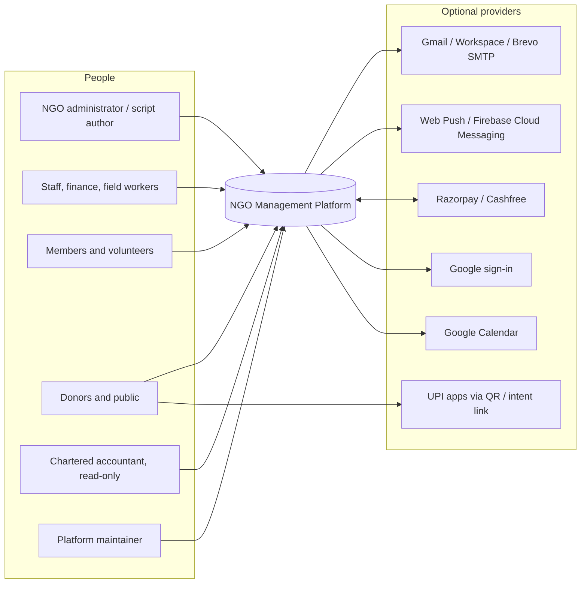
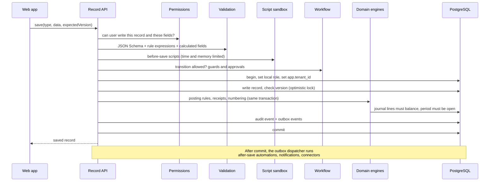

# Solution Architecture — Configurable NGO Management Platform

Status: proposed, 2026-10-18; reconciled with the code on 2026-10-25 (block F4 of `ngo-backend-enhancement-plan.md`). Source brief: `.cursor/docs/product-briefs/ngo-management-platform.md`.

## Implementation status

Code lives in `ngo-platform/` (local repository, not pushed). As of 2026-10-24, release 1 is implemented (blocks B01–B45 of `.cursor/docs/architecture/ngo-release-1-build-blocks.md`, design in `.cursor/docs/architecture/ngo-app-ui-implementation.md`): 1,079 automated tests pass on PGlite, including the production web build tests, and the release check passes 47 of 47. The manual walkthrough against the wireframes is waiting for sign-off (`.cursor/docs/reports/release-validation-2026-10-24.md`). On 2026-10-25, B00 replaced PGlite with PostgreSQL everywhere and moved fixed-table queries to Kysely (branch `kysely`, `.cursor/docs/architecture/ngo-kysely-migration-plan.md`). There, 1,114 tests pass on local PostgreSQL, and the release check passes 46 of 47. The open failure is the initial download at 91.4 of 90 kB, which comes from master's later web work (`.cursor/docs/reports/release-validation-2026-10-25.md`).

| Area | State | Notes |
| --- | --- | --- |
| Schema, row-level security, runtime role | Built | `migrations/001`–`004`. Ledger balance, immutability, open-period, and receipt rules are also database triggers. RLS binds `app_runtime` and is not FORCEd, so system work runs as the owning role on hosted PostgreSQL |
| Definition store, versioning, rollback, extension patches, module enable and re-sync | Built | Kinds: recordType, workflow (with approvals), postingRule, receiptRule, script, automation, template. Modules can ship roles |
| Identity | Built | Email and password (scrypt), email one-time code, TOTP two-step (required per role), rotating refresh tokens with reuse detection, account and IP lockout, suspension. Password reset and member invitations (single-use hashed links; completing one ends all sessions). OpenID Connect sign-in (code flow with PKCE, server-held state and nonce, RS256/ES256 verification against the provider's keys, verified email, existing members only, linked by issuer and subject); Google via `GOOGLE_CLIENT_ID`; NGO-run providers must name their email domains; role-required two-step still applies through a 5-minute ticket. Password policy on every password set: length, built-in common list (extendable via `COMMON_PASSWORDS_FILE`), trivial patterns, personal and organisation words, and the Have I Been Pwned range check (k-anonymity, padded; on by default in the server, `BREACHED_PASSWORD_CHECK=off` disables; fails open after 2 s with a log entry). No external identity service is required |
| Approvals | Built | Any-of-roles or named people, N distinct approvers, optional condition, no self-approval, stale detection, reject, withdraw |
| Outbox dispatcher and scheduler | Built | Postgres `SKIP LOCKED`, backoff retries, nudged after each write request; `/internal/tick` protected by App Engine cron header or shared secret |
| Automations | Built | Created, updated, status-changed, and cron schedule triggers; set fields, transition, create record, notify; depth limit 5, no self-retrigger, actions not repeated on retry |
| Notifications | Built | In-app inbox and plain-text email via SMTP (per-NGO connector or platform default); templates use the expression language |
| Money accounts | Built | Each account has its own ledger account; balances from postings; transfers as journal entries; no overdraft for cash and wallets; configurable transfer matrix |
| Payments | Built | UPI link to the NGO's own UPI ID (zero fee) with manual or bank-statement confirmation; Razorpay and Cashfree orders and signed webhooks, tested with a fake HTTP client only — verify against provider sandboxes before launch |
| Expression language | Built in-house | No dependency (`src/expressions/expression.ts`); see 5.6 |
| Script sandbox | Built | QuickJS WebAssembly, before-save hook only; time, memory, and output limits; run log. Other hooks and proposed effects are planned (blocks X1, X2) |
| Record engine save pipeline | Built | Validation, calculated fields, rules, scripts, workflow, numbering, optimistic locking, postings and receipts in one transaction, audit, outbox, sensitive-field masking |
| Ledger and receipts engines | Built | Trial balance, reversal, period close and reopen; receipt issue, void, replace |
| Donations module | Built as definition files | Parity proof for the approach |
| HTTP layer | Built for current engines | Plain Fastify 5 (with `@fastify/static` for the web app), all routes in `src/http/server.ts`, services wired by hand in `src/platform.ts`. Bearer access tokens, refresh token in HttpOnly SameSite=Strict cookie, webhooks with raw-body signature checks; development header sign-in only outside production |
| Web app | Built | Angular 21, zoneless, Angular Material only in record lists, system fonts and a local icon font; served by the API server with a strict content security policy. Sign-in (password, email code, two-step), menus and pages generated from definitions, lists, forms with workflow steps, receipts, approvals, inbox. Initial download about 65 kB compressed |
| Builder | Built | Catalogue of all definitions; visual editors for record types and workflows (including approvals); validated JSON editor for every kind; draft, publish, discard, history, restore; shipped definitions edited visually and saved as minimal NGO patches |
| Pre-pilot hardening | Built | Structured JSON logs for Cloud Logging with request ids; per-instance API and sign-in rate limits; shared limit on sign-in code emails; development sign-in refused on any cloud host; users visible to the runtime role only within their NGO; `app_runtime` membership granted so hosted PostgreSQL works; scheduled automations batched with a saved cursor and time budget, NGOs served fairly; bounded cleanup of processed events and expired tokens; audit archive-then-delete (opt-in); consistent NGO export as gzipped JSON lines; tests can run against real PostgreSQL via `TEST_DATABASE_URL` |
| Configured list dashboards | Built (first pass) | `listView` definition kind (chips with status lists, owner, permission; filters; row layout; detail sections; create form or stepper with presets; edit fields; chip limits). Field `visibleWhen` / `editableWhen`, enforced on save and mirrored in forms with the same expression evaluator. `POST /api/records/:type/query` with status lists, owner, typed field filters, search, sort, and a real total. Two layouts, cards and table, over one framework-free core (`web/src/app/core/records`) and one URL contract (see "Record lists" below). The cards layout is an in-repo port of the `@ssdev-toolkit` 1.0.0 list dashboard (same markup, stylesheets copied unchanged and checked by tests); the toolkit package is no longer used. Material loads only with record lists (about 120 kB compressed); first download about 85 kB; zoneless |
| List dashboard follow-ups | Mostly built in release 1 | Attachments (file field), bulk edit and bulk operations, reference-field search with "New …" and copy-from lookups, and record actions (Pay now, Send reminder, Print receipt) are built. Still open: patch save guarded by base version |
| Release 1: definitions and server | Built 2026-10-24 | Definition kinds `recordGroup`, `translation`, `action`, `page`; field options `copyFrom`, `unique`, `pattern`, `rollup`, `readPermission`, `editPermission`, `selfEditable`, `directory`; field types `multiChoice`, `file`, `location`, `signature`, `richText`, `person`; several workflows per record type (primary and parallel); migration 007; Donations module 0.2.1 (donors, Fundraising group, three actions, rollups, unique PAN). Job runner, managed indexes and trigram search, aggregates with financial-year periods, approvals query in SQL, record actions with outbox and print view, translations with English fallback, SMS/WhatsApp/webhook connectors, files (`FileStore`, allow-list, quota, `nosniff`), restricted visibility and shares, import and export, bulk operations, API keys with idempotency and OpenAPI, roles, people, profiles, fine-grained permissions, access map, Builder support APIs. Every `/api/` route refuses a signed-out caller (tested) |
| Release 1: web app | Built 2026-10-24 | Shell with four destinations, breadcrumb and language in More; Home and pages from widgets, pins; one record list screen (cards on phones, cards or table above), record panel with view, edit, step, create, action and share modes; picker, related sections; Inbox; import stepper, export, file field, share panel, selection and bulk bar; location, signature and rich-text controls; People directory, My profile, Administration (people, roles, connectors, API keys, jobs, audit, settings); installable app (service worker without `/api`, manifest, icons, update prompt, offline banner). Screen text in English, Hindi, Tamil, Telugu, Bengali and Marathi, loaded per area. Initial download 89.5 kB compressed (budget 90) |
| Release 1: Builder | Built 2026-10-24 | Editor frame (Visual, JSON, Changes, History, autosave, check, publish, restore, revert); generic schema editor for every kind with previews; expression editor with server check and Try it; record type and field panel with a Workflows tab; workflows list and diagram; list view with live preview; page editor; translations grid; roles, access map with role view, modules. Builder code 125.4 kB compressed (budget 180) |
| Offline capture, public donation pages and UPI QR, documents (PDF), reports, statutory books, depreciation; typed SQL (B46) | Not started | Next phases |

### Record lists: one core, one address, two layouts

Decision (2026-10-23): list behaviour lives once, in `web/src/app/core/records` (no Angular, no rxjs). The address bar is the only place list state is kept. Cards and table are layouts that draw the same state and send the same intents (`ListSession`). The open record — the cards detail, step, and create sheets, and the table's record page — is one `RecordSession` (loading, receipts, pending approval, form values per mode, field conditions, required checks, save, step, create, approve or reject), so neither screen holds record logic of its own; only the list store talks to the router, and only `http-gateway.ts` knows records API addresses. The toolkit list dashboard and zone.js were removed; the cards layout keeps the toolkit look by porting its markup and stylesheets into the repo, checked against a captured baseline (`web/src/app/ui/baseline/toolkit-1.0.0.json`, tested by `web/src/app/ui/look.test.ts`). The table and record page keep their own look; the table uses Material's table and sort, restyled to the plain table.

| Parameter | Meaning |
| --- | --- |
| `view=cards\|table` | Layout; else the person's last choice, else the list view's default |
| `chip`, `q` | Status chip and search |
| `<field>=a,b`, `<field>=true\|false`, `<field>From` / `<field>To`, `<field>=text` | Filters (choice, yes/no, date and number ranges, text) |
| `sort=field` / `sort=-field` | Sort ascending / descending |
| `show=n` | Rows loaded by infinite scroll (page multiples, at most 500) |
| `filters=open` | Filter panel open |
| `id`, `panel=edit\|step:<key>` | Open record: the detail sheet in cards, the record page in table |
| `create=new`, `createStep=n`, preset parameters | Create form or stepper |

Changing chip, search, filters, or sort starts again at the first page and replaces the history entry; opening or closing a record or create adds one, so Back closes it. `/records/:type/:id` and `/records/:type/new` redirect into this pattern.

| Feature | Cards | Table |
| --- | --- | --- |
| Chips, search, filters and pills, sort, count | Yes | Yes |
| Infinite scroll with depth kept in the address, Load more for keyboard and reduced motion, end of list | Yes | Yes |
| Row action menu (edit, allowed steps), last opened row highlighted | Yes | Yes |
| Open record | Detail sheet | Record page |
| Edit, workflow steps, approvals, receipts, field conditions | Yes | Yes |
| Create (presets, chip limits) | Form or stepper sheet | Record page form |

Phase 0 footprint result, bundled build against local PostgreSQL (block O1, 2026-10-25, `npm run measure:bundle`). The script builds `dist/`, then each run uses a fresh throwaway database and runs the deploy step. It starts `node dist/server.js` as a child process and makes 200 sequential create-and-pay saves through the HTTP API, then two streams of 50 concurrent saves, each running a before-save script. The table gives the median and range of 5 runs. The figures are for the server process only; PostgreSQL memory is not included. The machine was a laptop (Intel Core Ultra 7 165U, 14 logical processors, 31 GB, Windows, Node 22.23) shared with other agents running test suites on the same PostgreSQL, so the timings are noisy and the cold-start range is wide.

| Measure | Budget (section 12) | Median | Range |
| --- | --- | --- | --- |
| Spawn to first `/health` | — | 3.2 s | 2.2–7.3 s |
| Spawn to first signed-in API response (sign-in plus `/api/people/me`) | Under 4 s | 4.7 s | 3.0–9.9 s |
| Resident memory, idle | — | 108 MB | 107.5–108.1 MB |
| Resident memory, peak during 2 concurrent script saves | Under 250 MB | 144 MB | 143.8–145 MB |
| Create save, 95th percentile (median) | Under 500 ms | 18 ms (13 ms) | 16–27 ms |
| Pay transition, 95th percentile (median) | Under 500 ms | 38 ms (26 ms) | 33–56 ms |

Memory and save latency are well within budget locally. Cold start missed the 4 s budget in 3 of 5 runs, and the slowest runs coincided with other agents' test load. The gap between `/health` answering and the first signed-in response (0.7–2.6 s) is the first sign-in, which includes password hashing. The earlier PGlite result (about 650 MB, almost all of it the in-process database) no longer applies. Hosted-database figures are still owed. A person must run `npm run measure:bundle`, or the bundle with `npm start`, on the target instance size against hosted PostgreSQL, once with the database awake and once after it has paused (block O1 of `ngo-backend-enhancement-plan.md`). The script only accepts a local database.

Deviation from the original package plan: one npm package with folders per boundary under `src/` instead of separate workspace packages, to keep the build simple until boundaries settle. Section 11 shows the layout as built and the planned workspace layout (ADR-14). Import direction between the folders is enforced by `test/layer-architecture.test.ts`, with reasoned exceptions in `test/layer-allowlist.json`.

## 1. Architecture drivers

| Driver | Source in brief | Architectural consequence |
| --- | --- | --- |
| No-code change, including new modules | Primary objective | Metadata-driven runtime. Features are data (definitions), not code. |
| Override scripts within guardrails | Override scripts | Sandboxed script runtime that sees only a copy of its input and returns changes or proposed effects for the engines to check. No direct database access. |
| Core money rules are protected | Core rules | Fixed-code engines own ledger, receipts, balances, payments, identity, and tenancy. Configuration and scripts go through them. |
| Runs inside App Engine free tier, 384 MB instance | Running cost and footprint | One process, no Redis, no broker, scale to zero, in-process cache, Postgres-backed jobs. |
| Free hosted PostgreSQL, about 0.5 GB | Database decision | Compact storage, files kept outside the database, small connection pool, standard PostgreSQL only. |
| One-NGO and shared installations from one build | Installation types | Tenant id on every row from day one. Row-level security as a second line of defence. |
| India-first data location | Data location | Region chosen at setup: asia-south1 for compute and files, Mumbai for the database. |
| Low-end phones, offline field capture | Footprint | Small progressive web app, lazy-loaded, offline queue for flagged record types. |
| Fully AI-assisted build in Cursor | Delivery method | Every definition kind has a published JSON Schema. Modules are plain files in a repository. |
| Existing features at parity | Parity | Each current capability maps to a module package (Section 9). |

## 2. Architecture style

A **modular monolith with a metadata-driven runtime**:

- One deployable server process. Inside it: a small set of **infrastructure adapters**, a **metadata engine**, generic **runtime engines** (records, workflow, automation, scripts, pages, reports), and fixed **domain engines** (accounting, receipts, money accounts, payments).
- Business capabilities live in **module packages**: versioned definition files that the runtime interprets. Members, Donations, Projects, Volunteers and so on are packages, not code.
- One static web app renders pages from definitions. The builder is a lazy-loaded part of the same app, visible only to administrators.

Microservices, a message broker, and a separate cache were rejected. Each adds always-on cost and memory that the free tier cannot carry, and the data volumes of a single NGO do not need them.

## 3. System context



Every provider is optional. With none configured, the product still works: built-in sign-in, in-app notifications, UPI payment with manual matching, downloadable documents. Web Push, Firebase Cloud Messaging and Google Calendar are planned and not built (5.10).

## 4. Containers and deployment

### 4.1 One-NGO installation (default)

```mermaid
flowchart TB
  subgraph NGO Google Cloud project, asia-south1
    AE[App Engine standard, Node.js, F1<br/>API + static web app + cron endpoint]
    Cron[App Engine cron<br/>hourly tick]
    GCS[(Cloud Storage<br/>documents, uploads, exports)]
    SM[Secret Manager or env config]
  end
  DB[(Free hosted PostgreSQL<br/>Supabase or Neon, Mumbai if offered)]
  Browser[Browser / installed PWA]

  Browser -->|HTTPS| AE
  Cron -->|/internal/tick| AE
  AE -->|pooled TLS, pool size 3| DB
  AE --> GCS
  AE --> SM
```

- **Single service.** App Engine serves the compiled web app as static files and the API from the same Node.js process. One deploy, one URL, no cross-origin setup.
- **Scale to zero.** Automatic scaling with minimum instances 0 and maximum 1 or 2. Cold start is a budgeted cost (Section 12).
- **Scheduler.** App Engine cron calls an internal tick endpoint hourly (`schedule: every 60 minutes`). A tick every 15 minutes would keep an instance awake almost continuously and use most of the free instance hours. Section 4.5 gives the delays this causes.
- **Files** go to Cloud Storage, never the database, to protect the database size cap. A local-disk adapter exists for development only.

### 4.2 Shared installation

Same main artifact and configuration switch `INSTALLATION_MODE=shared`. Differences:

- Larger instance class and more instances. Paid PostgreSQL in Mumbai, for example Cloud SQL.
- NGO resolved from the signed-in identity, with subdomain as a routing hint only. Never from a request parameter.
- Cron tick fans out per tenant with a time budget, every 5 minutes (`schedule: every 5 minutes`). At least one instance stays warm, so the tick costs no extra instance hours.
- A separate `console` App Engine service runs the console (onboard, status, retry, suspend, reactivate, close) on the public App Engine address. Sign-in requires an enabled account and fresh two-factor authentication. It has its own service account, secrets, `__Host-ngo_operator` cookie and database roles (ADR-14, ADR-15, ADR-16). The transitional organisation CLI is removed.

### 4.3 Why one main artifact, plus a separate operator service

The main server is one artifact for both installation modes (ADR-10): the only behavioural difference is tenant resolution. Everything else, including row-level security, runs in both modes, so the shared mode is tested by every one-NGO deployment.

The operator console is a second deployable (ADR-14). It is the only serving process with cross-tenant control-plane rights, so it runs apart from tenant traffic, signs operators in through an identity provider with verifiable MFA, and never shares cookies, tokens or a database role with the main server. Both services are built from the same commit over the same shared packages and one migration stream (ADR-18). This differs from the public site, which stays folded into the main web app (ADR-09): public pages serve the same tenants under the same role, while the operator console has different users, privileges and threat model.

### 4.4 Build and start

| Command | What it does |
| --- | --- |
| `npm run build:server` | Builds main-web, then bundles `apps/onengo/server/src/main.ts` and its owner-only deploy entry into `apps/onengo/server/dist/`: ESM, Node 22 |
| `npm run operator:server:build` | Builds operator-web, then bundles the IAP-protected operator server into `apps/onengo-console/server/dist/` |
| `npm run deploy:prepare` | The owner-only deploy step: runs `dist/deploy.js` with plain `node` against `DATABASE_OWNER_URL`, then exits |
| `npm start` | Runs `dist/server.js` with plain `node`. Production never runs through `tsx` |
| `npm run web:build`, `npm run operator:web:build` | Build the two Angular workspace apps |
| `npm run deploy:prepare:dev`, `npm run start:dev` | Run the same two entry points from the TypeScript source through `tsx`, for development (`npm run dev` does both) |

**The deploy step runs once per release, before the new version starts.** It applies pending migrations, publishes the platform package (`platform/`), re-applies each organisation's changes onto a changed platform definition, creates missing member profiles, and publishes the shipped modules named in `SHIPPED_MODULES`. It alone requires `DATABASE_OWNER_URL`. The main service requires separate `DATABASE_SYSTEM_URL` and `DATABASE_RUNTIME_URL`; the operator service requires separate `OPERATOR_DATABASE_URL` and `OPERATOR_RUNTIME_URL`. No serving credential owns objects or can migrate.

**Process start does no deploy work.** It does not migrate, publish definitions or walk organisations. Each serving process checks its minimum schema and rejects unknown newer migrations unless every one is explicitly marked additive in `schema_compatibility`. The deploy entry performs the same forward-compatibility check before migration. Schema-history access is a narrow typed SQL boundary because Kysely's own table is intentionally absent from generated application table types.

**App Engine order.** Build all four apps, run `npm run deploy:prepare` from CI with the production `DATABASE_OWNER_URL`, deploy `apps/onengo/server/app.yaml`, deploy the private/IAP-protected `apps/onengo-console/server/app.yaml`, then deploy `apps/onengo/server/cron.yaml`. Migrations must stay compatible with the version still serving until traffic moves.

- **npm packages stay external.** The bundle holds only this repository's code. App Engine installs `dependencies` from `package.json`, so packages load from `node_modules` as usual. QuickJS finds its WebAssembly file inside its own package, and nothing is bundled twice.
- **The bundle must stay in `dist/` directly under the package root.** It finds `product/` (`migrations/`, `platform/`, `modules/`, `schemas/`, `locale/`), `web/` and `.data/` one folder up from its own location, as the source does from `src/`.
- The server reads its settings from the environment, as listed in `.env.example`. `npm start` does not read `.env`.
- `test/server-bundle.test.ts` builds both bundles against a throwaway database. It checks that the server refuses the unprepared database, runs the deploy step twice (the second run applies nothing), starts the server, and checks `/health`, a refused API call and the web app shell.

#### Checks before merge

`npm run ci` runs the same checks as the pipeline, in order, and stops at the first failure:

1. `npm run typecheck`: TypeScript across server and tests.
2. `npm run build:server`: the production bundle.
3. `npm run web:build`: the production web app. The bundle budget test needs it and is skipped without it.
4. `npm test`: the full suite. This includes the layer, Kysely and web architecture tests, the stale database types check and the web bundle budget.

`npm run ci:audit` runs `npm audit --omit=dev --audit-level=high` for the server and the web packages. It is separate because it needs the npm registry.

`azure-pipelines.yml` runs on every push and pull request to `backend_enhancement` and `master`. It uses Node 22 and a throwaway PostgreSQL 16 service container, installs the single npm workspace lock with `npm ci` from the public npm registry (`https://registry.npmjs.org/`), then runs `npm run ci` and `npm run ci:audit`. It holds no secrets; the tests generate their own.

The root `.npmrc` sets `registry=https://registry.npmjs.org/`.

To run it locally, start PostgreSQL as for the tests (`npm run dev:setup`), run `npm ci` once, then `npm run ci` and `npm run ci:audit`.

The file alone does not block merges. A person must create the pipeline in Azure DevOps from `azure-pipelines.yml` and add a build validation branch policy on `backend_enhancement` and `master` that requires it to pass.

### 4.5 Instance lifecycle and shared state

Several instances may serve one database at once (more than one in the shared mode, and briefly two in the one-NGO mode while traffic moves to a new version). Each behaves as follows.

**Probes.** `GET /health` is the liveness check: it answers `{ status: ok }` without touching anything. `GET /ready` is the readiness check: it runs `select 1` against the database with a 2-second limit, including the wait for a pool connection, and answers 200 `{ status: ready }` or 503 `{ status: unavailable }`. Neither needs a sign-in or reveals detail. The App Engine standard manifests are `apps/onengo/server/app.yaml` and `apps/onengo-console/server/app.yaml`; standard ignores flexible-environment probe sections, so health endpoints remain available for deployment smoke checks and other hosts.

```yaml
liveness_check:
  path: /health
readiness_check:
  path: /ready
  timeout_sec: 4
  app_start_timeout_sec: 300
```

App Engine standard ignores these sections; they apply when the service runs on App Engine flexible or behind another host that probes the same paths.

**Shutdown.** On `SIGTERM` or `SIGINT` the server stops accepting connections, answers requests already received, then lets the outbox run in progress finish (at most 10 seconds; it claims no new batch once shutdown starts, and events it did not reach stay pending for the next run on any instance). It then closes the database pool and exits with code 0. App Engine allows about 30 seconds after `SIGTERM`.

**Roles and membership.** Each instance caches a signed-in person's roles and permissions. `tenant.access_version` is bumped by the database whenever a role, a role assignment, a membership or a person's account status changes, whichever instance or script made the change. A cached entry is trusted for 5 seconds, then the instance compares the version (one primary-key read) and reloads the person only if it moved. A removed role or a suspended member is therefore refused on every instance within **5 seconds**, and at once on the instance that made the change.

**Rate limits.** Two kinds, by design:

| Limit | Where kept | Why |
| --- | --- | --- |
| General request limits (API 300, sign-in routes 30, webhooks 600 per minute per network address) | Memory of each instance | A first line of defence against floods; a database write per request would cost more than it protects. With *n* instances a caller can reach up to *n* times the figure |
| Sign-in failures and lock-out, sign-in codes per address and per network address | PostgreSQL (`auth_throttle`, `rate_limit`) | They protect accounts and send messages, so every instance must see the same count |

**Scheduler delays.** Background events (notifications, connector deliveries, event-driven automations) are dispatched straight after the request that caused them, while the instance is still running. The scheduler tick picks up what that misses: events written when the instance was idling down, retries after a failure (due 2, 4, 8 and 16 minutes later, then run by the next changing request or tick) and backlogs beyond 50 events or 5 seconds per request. Scheduled automations and jobs run only on the tick.

| Installation mode | Cron interval | Most delay for a notification or event-driven automation | Most delay for a scheduled automation or job |
| --- | --- | --- | --- |
| One-NGO (default) | 60 minutes | Seconds normally; up to 60 minutes when the instance stopped before dispatching, or for a retry | 60 minutes after it falls due |
| Shared | 5 minutes | Seconds normally; up to 5 minutes | 5 minutes after it falls due |

**Scheduler tick.** `/internal/tick` runs one tick and answers its counts. It is public but guarded:

| Request | Accepted when |
| --- | --- |
| `GET /internal/tick` | The `X-Appengine-Cron: true` header is present and the server runs on App Engine (`GAE_SERVICE` set), which strips that header from outside requests. The bearer secret is never accepted over GET, so it is never sent on a cacheable request |
| `POST /internal/tick` | The App Engine cron header as above, or `Authorization: Bearer <TICK_SECRET>`, for another scheduler such as Cloud Scheduler |

Anything else gets 403. App Engine cron sends GET, so the intended `cron.yaml` (deployed with `gcloud app deploy cron.yaml`) is:

```yaml
cron:
  - description: Scheduler tick
    url: /internal/tick
    schedule: every 60 minutes   # every 5 minutes for the shared installation
```

### 4.6 Alerts and dashboard

The platform runs no monitoring service of its own. It writes structured JSON logs that Cloud Logging reads, and the entries an alert watches carry a fixed `alert` field. Cloud Logging counts them with log-based metrics, and Cloud Monitoring raises the alerts and shows the dashboard. The `alert` values are a contract with those definitions: keep them stable.

| `alert` | Severity | What it means | What to do |
| --- | --- | --- | --- |
| `outbox.failed_permanently` | ERROR | A background event (email, SMS, webhook, automation, payment step) failed its fifth attempt and will not be retried. Earlier attempts log a WARNING without an alert | Read `eventType`, `tenantId` and the error; fix the cause (often a connector's settings); to retry, set the `outbox_event` row back to `pending` with `attempts` 0. Handlers that already finished do not run again |
| `job.failed` | ERROR | A background job (import, bulk operation, rebuild, file clean-up) stopped with an error. Its creator is notified and it shows as failed under Administration | Read `kind`, `jobId` and the error; the person can start the job again once the cause is fixed |
| `http.unhandled_error` | ERROR | A request was answered 500 because of an unexpected error, not a validation, permission or conflict refusal. The policy fires above 5 in 5 minutes (the error rate) | Users see a request id; find it in the entry's trace field. A burst after a deploy points at the release; roll back to the previous version |
| `memory.high` | WARNING | An instance's resident memory is above `MEMORY_ALERT_MB` (default 300 MB of the 384 MB F1 instance). App Engine restarts an instance over its limit, dropping its requests | Look for a large import or export, or growth since a deploy. Use a larger instance class if it is steady load |

Each serving instance checks its memory every minute, and every scheduler tick checks too, because cron reaches only one instance and may be an hour apart (Section 4.5).

The definitions are files in `docs/ops/monitoring/`: one log-based metric per alert (`metrics/`), one alert policy per metric (`policies/`) and one dashboard (`dashboard.json`) that shows the four metrics, responses by status code and App Engine's memory measurement. **A person applies them; nothing in the build, the deploy step or the server does.** With the Logging Admin and Monitoring Editor roles on the project, and after choosing a notification channel:

1. `gcloud logging metrics create <file name> --config-from-file=docs/ops/monitoring/metrics/<file name>.json` for each metric. Metrics come first because the policies and dashboard refer to them.
2. `gcloud alpha monitoring policies create --policy-from-file=docs/ops/monitoring/policies/<file>.json --notification-channels=<channel>` for each policy.
3. `gcloud monitoring dashboards create --config-from-file=docs/ops/monitoring/dashboard.json`.

`docs/ops/monitoring/README.md` has the commands as a script, the `update` commands for later changes, and a `gcloud logging write` command that writes one matching entry to check that an alert reaches the channel. `test/alerts.test.ts` checks that a forced permanent outbox failure, a failed job, an unhandled route error and a high memory reading each log exactly one entry with the expected `alert` and severity, and that every alert name has a metric, a policy and a dashboard chart.

### 4.7 Supported databases (ADR-13)

PostgreSQL is the reference database. A deployment may use only the combinations below; anything not listed is unsupported and must not be deployed.

| Database | One-NGO installation | Shared installation |
| --- | --- | --- |
| PostgreSQL 15 or later | Supported (reference) | Supported (reference) |
| MySQL | Planned, not available today. Supported only after block P5 delivers the MySQL implementation and it passes the contract suite (block P4) | Unsupported until a shared MySQL design passes every criterion below (block P7) |
| PostgreSQL before 15, MariaDB, SQL Server, SQLite, any other database | Unsupported | Unsupported |

**Why a connection string is not enough.** Tenant isolation, record queries and financial correctness are PostgreSQL behaviour in the code today:

| PostgreSQL behaviour | Where | What MySQL lacks or does differently |
| --- | --- | --- |
| Row-level security on every tenant-owned table, bound to the `app_runtime` role and `app_tenant()`, which reads `app.tenant_id` | `migrations/001_core.sql` (row-level security section) | No row-level security |
| Each tenant transaction runs `set local role app_runtime` and a transaction-local `set_config('app.tenant_id', …, true)` | `src/infrastructure/postgres/db.ts` (`TENANT_PREAMBLE`), run by `withTenant()` in `src/infrastructure/postgres/pg-database.ts` | No transaction-scoped role switch that row policies could bind to |
| Record list, count and totals run through `security definer` functions that accept only the query compiler's grammar, checked with PostgreSQL regular expressions | `migrations/016_record_query_hardening.sql` (`app_record_ids`, `app_record_count`, `app_record_agg`, `app_record_clause_ok`), `src/runtime/records/pg-query-compiler.ts` | The compiler emits `jsonb` operators (`->`, `->>`, `?|`) and casts; MySQL needs a different compiler and a different guard |
| Configured data lives in one `jsonb` column; the platform builds partial expression indexes per record type, concurrently where it can | `src/metadata/index-manager.ts`, `src/metadata/index-expressions.ts` | `JSON` type with generated-column or functional indexes; no partial indexes and no concurrent build |
| Job and outbox claims use `for update skip locked` | `src/infrastructure/jobs/jobs.ts`, `src/infrastructure/outbox/outbox-dispatcher.ts` | Available in MySQL 8, but unproven here until the contract suite covers it |
| Journals must balance (deferred constraint trigger, checked at commit); posted journals and issued receipts are immutable; closed periods refuse postings; money is `numeric(14, 2)` | `migrations/001_core.sql` (journal and receipt triggers) | No deferred constraints or constraint triggers; the balance rule needs another database-enforced design |
| Migrations run through Kysely's PostgreSQL migrator under a session advisory lock, one transaction per file, so a failed file rolls back | `src/infrastructure/postgres/migrate.ts` | DDL commits implicitly, so a failed MySQL migration can leave a half-applied file |

**Acceptance criteria for a shared MySQL installation.** All must pass, and a human architecture review must approve the design (block P7). Until then MySQL stays one-NGO only.

1. **Database-enforced isolation.** One database (schema) per NGO, or another mechanism that the database itself enforces and that is at least as strong as row-level security. Application-level `tenant_id` filtering alone is not acceptable. The automated cross-tenant tests pass against it.
2. **Contract suite.** The provider-neutral contract suite (block P4) passes in full: tenancy, ledger, receipts, optimistic writes, jobs, outbox, migrations and indexes.
3. **Financial invariants in the database.** Balanced journals, immutable posted journals and issued receipts, closed-period refusal and one live receipt per record and series are enforced by database constraints and triggers, so a write that bypasses the application is still refused; stale writes are refused by the database's conditional write, not by a read-then-check in the application.
4. **Migration recovery.** A migration interrupted part-way is detected, refused at start-up, and recoverable by a documented procedure, for every NGO database, without losing or mixing data.
5. **Measured performance.** Record list, count, totals and save latency are measured on the target service at the reference NGO size and the shared fan-out, and published as provider limits against the budgets in Section 12.
6. **Operational qualification.** Provisioning, backup and restore per NGO, export, deletion, monitoring and on-call runbooks are written and drilled (blocks O4, P6).

**How an unsupported combination is rejected.** One shared start-up check runs for each process-specific connection before work starts. Main validates `DATABASE_SYSTEM_URL` and requires `DATABASE_RUNTIME_URL`; deploy validates `DATABASE_OWNER_URL`; operator validates `OPERATOR_DATABASE_URL` and requires `OPERATOR_RUNTIME_URL`. It also validates `INSTALLATION_MODE` and PostgreSQL 15 or later. The selected URL is normalized internally for the shared check; that internal `DATABASE_URL` name is not a serving fallback. Only PostgreSQL connection strings pass. Failures log the refused scheme, never the connection string, host or credentials.

| Condition | Message |
| --- | --- |
| Scheme is not `postgres://`, `postgresql://` or `mysql://` | `Unsupported database: DATABASE_URL must be a PostgreSQL connection string (postgres:// or postgresql://).` |
| `mysql://` before block P5 ships | `Unsupported database: MySQL is not available in this version. Use PostgreSQL 15 or later.` |
| `mysql://` with `INSTALLATION_MODE=shared` | `Unsupported combination: MySQL supports one-NGO installations only. Use PostgreSQL 15 or later for INSTALLATION_MODE=shared.` |
| PostgreSQL server older than 15 | `Unsupported database: PostgreSQL 15 or later is required (found <version>).` |

## 5. Component architecture

```mermaid
flowchart TB
  subgraph Web app, Angular PWA
    Shell[Runtime shell<br/>menus, pages, forms, lists, dashboards]
    Builder[Builder, lazy-loaded<br/>modules, types, forms, pages, workflows, scripts]
    Offline[Offline store and sync queue<br/>IndexedDB]
    PublicPages[Public pages<br/>giving, forms, membership check]
  end

  subgraph Server, plain Fastify modular monolith
    subgraph Kernel
      Tenancy[Tenancy context]
      Identity[Identity and sessions]
      Authz[Permissions]
      Audit[Audit log]
      Files[File storage]
      Jobs[Jobs and outbox]
      I18n[Language packs]
      Seq[Numbering sequences]
    end
    subgraph Metadata
      Defs[Definition store and versioning]
      Pkg[Packages, import / export, extension layers]
      Schemas[Definition JSON Schemas]
    end
    subgraph Runtime engines
      Rec[Record engine]
      Wf[Workflow engine]
      Auto[Automation engine]
      Expr[Expression evaluator]
      Script[Script sandbox, QuickJS WASM]
      Pages[Page and view resolver]
      Rep[Report engine]
      Notify[Notification engine]
      Docs[Document generator]
      Conn[Connector registry]
    end
    subgraph Domain engines, fixed rules
      Ledger[Accounting and statutory books]
      Money[Money accounts and transfers]
      Rcpt[Receipts]
      PayEng[Payments]
      Depr[Depreciation]
    end
  end

  Shell --> Rec
  Builder --> Defs
  Offline --> Rec
  PublicPages --> Rec
  Rec --> Wf
  Rec --> Expr
  Rec --> Script
  Wf --> Auto
  Auto --> Notify
  Auto --> Docs
  Auto --> Script
  Rec --> Ledger
  Script -.->|proposed effects, planned| Rec
  Script -.->|proposed effects, planned| Ledger
  Ledger --> Money
  Rcpt --> Seq
  PayEng --> Rcpt
  PayEng --> Ledger
```

The diagram is the target design. Not built yet: the offline store, public pages, report engine, document generator, and depreciation (see Implementation status). Scripts run inside the record engine's save today and can change only the record being saved; the dotted lines are the planned proposed-effects design (blocks X1, X2 of `ngo-backend-enhancement-plan.md`).

### 5.1 Kernel

| Component | Responsibility | Notes |
| --- | --- | --- |
| Tenancy context | Resolves the NGO for every request, job, and script run. Sets `app.tenant_id` on each database transaction. | One-NGO mode has a single tenant row. Same code path. |
| Identity and sessions | Email and password (scrypt, from Node's built-in `crypto`), email one-time code, OpenID Connect sign-in (Google or an NGO-run provider), TOTP two-step verification (required per role), short-lived access tokens, rotating refresh tokens. | Replaces Auth0 to remove the external dependency and its user limits. |
| Permissions | Roles, role groups, and permissions; record-level rules (own records, team, project) as expressions; field-level visibility. | Every engine, page, and script call passes through it. |
| Audit log | Append-only who, what, when, before and after for every change, publish, script run, and sign-in. | No update or delete grants on this table. |
| File storage | Upload with content-type sniffing against an allow-list, size limit and per-NGO quota; downloads stream through the server after a permission check. | Cloud Storage adapter, local adapter for development. Keys are prefixed by tenant id. No signed links today. |
| Jobs and outbox | Durable jobs and domain events in Postgres, processed with `FOR UPDATE SKIP LOCKED`. | Replaces BullMQ and Redis. |
| Language packs | Label resolution per language with English fallback. | Packs are definitions. |
| Numbering sequences | Gap-free counters per tenant, series, and period, using row locks inside the caller's transaction. | Used by receipts, membership numbers, invoices, any configured number. |

### 5.2 Metadata engine

**Definition kinds:** `module`, `recordType`, `form`, `view` (list, board, calendar), `page`, `dashboard`, `menu`, `workflow`, `rule`, `automation`, `script`, `template` (document, email, notification), `sequence`, `lookup`, `report`, `role`, `postingRule`, `connector`, `languagePack`, `publicEndpoint`.

As implemented, the kinds are `recordType`, `workflow`, `postingRule`, `receiptRule`, `script`, `automation`, `template`, `theme`, `listView`, `recordGroup`, `translation`, `action` and `page`, plus the `module` manifest (`schemas/`). Rules and numbering live inside `recordType`, and forms come from its fields plus the `listView` create and edit settings; language packs are `translation`; roles ship in the module manifest, and connectors are stored per NGO rather than as definitions (5.10). The other kinds above are not built.

**Lifecycle:** draft, then validate, then publish (immutable version), then optional rollback, which republishes an earlier version as the newest. Records store the schema version they were saved under, so historical records render with their own form version.

**Validation:** each kind has a JSON Schema in the repository. The builder, the import tool, and the Cursor workflow all validate against the same schemas, using Ajv, which is already used by the team. Cross-reference checks run on publish: a form refers to fields that exist, a workflow uses roles that exist, a posting rule refers to ledger accounts that exist.

**Extension layers (key decision, ADR-05):**

- Product-shipped modules are **base layers**. They are read-only to NGOs.
- An NGO's changes to a shipped module are stored as **extension patches** (JSON merge patches keyed by definition and version).
- Effective definition = base + patches, computed at publish time and cached.
- A product upgrade replaces the base layer. Patches are re-applied; conflicts are shown in the builder for the administrator to resolve.
- Modules created by an NGO have no base layer; they are fully owned.

**Packages:** a module package is a folder with a `module.json` manifest (key, version, required engine version, dependencies) and one file per definition. Packages import and export as a zip. Starter templates are lists of packages.

As implemented, always-on definitions (the person profile) live in `ngo-platform/platform/` and optional packages live in `ngo-platform/modules/`. They share one package format and one loader. The folders are separate so the builder cannot turn the person profile off. See `ngo-platform-and-modules.md`.

**Caching:** effective published definitions are cached in memory per tenant. A `config_version` counter on the tenant row is checked at most every few seconds; any publish increments it. No external cache needed, and multiple instances converge quickly.

### 5.3 Record engine

- Generic create, read, update, delete, search, and link for every configured record type.
- Save pipeline, all in one database transaction:



- As built, the write, postings, receipts, audit and outbox commit in one transaction, but the checks before the write open several short transactions of their own. One transaction per command, with the save split into stages, is planned (block D2).
- Postings and receipt numbers happen **inside** the save transaction, so a donation cannot be marked paid without its ledger entry and receipt, and a failed posting rolls the save back.
- Side effects that reach the outside world (email, push, payment provider, connectors) run **after** commit from the outbox, with retries and idempotency keys.

### 5.4 Workflow engine

- A workflow definition is a state machine per record type: states, transitions, guard expressions, required fields per transition, approval steps (role, role group, named person, or any-of / all-of), on-enter and on-exit actions.
- Approval inbox, claim, and delegation replace the current requests capability's flow and generalise it to any record type.
- Status lives on the record. Pending approvals live in `approval_request`, and each approver's decision in `approval_decision`.

### 5.5 Automation engine

- **Triggers:** record created, updated, status changed, field changed, form submitted, schedule (cron expression evaluated on tick), payment received, incoming webhook.
- **Conditions:** expressions.
- **Actions:** set fields, create or update related records, start a workflow transition, send a notification, generate a document, call a connector, run a script, enqueue a job.
- Scheduled automations cover recurring donations, membership renewals, compliance reminders, and lapsed-donor journeys.
- Loop protection: an automation chain carries a depth counter (default limit 5) and an automation cannot retrigger itself on its own write.
- **As built:** triggers are created, updated, status changed, and schedule; actions are set fields, notify (in-app, email, SMS, WhatsApp), create record, transition, call a webhook connector, and call an http connector in send mode (a `connector` step, queued as a `connector.http` outbox event after the save). The other triggers and actions above, including running a script, are planned.

### 5.6 Expressions

One expression language everywhere: validation, calculated fields, visibility, guards, permission rules, posting amounts, automation conditions.

- Pure, side-effect free, deterministic, sandboxed.
- Implemented in-house with no dependency (`src/expressions/expression.ts`): a small tokenizer, parser and evaluator with literals, field paths, arithmetic, comparison, logical and conditional operators, and a fixed function list. Only own properties of plain objects and arrays are readable; `__proto__`, `prototype` and `constructor` are blocked, and source length and nesting depth are capped. The web app's forms use the same evaluator for field conditions.
- The earlier backend used `expr-eval`, which has had a published code-execution advisory. That library was not adopted; the in-house evaluator replaced the planned spike.

### 5.7 Script sandbox (ADR-03)

- **Runtime:** QuickJS compiled to WebAssembly (`quickjs-emscripten`). Pure WebAssembly, so no native build on App Engine. Small per-runtime memory, so it fits the 384 MB instance.
- **Limits:** memory per run (default 16 MB), wall-clock limit enforced with the interrupt handler (default 250 ms; a script definition may set 10 ms to 1 s, and 1 to 32 MB of memory), output capped at 256 KB, no timers beyond the run, no file system, no network. A longer limit for scheduled jobs is planned with the job hook.
- **What a script sees:** a JSON copy of its input, with no host objects reachable. Nothing a script does calls back into the server. The whole input (record, previous, declared inputs) is capped at 256 KB like the output. Design: `ngo-script-effects-design.md` (block X1, built in X2).

| Name | Purpose |
| --- | --- |
| `ctx.record`, `ctx.previous` | Current and previous values. On before-save and custom-button scripts the script changes `ctx.record`; the record engine then validates and saves it |
| `ctx.status`, `ctx.recordType` | Current workflow status and the record type |
| `ctx.id`, `ctx.number` | The saved record's id and number (after-save, custom button) |
| `ctx.transition`, `ctx.to` | The workflow step asked for and its target state (workflow guard) |
| `ctx.user` | Who is saving (id and roles) |
| `ctx.inputs` | Read-only data the definition declared: `related` records, `lookups`, allow-listed `settings`, and ledger `balances` |
| `ctx.effects`, `ctx.propose.*` | Proposed effects; `journal`, `record`, `update`, `notify` and `connector` helpers push the same objects |
| `ctx.fail(message)` | Abort the save with a user-facing message |
| `ctx.log(...)` | Captured in the script run log (up to 50 lines) |

- **Proposed effects** (decision in `ngo-backend-enhancement-plan.md` section 2). A script returns `ledger.propose`, `records.create`, `records.update`, `notify` or `connector.call` proposals; it never calls the host. The definition declares what it may propose (`effects.allow`, accounts, a per-run `maxTotalAmount`, connectors, named recipients, `maxEffects`). Proposals are checked by `scriptEffects.schema.json` and the pure pre-checks as soon as the script returns, held, and applied after the write and the posting and receipt rules, inside the save transaction: journals through `LedgerService.post` (source `script:<key>@<version>`), records through nested saves of the full pipeline, notifications and connector calls as outbox events. Any refusal rolls the whole save back; the run is logged as `rejected`. Each save that applied effects has one `script.effects` audit entry. At most 20 effects per run and 50 per save, nested saves included.
- **Inputs and authority:** inputs are read in the save transaction through the screens' read path, as the person saving, or as the declared `runAs` role. Effects are applied with the same authority. Scripts never supply an email address or phone number: they name people, roles, a field of the record, or a named fixed recipient an administrator keeps in the organisation settings.
- **Hook points:** before-save, validate, after-save, workflow guard and custom button (a record action step `{ "type": "script" }`). Validate and workflow-guard scripts may only refuse. Calculated field, workflow action, scheduled job, report data shaping and payment matching remain in the brief with no block yet.
- **Governance:** script-author permission (`config:script:publish`) publishes, and every publish writes an audit event like any definition. A script that runs as a role or reads ledger balances needs `config:script:admin` (organisation administrators) to publish or roll back to. A finance script (declares journals, or runs for a record type with a posting or receipt rule or money fields) also writes `script.published.finance` on publish and on rollback, with the versions, author and what changed, and notifies the holders of the `admin` role. Try it runs a script against sample values or an existing record and shows the field changes, the loaded inputs, the proposed effects and what the engines would refuse, and writes nothing. Each script has an `enabled` switch, and each run is logged in `script_run` with a summary of its effects.
- **Why core rules survive scripts:** scripts have no SQL and no engine internals. A before-save script's changes go through the same validation, workflow and posting checks as the screens, and effects go through the owning engines. The database adds a final layer: balance check triggers on journals, a unique constraint on receipt numbers, row-level security on tenant id.

### 5.8 Pages, views, and the web app

- Page definitions compose a governed component catalogue: form, detail, related list, list or table, board, calendar, timeline, dashboard card, chart, metric, action bar, rich text, embedded report, public giving widget.
- The web app is a runtime renderer. It fetches effective definitions once per session (cached by `config_version`) and renders them. New pages and modules appear without a new build.
- No toolkit packages are dependencies. The cards layout of record lists is an in-repo port of the team's `angular-list-dashboard` and `angular-forms` 1.0.0 look (markup and stylesheets checked against a captured baseline); `angular-comment` is not used.
- Angular 21, standalone components, zoneless change detection (no zone.js), lazy-loaded builder, Angular service worker. Plain component stylesheets, no CSS framework; Angular Material only where a component cannot be replaced cheaply, which today means record lists, loaded with them. Initial download budget: 250 KB compressed for the shell; as built it is about 90 kB (see Implementation status).
- System font stack only. No remote fonts, images, or scripts, as the workspace rules require. Indian scripts render with device fonts.
- **Offline (planned, not started):** record types flagged `offlineCapable` (for example attendance, beneficiary visit, volunteer hours) are cached in IndexedDB. Writes queue locally and sync with `expectedVersion`. On conflict, the server rejects and the user chooses which version to keep. Money record types are never offline-capable.
- **Public pages (planned, not started):** the same renderer in a public mode, limited to definitions marked public: giving pages, public forms, membership-number check, newsletter sign-up, public impact report. The current separate public-site app is folded in to save hosting and maintenance.

### 5.9 Reports and documents

- Planned (not started; see Implementation status). A report definition is a query (record type, filters, grouping, aggregates, joins through links), optional script shaping, and an output: on-screen table, chart, spreadsheet, or PDF. The spreadsheet and PDF libraries are not chosen yet; none is a dependency today.
- Large reports run as jobs and land as files in Cloud Storage, so request time limits do not apply.
- Every report carries the "management report, not auditor file" label, except statutory outputs produced by the accounting engine.
- Built today: CSV export of record lists (large exports run as jobs), aggregates with financial-year periods, and a browser print view for receipts. Templates use the platform's own expression language, not a template library.

### 5.10 Notifications and connectors

- Channels: in-app (always), email through SMTP (Gmail, Workspace, Brevo; sent with `nodemailer`), and SMS, WhatsApp business messages and HTTP webhooks through connectors. Web push (VAPID) or Firebase Cloud Messaging, and WhatsApp share links, are planned and not built.
- As built, connectors are rows stored per NGO, not definitions: a type (`smtp`, `sms`, `whatsapp`, `webhook`, `http`, `oauth`) with its configuration and encrypted credentials. Razorpay and Cashfree are payment providers (6.4), not connectors. Credentials are encrypted with a key held in Secret Manager or the environment, never in definitions or exports.
- **http** connectors are request templates (method, https URL, headers, body) with placeholders such as `{{record.<field>}}`, `{{message.mime | base64url}}`, `{{secrets.<name>}}` and `{{credential.accessToken}}`. Unknown placeholders and non-https URLs are refused on save, and substituted secrets are redacted from logged errors and returned answers. Every call is logged as a delivery.
  - **Send mode:** called by `connector` steps and script `connector.call` effects through the `connector.http` outbox event, with up to five attempts. One send connector per NGO may be the email sender: all of the NGO's email then goes through it as an RFC 822 message (for example Gmail's `raw`), ahead of its SMTP connector and the platform default.
  - **Lookup mode:** called by a record type's `lookups` while saving, before the save's transaction opens, when an input field changes. The values from its `responseMap` fill the mapped fields, and a failed call is a field error that saves nothing. A concurrent edit made during the call conflicts. Action, automation and script saves may not change a lookup input; imports run lookups, import checks do not.
- **oauth** connectors are authorization-code credentials (PKCE) that http connectors name as `credential`. An administrator connects one from Administration (`POST /api/admin/connectors/:key/oauth/start`, permission `admin:connectors`). The provider returns to the public `GET /api/connectors/oauth/callback`. Access and refresh tokens are kept with the connector's encrypted secrets and refreshed under a row lock, so concurrent calls refresh once. A refused refresh reports "Reconnect needed". A Google Calendar connector is planned.

## 6. Domain engines

These are fixed code. NGOs configure them; nobody redefines their rules.

### 6.1 Accounting and statutory books

- **Double-entry general ledger:** chart of accounts (configurable), funds (restricted and unrestricted), journal entries with lines, fiscal periods and the statutory year (1 April to 31 March by default).
- **Posting rules** are `postingRule` definitions: "when a record of type T reaches status S, post: debit account A, credit account B, amount from expression E, fund from field F, date from field D". Donations, expenses, earnings, invoices, and fees all post this way, including record types that NGOs create.
- **Invariants enforced in code and in the database:**
  - Each entry balances (deferred constraint trigger on journal lines).
  - No posting into a closed period. Reopening requires a reason and is audited.
  - Posted entries are immutable. Corrections are reversals plus new entries.
- **Statutory year features** carried from the earlier brief: account perimeter, frozen openings, monthly bank agreement (bank statement import plus matching), completeness list, adjusted trial balance, Income and Expenditure and Balance Sheet statement versions with signer and date, handover pack and ledger-name export as point-in-time files.
- **Depreciation:** policy per asset class (method, rate or useful life, residual value, start convention). A run calculates per period and posts through the ledger. Overrides need a reason.
- **As built:** chart of accounts, journal entries and lines, fiscal periods with close and reopen, reversal, trial balance, and the three invariants above. Funds, the statutory year features and depreciation are not started. The financial year is fixed to start in April; a per-NGO setting is planned (block D10).

### 6.2 Money accounts

- Wallets, bank accounts, cash in hand, and investment accounts, each linked to a ledger account.
- Balances derive from the ledger. A cached balance row updates in the same transaction for fast reads.
- Transfers are journal entries between linked accounts and never count as income or expenditure. The allowed transfer combinations are a configurable lookup, which carries over the current transfer matrix.
- Expense reimbursement from a member wallet, including top-up with proof, is a workflow plus money-account actions.

### 6.3 Receipts

- Receipt series per tenant and type, with format, prefix, reset period, and template.
- Issue: number from the sequence in the same transaction. Void: reason required, number kept. Replacement: new number linked to the voided receipt.
- Unique constraint on (tenant, series, period, number). Receipts are never deleted.
- The first delivery prints no tax-credit wording. The 80G tax-receipt register comes later as an extension of this engine.

### 6.4 Payments

- **UPI default:** generates a UPI intent link and QR code for the NGO's own UPI ID, with a reference code. The donation stays "awaiting confirmation" until a finance operator confirms it or a bank statement line matches the reference.
- **Gateway adapters:** Razorpay and Cashfree behind a `PaymentProvider` port. Webhook signatures are verified, and events are stored and processed idempotently by provider event id.
- Payment confirmed: an outbox event; the donation workflow moves to paid, the posting rule posts, and the receipt is issued.

## 7. Data architecture

### 7.1 Storage strategy (ADR-02)

| Data | Storage | Reason |
| --- | --- | --- |
| Engine data: tenants, identity, ledger, receipts, accounts, payments, jobs, audit | Normal relational tables defined by plain SQL migrations (`migrations/`), applied by Kysely's migrator and queried through Kysely; no ORM (ADR-12) | Strong constraints protect the core rules |
| Configured record types | One `record` table with a JSONB `data` column | New types need no schema change; works on free hosted PostgreSQL |
| Searchable configured fields | Partial expression indexes per type and field, created by the platform on publish | Fast filters without one table per type |
| Relationships between records | `record_link` table plus reference ids in JSONB | Reverse lookups and related lists |
| Definitions | `definition` table with JSONB body | Versioned, cached in memory |
| Files | Cloud Storage | Keeps the database under its size cap |

Rejected alternatives: one physical table per record type (schema changes at runtime, hard in a shared installation and with migrations); entity-attribute-value rows (slow, verbose, larger storage).

### 7.2 Core tables (outline)

```text
tenant(id, name, region, installation_mode, config_version, status)
app_user(id, email, password_hash, google_sub, totp_secret_enc, status)
tenant_member(tenant_id, user_id, member_record_id, status)
role(tenant_id, key, permissions[]), role_assignment(tenant_id, user_id, role_key)
definition(tenant_id NULL=base, kind, key, version, status, body jsonb, checksum, published_by, published_at)
extension_patch(tenant_id, kind, key, base_version, patch jsonb)
record(id, tenant_id, type_key, schema_version, number, status, data jsonb,
       owner_id, version, created_by, created_at, updated_by, updated_at, deleted_at)
record_link(tenant_id, from_id, relation_key, to_id)
approval_task(tenant_id, record_id, step_key, assignee_rule, claimed_by, decision, decided_at)
sequence(tenant_id, key, period, next_value)
audit_event(id, tenant_id, actor_id, action, entity, entity_id, before jsonb, after jsonb, at)
outbox_event(id, tenant_id, type, payload jsonb, status, attempts, available_at)
job(id, tenant_id, kind, payload jsonb, status, attempts, run_after, locked_until)
script_run(id, tenant_id, script_key, version, hook, duration_ms, memory_kb, outcome, log)
file_object(id, tenant_id, bucket_key, name, size, content_type, owner_record_id)
consent(tenant_id, person_record_id, purpose, granted_at, withdrawn_at, evidence)

ledger_account, fund, fiscal_period, statutory_year, journal_entry, journal_line,
money_account, account_balance, transfer,
receipt_series, receipt,
payment_intent, payment_event,
depreciation_policy, depreciation_run,
bank_statement_line, bank_match, opening_balance, perimeter_account,
completeness_exception, statement_version, handover_pack
```

This is the design outline. As built (`migrations/001`–`013`), the numbering table is `sequence_counter`, approvals are `approval_request` plus `approval_decision`, and identity adds `user_identity` (OpenID Connect links), `refresh_token`, `email_code`, `password_token` and `auth_throttle`. Not built yet: `consent`, `fund`, `statutory_year`, `account_balance`, depreciation, bank-matching and statutory-statement tables.

### 7.3 Tenancy enforcement (ADR-04)

1. Application layer: tenant id from the signed-in identity is applied to every query by the persistence layer. Callers cannot pass it.
2. Database layer: row-level security on every tenant-owned table, using `current_setting('app.tenant_id')`. Each tenant transaction starts with `set local role app_runtime` and a transaction-local `set_config('app.tenant_id', …, true)`. This works with transaction-mode connection poolers such as those in Supabase and Neon.
3. Files: object keys prefixed by tenant id, streamed only through the server after a permission check.
4. Sequences, jobs, outbox, caches, script runs, and audit events all carry tenant id.
5. Automated cross-tenant tests in the test suite run on every build.

### 7.4 Size budget for the free database

Assuming an NGO with about 500 members and a few thousand transactions a year:

- Records with JSONB and indexes: about 2 to 5 KB each with history; 50,000 records is roughly 100 to 250 MB.
- Audit log is the main growth risk. Diffs only, no full snapshots; older events archived to Cloud Storage as compressed files after a configurable period, for example 24 months.
- A storage meter in the admin console warns at 70 and 90 percent of the cap.

### 7.5 Data protection

- Consent per person and purpose. Erasure is a command (S3, below); export requests use the tenant export.
- Erasure versus statutory retention: financial records must be kept for the legally required period. For those records, erasure pseudonymises personal fields and keeps amounts, dates, and receipt numbers. The period (8 years by default) is pending counsel confirmation.
- Fields flagged `sensitive` (for example PAN, Aadhaar, phone, beneficiary health notes) are encrypted at application level, masked in lists and exports unless the viewer has the permission, and excluded from search indexes.
- **Field encryption (S2).** The save pipeline's write encrypts each sensitive value as its last step (`src/runtime/records/save/encrypt.ts`): AES-256-GCM over the JSON of the value, with the record type and field key as associated data, stored in `record.data` as `enc:v1:<key id>:<base64url of iv | tag | ciphertext>`. Reference, person, file, signature and rollup fields stay in plain form: they are ids the database joins on, and file contents live in the file store. Empty values stay empty.
  - *Key ring.* `ENCRYPTION_KEY` is the current key; `ENCRYPTION_KEY_PREVIOUS` (comma separated) lists older keys that still decrypt. Separate encryption and hashing keys are derived from each with HKDF, and the key id is derived from the key, so the order of the previous keys does not matter. A value under a key that is not configured, or one that fails authentication, fails the read with an error naming the key id.
  - *Reads.* Rows are decrypted where they are read (`SensitiveFields.open` in `src/runtime/records/sensitive.ts`): record views, lists and exports, the stored data scripts and server expressions see, copy-from, rollups, automations and their notifications, the approvals list title, profile directory values and the profile phone for SMS. Masking runs on the decrypted data exactly as before, so people without the permission still see `***`. Values stored in plain text before their field was encrypted read as they are.
  - *Not plaintext.* Search text and audit entries already left read-protected fields out, so they never hold a sensitive value. The data of a step waiting for approval is stored encrypted too.
  - *Unique sensitive fields.* `unique` may be combined with `sensitive` (the Donations donor PAN is both). Each record keeps keyed hashes (HMAC-SHA-256, text lower-cased, numbers by value) of such values in `record.blind_index` (migration 019); the unique check, import matching by unique value, and the managed unique index (cast `hash`) compare the hash, never the plaintext. During a rotation the check compares the hashes under every key. Text values still in plain form are also matched in plain form.
  - *Rotation.* Put the old key in `ENCRYPTION_KEY_PREVIOUS` and a new one in `ENCRYPTION_KEY`, restart, then run `npm run fields:reencrypt` (the deploy step, `src/deploy.ts`, with `--reencrypt-sensitive-fields`; it calls `Platform.reencryptSensitiveFields()` and logs only how many organisations and record types it queued). It must also run once after the first deploy that includes S2. Neither normal start nor the plain deploy step queues the jobs. The call queues a `fields.reencrypt` job per record type with sensitive fields in every active organisation. Each job pages through the records, locks them, and rewrites values not under the current key (plain values included) without changing the record version; its progress and result (`checked`, `rewritten`) are on the job. Remove the old key once the jobs are done. Publishing a record type that turns encryption on or off for a field queues the same job for that type. The same call encrypts values saved before S2 shipped.
  - *Stored secrets.* Two-step sign-in secrets and connector, payment gateway, SMTP and sign-in provider credentials (`app_user.totp_secret_enc`, `connector.secret_enc`) keep their format, `v1.<iv>.<tag>.<ciphertext>` with no key id (`SecretKeys` in `src/infrastructure/crypto/crypto.ts`). They are always encrypted with `ENCRYPTION_KEY`; reads try it and then each key in `ENCRYPTION_KEY_PREVIOUS`, and the authentication tag tells which key fits. A secret no configured key opens fails with an error that says to list its key in `ENCRYPTION_KEY_PREVIOUS` or save the secret again. `npm run fields:reencrypt` rewrites every stored secret not under the current key in one locked transaction before it queues the record jobs (`src/infrastructure/crypto/secret-rotation.ts`), and logs the counts (`twoStepSecrets`, `connectorSecrets`); a secret saved again is also stored under the current key.
  - *Limits.* The tenant export (JSON lines) carries the stored ciphertext and hashes; reading it needs the key ring. A value moved between fields or record types in SQL no longer opens. Text search, filters, sorts and totals never covered sensitive fields, and now cannot.
- **Consent, erasure and financial retention (S3).** The erasure rules below are *proposed and await product-owner approval*; the retention period is *pending counsel confirmation*. Business rules: `docs/business/privacy/consent-and-erasure/business-document.html`.
  - *Data subject.* A record (`subjectKind: record`, for example a donor or beneficiary) or a member (`subjectKind: member`, a user id). Profiles are reached through their member.
  - *Consent.* `consent_event` (migration 020): tenant, subject kind and id, purpose (`^[a-z][a-z0-9_.-]{0,63}$`), granted or withdrawn, source (form, paper, email, phone, in person, import, API; `erasure` only from erasure), recorder and time. Row-level security like every tenant table; an append-only trigger refuses update and delete for every role. No free text, so the history holds nothing personal and survives erasure. Current consent is the latest event per purpose. Routes: `POST /api/privacy/consents` (`privacy:consent:record`), `GET /api/privacy/consents?subjectKind=&subjectId=` (`privacy:consent:read`).
  - *Erasure.* `POST /api/privacy/erasures` `{ subjectKind, subjectId, reason? }` (`privacy:erase`) runs `PrivacyService.erase` (`src/application/privacy/`) in one tenant transaction behind a per-subject advisory lock; the store is `src/infrastructure/postgres/stores/privacy-store.ts`. A member must be suspended. It writes one `erasure_request` row (append-only, unique per subject) and returns it; a repeated request returns that row with `alreadyErased: true` and changes nothing (201 first, 200 after).
    - The subject's record or profile: every *personal* field is erased. A field is personal when `personal` says so, otherwise when it is `sensitive` or of type text, longText, richText, email, phone, location, signature or file; rollups never. A required text, longText, email or phone field gets the pseudonym `Erased person <8 hex>` (email `erased-<8 hex>@erased.invalid`, phone `0000000000`), cut to `maxLength`; every other erased value is removed. The data is sealed again through `SensitiveFields.seal`, so a pseudonym in a sensitive field is ciphertext under the current key and removed unique values leave no keyed hash. Search text is rebuilt; the version goes up by one.
    - Records whose reference field points at the subject: fields copied (`copyFrom`) from an erased field are erased the same way (a donation's `donorName`, `donorEmail`, `donorPhone`, `donorPan`). The save pipeline is not used: validation, `editableWhen`, posting rules and automations must not run on an erasure.
    - Files in erased file fields are detached (renamed `erased`); the existing file clean-up removes them. Notifications about the changed records lose address, subject and body. Earlier audit snapshots of the changed records get `"[erased]"` for the erased keys through `app_erase_audit_values` (security definer, own tenant, `record:*` entries only); each change writes `record.pseudonymised` and the request writes `privacy.erased`, both naming fields and counts only. Granted consents are withdrawn with source `erasure`.
    - Members: `app_erase_account` (security definer) pseudonymises the account name and email, clears the password and two-step secret, disables it, removes provider links and email codes, uses up password tokens and revokes refresh tokens — only for a suspended member of the current organisation who belongs to no other organisation; otherwise it returns `shared` and changes nothing.
    - What the database keeps: receipts (no donor identity of their own; reprints read the pseudonymised donation), receipt issuer snapshots (organisation data), posted journals and lines including the memo — **the donations posting rule's memo `Donation <number> from <donorName>` keeps the donor's name**, because `journal_is_immutable` refuses every change — payment intents, payment events (provider payloads may hold the payer's email or phone), transfers. Not touched: job items, connector deliveries, import records, archived audit files, values typed into records that do not reference the subject.
  - *Retention.* `src/infrastructure/postgres/retention.ts`: `FINANCIAL_TABLES` lists the financial tables, and `applyRetention` refuses a rule on any of them. `FINANCIAL_RETENTION_YEARS_DEFAULT = 8` (*pending counsel confirmation*), overridden per installation by `RetentionPolicy.financialRetentionYears`, set from `FINANCIAL_RETENTION_YEARS` in `src/main.ts`. Each erasure reports the financial rows it kept and `retainedUntil` (latest receipt or journal date plus the period). Erasure never deletes a row. Deleting financial records after the period is not built.

## 8. Security architecture

| Concern | Control |
| --- | --- |
| Authentication | Built-in identity with scrypt password hashes, lockout and throttling by account and IP stored in Postgres, optional TOTP, Google sign-in. Required two-step verification for finance, admin, and script-author roles is configurable. |
| Sessions | Short-lived signed access token, rotating refresh token in an HttpOnly, Secure, SameSite=Strict cookie (SameSite=None only for an allow-listed cross-site origin). CSRF protection on cookie flows comes from SameSite and the origin allow-list. |
| Authorisation | Single permission service used by API, engines, pages, reports, and scripts. Deny by default. |
| Tenancy | Section 7.3. |
| Scripts | Sandbox limits, a JSON copy of the input only (proposed effects planned, 5.7), audit and kill switch. |
| Secrets | Secret Manager or environment variables. Connector credentials encrypted at rest. Never in exports. |
| Transport and headers | HTTPS only, HSTS, content security policy with no third-party origins, `nosniff`, `Referrer-Policy`, frame denial and a permissions policy, all set by the server itself (no header library). |
| Uploads | Size and type allow-list by content sniffing, stored outside the web root, signed download links. |
| Webhooks | Signature verification, idempotent processing, replay window. |
| Error handling | Carries over the current error-handling rules: no internal ids, configuration, or supplier diagnostics in user-facing errors. |
| Audit | Append-only, covers data, configuration, scripts, sign-in, and exports. |

## 9. Mapping current features to the new platform

| Current capability | New home |
| --- | --- |
| Members, roles, role groups, sign-in methods | Kernel identity and permissions, plus the `members` package |
| Lifetime membership number and public check | Sequence plus a `publicEndpoint` definition returning active or inactive only |
| Accounts, wallets, investments, transfers, transfer matrix | Money accounts engine; transfer matrix as a lookup |
| Donors and donations, raised to paid, proof, corrections | `donations` package: record types, workflow, posting rule, receipt series |
| Monthly recurring donations | Scheduled automation in the `donations` package |
| Expenses, review, wallet top-up, reimbursement | `expenses` package: workflow plus money-account actions and posting rules |
| Earnings | `earnings` package with posting rule |
| Invoices | `invoices` package: sequence, document template, posting rule |
| Projects: goals, milestones, beneficiaries, team, risks, activities | `projects` package with related record types and dashboards |
| Physical assets | `assets` package plus depreciation policies |
| Book bank: register, lend, return, donate | `book-bank` package with workflow |
| Meetings, agenda, attendees, outcomes | `meetings` package, optional Google Calendar connector, calendar file attachment |
| Requests, approvals, inbox | Workflow engine (generic), plus a `requests` package for free-form requests |
| Notifications and follow | Notification engine |
| Correspondence | Document and email templates |
| Comments | Kernel comments on any record (planned, not built; the toolkit comment packages are not used) |
| Reports: donation summaries, annual workbook, project closure | Report definitions in the relevant packages |
| Help portal | `help` package: content record type and pages |
| Quick access home screen and shareable record links | Menu and launcher definitions; stable record URLs |
| Admin console, JSON Store lookups, custom forms | Builder and metadata engine |
| Public site: content, forms, newsletter | Public pages, public forms, `newsletter` package |
| Document storage, scheduled jobs | Kernel files and jobs |
| Statutory books (earlier brief) | Accounting engine and `statutory-books` package |

New first-delivery packages: `online-giving` (public pages, payments engine, receipts), `volunteers` (profiles, skills, shifts, assignments, hours, certificate template), and `compliance-calendar` (obligations, due dates, attached registrations, reminder automations).

## 10. Technology choices

| Area | Choice | Reason |
| --- | --- | --- |
| Server runtime | Node.js LTS on App Engine standard | Free tier; team skill |
| Server framework | Plain Fastify 5 (ADR-11). Services are plain classes wired by hand in the composition root `src/platform.ts`; routes are registered in `src/http/server.ts` (route plugins planned, blocks H1, H2). Production runs the esbuild bundle `dist/server.js` with plain `node` (section 4.4) | No dependency-injection container, decorator metadata or RxJS to load, which keeps cold start and memory down on a 384 MB instance that scales to zero. Fastify's in-process request injection gives the tests their seam. NestJS on the Fastify adapter was the original choice and is rejected unless a measured spike meets the budgets (`ngo-backend-enhancement-plan.md` section 1.2) |
| Persistence | As built (B00, 2026-10-25; `.cursor/docs/architecture/ngo-kysely-migration-plan.md`): no ORM. One `Database` port with a single node-postgres adapter, used everywhere: hosted, local (`DATABASE_URL`, started by `npm run dev`) and tests (a derived `<name>_test` database, with a schema per test world). PGlite is removed. Fixed engine tables are queried through Kysely (`typed(tx)`), bound to the transaction opened by `withTenant()`/`asSystem()` after the tenant preamble, with no pool of its own. Its types are generated from the migrations (`npm run db:types`, checked in, stale-checked by a test). Plain SQL migrations remain the schema source of truth and are applied by Kysely's migrator (B00b, 2026-10-25): one transaction and one advisory lock per file. Kysely records history in `kysely_migration`. Release 1 resets the database, so the previous `schema_migration` table is not copied. Type generation stays `npm run db:types`. A ratchet test (`test/kysely-architecture.test.ts`) keeps raw SQL to the files and counts in `test/raw-sql-baseline.json` | The per-transaction role switch and NGO setting, RLS, and money triggers need exact SQL control; ORMs manage connections in ways that make transaction-scoped settings easy to miss. Kysely adds compile-time column checking without hiding the SQL. Record queries, index DDL, and the money triggers stay parameterised SQL |
| Database | PostgreSQL 15 or later, free hosted tier for one-NGO installations, paid Mumbai instance for the shared one. MySQL is planned for one-NGO installations only and is not available today (section 4.7, ADR-13) | Decision in brief |
| Validation | Ajv with JSON Schema | Already used; shared by builder, server, and import |
| Expressions | In-house evaluator, no dependency | Section 5.6 |
| Scripts | `quickjs-emscripten` | Section 5.7 |
| Email | `nodemailer` over SMTP | Section 5.10 |
| Documents | Not chosen yet (reports and PDF documents not started) | Section 5.9 |
| Web app | Angular 21, standalone, zoneless, service worker, Angular Material in record lists only, no CSS framework | Team skill, offline support |
| Jobs and events | Postgres tables with `SKIP LOCKED` | No Redis or broker |
| Cache | In-process map of each NGO's published definitions, re-checked against `config_version` every few seconds | No Redis |
| Files | Cloud Storage (local disk for development) | Free allowance, keeps database small |
| Observability | Structured JSON logs to Cloud Logging with request ids; `/health` liveness and `/ready` readiness endpoints (section 4.5). Alerts and a dashboard are planned (block O3) | Free allowance |

The server's runtime dependencies are `fastify`, `@fastify/static`, `kysely`, `pg`, `ajv`, `ajv-formats`, `nodemailer` and `quickjs-emscripten`. Password hashing, tokens, TOTP and OpenID Connect verification use Node's built-in `crypto`; moving JWT, OpenID Connect and TOTP to maintained libraries is planned (block S1).

**Toolkit reuse:** none of the team's toolkit packages is a dependency. The NestJS toolkit packages (`nestjs-comment`, `nestjs-document-generator`, `nestjs-dms`, `nestjs-custom-forms`, `nestjs-health`, `nestjs-queue`, `nestjs-auth`, `nestjs-cron`) do not fit a plain Fastify server; their jobs are done in-repo (definition store, files, jobs and outbox, built-in identity) or are not built yet (comments, documents). The list dashboard and the form look it used were ported into the repository (`web/src/app/core/records` plus the cards layout, checked against a baseline captured from `angular-list-dashboard` and `angular-forms` 1.0.0) and are no longer dependencies; `angular-comment` is not used.

## 11. Repository and delivery structure for AI-assisted build

As built: one npm package (`@onengo/platform`) with folders, plus the web app as its own Angular project. No workspace packages.

```text
ngo-platform/
  src/
    platform.ts             composition root: constructs every service and wires it by hand
    main.ts                 process start: checks the deploy step ran, then serves
    deploy.ts               the deploy step's command; deployment.ts holds its work (migrations,
                            platform package and re-sync, profiles, shipped modules)
    http/                   plain Fastify server (server.ts), OpenAPI, idempotency
    application/            use cases per capability; the only layer that calls more than one capability
    runtime/                records, workflows, automation, expressions, scripts, definitions (engines over ports)
    domain/                 pure rules and ports: ledger, receipts, accounts, payments, identity, privacy
    infrastructure/         PostgreSQL adapter, Kysely binding, migrations, tenancy, stores, jobs, outbox,
                            audit, crypto, files, notify, connectors, transfer, observability
    composition/            wiring only: builds the objects platform.ts hands out
  migrations/               plain SQL migrations, applied by Kysely's migrator
  schemas/                  JSON Schema per definition kind (single source for builder, server, Cursor)
  platform/                 always-on definitions (person profile)
  modules/                  shipped packages (donations today)
  utilities/                development start, SQL seed data, footprint measurement
  test/                     Vitest suites on PostgreSQL, including tenancy, core-rule, layer and route-guard tests
  web/                      Angular runtime shell and builder
```

The target layering (`http`, `application`, `runtime`, `domain`, `infrastructure`, still one package) is section 10 of `ngo-backend-enhancement-plan.md`; folders move when the block that changes their code lands. `test/layer-architecture.test.ts` enforces the allowed import directions for the current folders. Not built yet: starter templates, a deploy folder (`app.yaml`, `cron.yaml`, setup script), API contracts shared with the web app (planned, blocks H4, H7), and load tests.

Target layout (ADR-14, ADR-18; planned, nothing moved yet). Private npm workspaces, never published, one lockfile, one version:

```text
one-ngo/
  packages/
    kernel/           @onengo/kernel: protocol and infrastructure primitives only (ports, errors, database
                      mechanics, HTTP basics, IAP check, OIDC protocol, crypto, logging, mail, files);
                      imports no @onengo/* package and has no tenant, member or NGO concept
    platform/         @onengo/platform: today's engine (domain, runtime, application, infrastructure, shared,
                      composition), product/ (migrations, schemas, modules, locale) and the engine tests.
                      Public entries only: ./main, ./operator, ./contracts, ./browser, ./deployment, ./testing
    web-kit/          @onengo/web-kit: shared Angular models, i18n, HTTP, paging and generic components,
                      extracted only once operator-web uses them
  apps/
    onengo/
      server/         main.ts, deploy.ts, http/; imports ./main, ./contracts, ./deployment, never ./operator
      web/            NGO member and administrator web app
    onengo-console/
      server/         operator sign-in (backend-for-frontend), sessions, step-up, grants and organisation routes;
                      imports ./operator and ./contracts, never ./main
      web/            operator console screens
```

Order of work: service database roles, operator identity and audit, and narrow entry points land first in today's layout; then workspaces with no moves; then the engine moves as one block. Package-graph tests enforce the import rules above.

- Each package has acceptance tests written as definition files plus expected outcomes, so the AI build loop can verify parity without a person reading code.
- Cursor rules in the new repository should point at `schemas/` and require schema validation before any definition is committed.

## 12. Quality attributes and budgets

| Attribute | Budget | How it is checked |
| --- | --- | --- |
| Server memory | Under 250 MB resident with 2 concurrent script runs, on a 384 MB instance | `npm run measure:bundle`; local PostgreSQL measured (block O1, see Implementation status), target environment still owed |
| Cold start | Under 4 s to first API response on F1 | `npm run measure:bundle`, then each release; local PostgreSQL measured, target environment still owed |
| Page load | Under 3 s on a low-end phone over slow 4G for common pages | Lighthouse run in continuous integration with throttling |
| Shell size | Under 250 KB compressed initial download | Angular build budget and the web build test (`test/web-build.test.ts`) |
| Save latency | Under 500 ms at the 95th percentile, excluding cold start | `npm run measure:bundle`; local PostgreSQL measured, target environment still owed |
| Database size | Under 300 MB for the reference NGO after 3 years | Seeded data test |
| Free tier | Reference NGO within App Engine free instance hours and egress | Billing report for a pilot installation |
| Tenancy | Zero cross-tenant reads or writes | Automated suite on every build |

## 13. Architecture decision records (summary)

| ADR | Decision | Main alternative rejected | Consequence |
| --- | --- | --- | --- |
| 01 | Modular monolith, one process (revised by ADR-14: the operator console becomes a second process over the same packages) | Microservices | Cheap and simple; engine boundaries kept by the folder layering and the layer-dependency test (`test/layer-architecture.test.ts`), with reasoned exceptions in `test/layer-allowlist.json` |
| 02 | JSONB record table plus fixed engine tables | Table per type; entity-attribute-value | Flexible without runtime schema changes; indexes managed by the platform |
| 03 | QuickJS WebAssembly sandbox; scripts see a copy of their input and return changes (proposed effects planned, 5.7) | Node `vm`, `isolated-vm`, no scripts; host callbacks (async QuickJS) | Safe and small; scripts are slower than native code, so hooks have strict time limits |
| 04 | Tenant id everywhere plus row-level security | Database per tenant | One schema for both installation types; needs disciplined transaction handling |
| 05 | Base layers plus extension patches for shipped modules | Fork on install | Product upgrades reach NGOs without losing their changes; needs a conflict view |
| 06 | Postgres jobs and outbox, App Engine cron tick | Redis with BullMQ, Cloud Tasks | No extra service; hourly granularity for scheduled work |
| 07 | Built-in identity for NGO members (operators sign in through an external provider, ADR-16) | Auth0, Firebase Auth | No external dependency or user limits; the product owns password security |
| 08 | Postings and receipts inside the save transaction | Asynchronous posting | Books always consistent with records; save is slightly slower |
| 09 | Public site folded into the main web app | Separate public site app | One deploy and one runtime; public pages need careful size budgets |
| 10 | One main build for one-NGO and shared modes (the operator console is a separate build, ADR-14) | Separate editions | Shared-mode safety tested everywhere |
| 11 | Plain Fastify with a hand-wired composition root (`src/platform.ts`); route plugins and small helpers rather than a framework (planned, blocks H1, H2) | NestJS on the Fastify adapter, unless a like-for-like production-build spike meets all of: under 250 MB resident with two script runs, under 4 s from zero to first response, under 500 ms p95 save latency, full test parity, and a named maintainability gain that pays for migrating 100+ routes (`ngo-backend-enhancement-plan.md` section 1.2) | No dependency-injection container, decorators or RxJS to load; the team owns route organisation and request helpers |
| 12 | No ORM: plain SQL migrations, Kysely as a typed query builder for fixed tables, SQL for PostgreSQL-specific behaviour (row-level security, triggers, database functions, managed-index DDL, dynamic record queries) | A full ORM, including Prisma migrations as first planned (`ngo-backend-enhancement-plan.md` section 1.4) | Transaction-scoped role and tenant settings stay explicit; compile-time column checks without hiding the SQL; the remaining raw SQL is a small reviewed boundary held by a ratchet test (`test/raw-sql-baseline.json`) |
| 13 | PostgreSQL 15 or later is the reference database for one-NGO and shared installations. MySQL is permitted for one-NGO installations only, each NGO with its own database, and only once block P5 delivers it; shared MySQL stays unsupported until a design meets the acceptance criteria in section 4.7 (database-enforced isolation such as database per NGO, the provider-neutral contract suite, financial invariants in the database, migration recovery, measured performance, operational qualification). Every other database or combination is unsupported (section 4.7; `ngo-backend-enhancement-plan.md` section 11) | Treating MySQL as a drop-in by changing the connection string; shared MySQL isolated by application-level `tenant_id` filtering alone | Tenancy, record queries and financial rules stay database-enforced on every supported provider; MySQL needs its own migrations, query compiler and triggers behind persistence ports (blocks P2, P4, P5); deployment documentation, and later a start-up check, refuse unsupported combinations |
| 14 | Two deployables over shared private workspace packages: main-server plus main-web for NGOs, operator-server plus operator-web for platform operators, over `@onengo/kernel`, `@onengo/platform` and later `@onengo/web-kit` (section 11). Onboarding and lifecycle stay in the engine behind an `OperatorControlPlane` exported only through `@onengo/platform/operator`. Revises ADR-01 and ADR-10; unlike the public site (ADR-09), the console has different users, privileges and threat model | Keeping the operator console inside the main server; moving onboarding out of the engine; publishing packages | The only cross-tenant serving process is the public console service, gated by required two-factor sign-in and an enabled account; two artifacts to build and deploy from one commit; package-graph tests keep main-server off `./operator` and operator-server off `./main` |
| 15 | Service database roles. The owner (DDL) password is held only by the deploy job, after rotation at cutover. `ngo_main_runtime` (member of `app_runtime`) serves tenant traffic under row-level security; `ngo_main_system` may only call listed security-definer system functions (sign-in lookup, outbox, jobs, scheduler, retention); `ngo_operator` owns the control plane (onboarding, lifecycle, `platform_audit`, `operator_*` tables); `ngo_operator_runtime` runs onboarding's tenant steps. No serving role owns tables, has `BYPASSRLS`, or is a member of the owner (migrations 028, 029) | Serving processes connecting as the owner, as the main server's system work and the organisation command do today | A compromised serving process cannot run DDL or read across tenants outside the listed functions; system work moves into reviewed security-definer functions; a role test checks each role can do only its listed work |
| 16 | Operator identity: an identity provider with verifiable MFA (Auth0 by default) authenticates; a local `operator_account` table authorizes, per action, and its UUID is the audit identity in `requested_by` and `platform_audit`, stored with issuer, subject, display snapshot, `auth_time`, `amr` and session ids. The operator server is a backend-for-frontend: server-side sessions in `__Host-` cookies, tokens never reach the browser. Suspend, reactivate and close need a one-time step-up (`max_age=0`, fresh MFA, `auth_time` within 5 minutes). Grants change only through an audited command (migrations 030, 031) | Provider permission claims or Auth0 Organizations as the authority; a local operator password, including break-glass; a free-text operator name as today | Immediate revocation and a stable audit id across provider changes (re-linking is audited); destructive actions fail closed while the provider is down |
| 17 | NGO sign-in policy and assurance levels. Password, email code and OIDC pass one three-stage pipeline (verify credential; resolve account and enforce assurance; issue session). A role's required assurance applies to every method; email code alone is never strong; provider MFA counts only through an explicit per-provider mapping, otherwise local TOTP follows. OIDC providers are per-NGO opt-in; per-NGO policy covers methods, providers, password on or off (off needs two strongly protected admins), assurance per role and recovery; sessions record their method, and disabling a method revokes those sessions (migrations 032, 033) | Installation-wide providers offered to every NGO, as Google is today; separate code paths per method | No weaker route bypasses a stronger policy; linking is hardened (atomic, no automatic relink, audited); passwords stay on by default so no NGO is locked out |
| 18 | Package and schema compatibility contracts. All workspace packages share one version and ship together; only `exports` entries are public. One migration stream in `@onengo/platform`, run only by the deploy job; migrations are add-before-use, and a destructive one waits a release and is marked `breaking`. `SCHEMA_LEVEL` is the last migration number; each server declares the minimum level it needs and refuses to start below it or when the database holds a newer `breaking` migration. Release order: deploy job once, then both services from the same commit | Per-package versions; each service migrating on start | Two services can safely share one database during a rolling deploy; CI builds and tests both artifacts from a clean folder on every change |

## 14. Delivery phases

Baseline before the platform restructure (branch `develop`, phase 0, 2026-10-30): `npx vitest run` gives 1,652 tests passed, 2 failed, and 5 test files that fail to load (1,654 tests in total). The failures are path problems from the web and folder reorganisation: tests that read `migrations/`, `modules/donations/` and `ops/monitoring/` from the repository root, and a Kysely boundary test that flags `web/package-lock.json`. Each restructuring step must lower these failures to zero and never lower the passing count.

| Phase | Scope | Exit criteria |
| --- | --- | --- |
| 0. Spikes | Server cold start and memory on F1 (plain Fastify, ADR-11; still to measure, block O1); QuickJS limits; JSONB index performance; Supabase and Neon Mumbai free-tier behaviour, pauses, and pooler with row-level security; expression language (resolved: built in-house, 5.6) | Budgets in Section 12 met or ADRs revised |
| 1. Kernel and metadata | Tenancy, identity, permissions, audit, files, jobs, sequences, definition store, schemas, packages | Import a package, publish, roll back; tenancy suite passes |
| 2. Runtime engines and web shell | Records, views, pages, forms, workflow, automation, notifications, documents, reports, scripts, offline queue | A non-developer builds a two-type module with approval and report in under a day |
| 3. Domain engines | Ledger, posting rules, money accounts, receipts, payments (UPI, Razorpay, Cashfree) | Core rule tests pass, including hostile scripts |
| 4. Parity packages | Every row in Section 9 | Acceptance tests per package |
| 5. New packages | Online giving, volunteers, compliance calendar | Brief MVP criteria |
| 6. Statutory books | Year, perimeter, openings, bank agreement, completeness, depreciation, statements, handover pack | Chartered accountant review of a sample year |
| 7. Installation and shared mode | Setup script, region choice, operator console, usage metering, Hindi pack, export and deletion | Pilot NGO on free tier for one month; shared installation with two pilot NGOs |
| Later | Migration from the current system, tax-credit receipts, FCRA books (SMS and WhatsApp business connectors were built early, in release 1) | Separate briefs |

## 15. Risks and open questions

| Risk or question | Mitigation or next step |
| --- | --- |
| Server cold start or memory exceeds the F1 budget | Plain Fastify keeps framework overhead small (ADR-11); measure the bundled build against hosted PostgreSQL (block O1) |
| Free database pauses when idle, adding seconds to the first request after a quiet period | Measure in the spike; show a "waking up" state; document the paid upgrade path |
| Free database provider lacks a Mumbai region on the free tier, or changes terms | Confirm in Phase 0; keep standard PostgreSQL so the provider can change |
| JSONB queries slow for large reports | Platform-managed indexes, report jobs, materialised summaries for dashboards |
| Extension patches conflict on upgrade | Conflict view in the builder; base modules keep stable keys |
| Scripts write balanced but wrong entries, since finance scripts need no second approval | Audit on publish (built); treasurer notification (planned, block X3); posting previews in test runs (planned with proposed effects, block X2) |
| Expression evaluator security | In-house evaluator with no method calls or prototype access and capped size and depth (5.6), covered by `test/expression.test.ts`; fuzz tests on the evaluator still to add |
| Erasure versus financial record retention | Pseudonymisation design; confirm retention period with counsel |
| Data location outside India | India-first default; counsel's decision still open |
| Hourly scheduler too coarse for some reminders | Per-tenant setting; the shared installation can tick more often because it is always on |
