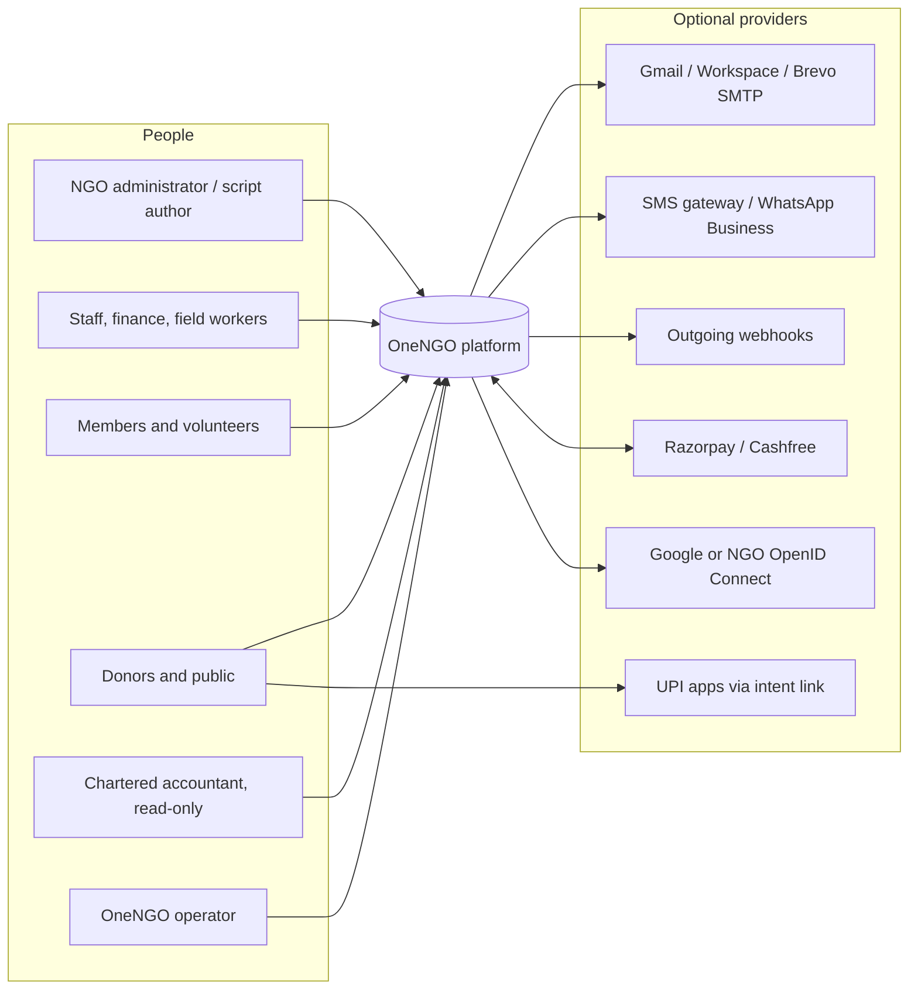
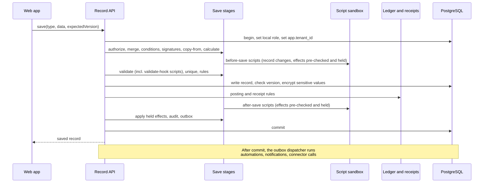
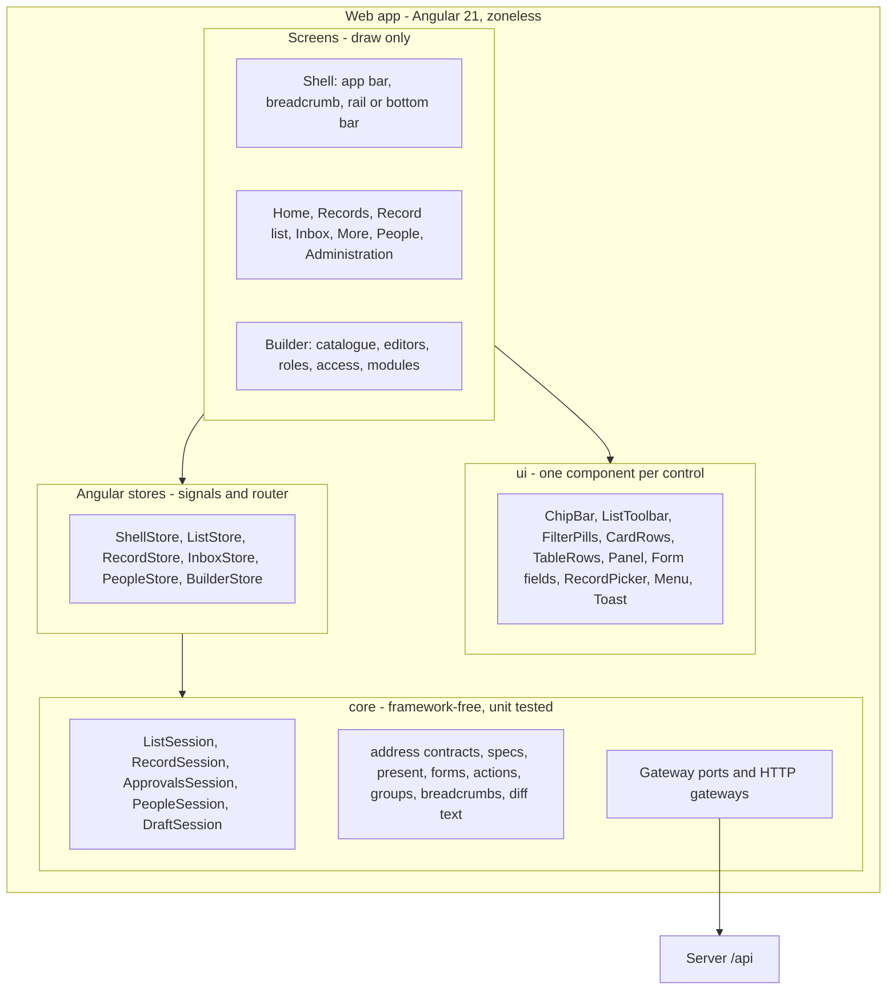

# Architecture — OneNGO configurable NGO management platform

Status: current, consolidated 2026-10-28. This is the single architecture document. It replaces six earlier documents, which were removed; section 0.3 maps their sections to this one.

## 0. About this document

### 0.1 Scope and sources

| Source | What it fixes |
| --- | --- |
| `.cursor/docs/product-briefs/ngo-management-platform.md` | The product brief |
| `.cursor/docs/design/ngo-app-ui-design.md` | Signed-off screen behaviour ("Design §n"). Where this document and the design disagree on screen behaviour, the design wins and this document is corrected |
| `.cursor/docs/design/wireframes/ngo-app-navigation-flows.html`, `ngo-builder-screens.html` | App journeys ("Flow n.m") and Builder screens ("Builder n") |
| `.cursor/docs/plans/ngo-backend-enhancement-plan.md` | Backend blocks. Its section 5.1 is the authoritative block status |
| `.cursor/docs/plans/ngo-release-1-build-blocks.md`, `ngo-release-2-build-blocks.md` | Release build blocks |
| `.cursor/docs/reports/s4-review-2026-10-26.md` | Security review, findings S4-1 to S4-17 |
| `.cursor/docs/operations/devops-handover.md` | Hosted work handed to DevOps |

### 0.2 Where the code is

- The workspace root holds the current code. Platform code is `packages/platform/`, product files are `packages/product/`, the Angular app is `apps/onengo/web/`, and the server entry is `apps/onengo/server/`. The server keeps the five-layer layout (section 4).
- **`legacy/ngo-platform/`** is that previous layout (branch `backend_enhancement`). It is no longer developed. Plans written before 2026-10-27 cite its old paths (the kernel, metadata and engines folders); Appendix A maps them to this repository.

Paths in this document are relative to `one-ngo/` unless they start with `.cursor/`.

### 0.3 Documents folded in

| Old document | Now |
| --- | --- |
| `ngo-management-platform.md` §1 drivers, §2 style, §3 context | Sections 1 and 2 |
| `ngo-management-platform.md` §4 containers and deployment (4.1–4.7) | Section 3 (3.1–3.7, same order) |
| `ngo-management-platform.md` §5 components | Sections 5 and 6 |
| `ngo-management-platform.md` §6 domain engines | Section 7 |
| `ngo-management-platform.md` §7 data architecture | Section 8 |
| `ngo-management-platform.md` §8 security | Section 9 |
| `ngo-management-platform.md` §9 feature mapping | Section 16 |
| `ngo-management-platform.md` §10 technology | Section 14 |
| `ngo-management-platform.md` §11 repository | Section 4 |
| `ngo-management-platform.md` §12 budgets, implementation status, footprint | Sections 0.4 and 13 |
| `ngo-management-platform.md` §13 ADRs | Section 15 |
| `ngo-management-platform.md` §14 phases, §15 risks | Sections 17 and 18 |
| `ngo-platform-and-modules.md` | Section 5.3 and 5.4 |
| `ngo-script-effects-design.md` (block X1, built in X2) | Section 6.6 |
| `ngo-app-ui-implementation.md` §2 server changes | Sections 5.6 and 6 |
| `ngo-app-ui-implementation.md` §3 web app, §4 addresses | Section 10 |
| `ngo-app-ui-implementation.md` §5 permissions, §6 testing | Sections 11 and 12 |
| `ngo-app-ui-implementation.md` §7 delivery phases | Done. Release 1 blocks are in `plans/ngo-release-1-build-blocks.md` |
| `ngo-app-ui-implementation.md` §8 risks, §9 decisions | Sections 18 and 15.2 |
| `guardrail-violations.md` | Section 4.4 |
| `relocation-map.md` | Section 4.5 and Appendix A |

### 0.4 Implementation status (2026-10-28)

Release 1 (blocks B00–B45) is built and validated (`.cursor/docs/reports/release-validation-2026-10-24.md`, `-2026-10-25.md`); the manual walkthrough against the wireframes awaits sign-off. The backend enhancement tracks F, D, H, S, X, O, P, A and G are merged except where the table says otherwise. Release 2 phase 1 (operator-run onboarding and lifecycle, R2-B01) is in the code: migration 017, `packages/platform/src/application/organisations/onboarding-service.ts`, `packages/platform/test/organisation-onboarding.test.ts`. Phase 2 (configuration packages, R2-B02) is not built.

| Area | State | Notes |
| --- | --- | --- |
| Schema, row-level security, runtime role | Built | `packages/platform/migrations/`. Ledger balance, immutability, open-period and receipt rules are also database triggers |
| Five-layer server layout and guardrails | Built | Blocks A1–A8 and G. Layer allowlist empty, no conformance violations (section 4) |
| Definition store, versioning, rollback, extension patches, module enable and re-sync | Built | Section 5 |
| Record engine save pipeline | Built | One transaction per command (D2), stages under `packages/platform/src/runtime/records/save/` (section 6.1) |
| Scripts with proposed effects | Built | Blocks X1, X2 (section 6.6). Open: Try it does not check open financial years or enabled connectors; no web editors for script effects or named recipients |
| Identity | Built | Password (scrypt), email code, TOTP two-step, OpenID Connect, rotating refresh tokens, lockout. JWT and OIDC verification through `jose`, TOTP through `otplib` (S1). Passkeys (WebAuthn platform authenticators) are an optional sign-in method per organisation, rated AAL2 (see Passkeys below) |
| Approvals, automations, notifications, connectors, jobs | Built | Sections 6.3, 6.4, 6.10, 6.11 |
| Ledger, receipts, money accounts, payments | Built | Section 7. Financial-year start month per organisation (D10) |
| Field encryption, consent, erasure, retention | Built | S2, S3. Erasure rules await product-owner approval; retention period awaits counsel (section 8.5). No web screens for privacy yet |
| HTTP layer | Built | Plain Fastify 5, route plugins under `apps/onengo/server/src/http/plugins/` (H2), fixed-route contracts in `packages/platform/src/http/contracts/` (H4), shared with the web app (H7) |
| Web app and Builder | Built | Release 1 (section 10) |
| Supported-database start-up check | Built | `packages/platform/src/infrastructure/postgres/database-support.ts` (section 3.7) |
| Provider contract suite | Built | P4, `packages/platform/src/infrastructure/contract-tests/` |
| Alerts and dashboard | Built; applying deferred to DevOps | O3 (section 3.6) |
| Footprint on hosted PostgreSQL | Owed | O1 measured locally only (section 13) |
| Security review | Done; findings open | S4: 2 High (S4-1 payment amount, S4-2 scripts on the main thread), 5 Medium, 6 Low, 4 Informational. Pilot blockers are S4-1, S4-2 and S4-3 |
| MySQL for one-NGO installations | Not started | P5 (section 3.7) |
| Offline capture, public pages and UPI QR, documents (PDF), reports, statutory books, depreciation | Not started | Section 17 |

## 1. Architecture drivers

| Driver | Source in brief | Architectural consequence |
| --- | --- | --- |
| No-code change, including new modules | Primary objective | Metadata-driven runtime. Features are data (definitions), not code |
| Override scripts within guardrails | Override scripts | Sandboxed script runtime that sees only a copy of its input and returns changes or proposed effects for the engines to check. No direct database access |
| Core money rules are protected | Core rules | Fixed-code engines own ledger, receipts, balances, payments, identity and tenancy. Configuration and scripts go through them |
| Runs inside App Engine free tier, 384 MB instance | Running cost and footprint | One process, no Redis, no broker, scale to zero, in-process cache, Postgres-backed jobs |
| Free hosted PostgreSQL, about 0.5 GB | Database decision | Compact storage, files outside the database, small connection pool, standard PostgreSQL only |
| One-NGO and shared installations from one build | Installation types | Tenant id on every row from day one. Row-level security as a second line of defence |
| India-first data location | Data location | Region chosen at setup: asia-south1 for compute and files, Mumbai for the database |
| Low-end phones, offline field capture | Footprint | Small progressive web app, lazy-loaded, offline queue for flagged record types (planned) |
| Fully AI-assisted build in Cursor | Delivery method | Every definition kind has a published JSON Schema. Modules are plain files in a repository |
| Existing features at parity | Parity | Each current capability maps to a module package (section 16) |

## 2. Architecture style and context

A **modular monolith with a metadata-driven runtime**:

- One deployable server process. Inside it: **infrastructure adapters** behind ports, a **metadata engine**, generic **runtime engines** (records, workflows, automation, expressions, scripts), fixed **domain engines** (ledger, receipts, money accounts, payments, identity, privacy) and **application use cases** that combine them.
- Business capabilities live in **module packages**: versioned definition files that the runtime interprets. Donations is a package, not code.
- One static web app renders screens from definitions. The Builder is a lazy-loaded part of the same app, visible only to people who configure.

Microservices, a message broker and a separate cache were rejected. Each adds always-on cost and memory that the free tier cannot carry, and the data volumes of a single NGO do not need them.



Every provider is optional. With none configured the product still works: built-in sign-in, in-app notifications, UPI payment with manual matching, a browser print view for receipts. Web Push, Firebase Cloud Messaging and Google Calendar are planned and not built.

## 3. Deployment and operations

### 3.1 One-NGO installation (default)

```mermaid
flowchart TB
  subgraph NGO Google Cloud project, asia-south1
    AE[App Engine standard, Node.js, F1<br/>API + static web app + cron endpoint]
    Cron[App Engine cron<br/>hourly tick]
    GCS[(Cloud Storage<br/>uploads, exports)]
    SM[Secret Manager or env config]
  end
  DB[(Free hosted PostgreSQL<br/>Supabase or Neon, Mumbai if offered)]
  Browser[Browser / installed PWA]

  Browser -->|HTTPS| AE
  Cron -->|/internal/tick| AE
  AE -->|pooled TLS, pool size 3| DB
  AE --> GCS
  AE --> SM
```

- **Single service.** App Engine serves the compiled web app as static files and the API from the same Node.js process. One deploy, one URL, no cross-origin setup. `app.yaml` and `cron.yaml` are in the repository root.
- **Scale to zero.** Automatic scaling with minimum instances 0 and maximum 1 or 2. Cold start is a budgeted cost (section 13).
- **Scheduler.** App Engine cron calls the tick endpoint every 60 minutes. A 15-minute tick would keep an instance awake almost continuously and use most of the free instance hours. Section 3.5 gives the delays this causes.
- **Files** go to Cloud Storage, never the database, to protect the size cap. A local-disk adapter exists for development.

### 3.2 Shared installation

Same artifact with `INSTALLATION_MODE=shared`. Differences:

- Larger instance class and more instances. Paid PostgreSQL in Mumbai, for example Cloud SQL.
- The NGO is resolved from the signed-in identity, with subdomain as a routing hint only, never from a request parameter.
- Cron tick every 5 minutes, fanned out per tenant with a time budget. At least one instance stays warm, so the tick costs no extra instance hours.
- Release 2 adds operator-run onboarding and lifecycle commands (`packages/platform/src/application/organisations/onboarding-service.ts`, migration 017) rather than a public operator console (`plans/ngo-release-2-build-blocks.md`).

The only behavioural differences between the modes are tenant resolution and operator tooling. Everything else, including row-level security, runs in both, so the shared mode is tested by every one-NGO deployment (ADR-10).

### 3.3 Build, deploy step and start

| Command | What it does |
| --- | --- |
| `npm run build:server` | esbuild bundles `apps/onengo/server/src/main.ts` into `dist/server.js` and `apps/onengo/server/src/deploy.ts` into `dist/deploy.js`, with source maps: ESM, Node 22 |
| `npm run deploy:prepare` | The deploy step: runs `dist/deploy.js` with plain `node` against `DATABASE_URL`, then exits |
| `npm start` | Runs `dist/server.js` with plain `node`. Production never runs through `tsx` |
| `npm run web:build` | Builds the web app into `apps/onengo/web/dist/web/browser`, which the server serves (`WEB_DIST_DIR` in `packages/platform/src/platform.ts`) |
| `npm run deploy:prepare:dev`, `npm run start:dev` | The same two entry points from TypeScript through `tsx`, for development (`utilities/start-dev.ts` does both) |
| `npm run fields:reencrypt` | The deploy step with `--reencrypt-sensitive-fields` (section 8.5) |

**The deploy step runs once per release, before the new version starts** (`packages/platform/src/prepare-deployment.ts`, wired by `packages/platform/src/composition/deployment.ts`). It applies pending migrations, publishes the platform package (`packages/platform/`), re-applies each organisation's changes onto a changed platform definition, creates missing member profiles, and publishes the shipped modules named in `SHIPPED_MODULES` (comma-separated folders under `packages/product/modules/`; default `donations`, empty for none). It reads only `DATABASE_URL` and `SHIPPED_MODULES`, no secrets. Running it again changes nothing. Organisations whose changes no longer fit a new platform definition keep their version and are logged as a warning. Run one copy at a time.

**Process start does no deploy work.** It does not migrate, publish or walk organisations, so a second instance starts as fast as the first. It stops with exit code 1 and a `Start-up failed` log entry naming the deploy step if either check fails: every file in `packages/platform/migrations/` is recorded in `kysely_migration` and no recorded migration is unknown to this version; each platform definition is published at the checksum of the files in this version.

**App Engine order.** Build (`npm run build:server`, `npm run web:build`), run `npm run deploy:prepare` from the build machine or CI with the production `DATABASE_URL`, then `gcloud app deploy`. Migrations must stay compatible with the version still serving: add before use, drop in a later release. If the deploy step fails, do not deploy; a failed migration file rolls back, so the serving version keeps its schema.

- **npm packages stay external.** The bundle holds only this repository's code; App Engine installs `dependencies`. QuickJS finds its WebAssembly file in its own package.
- **The bundle must stay in `dist/` directly under the package root.** It finds `product/`, `web/` and `.data/` one folder up, as the source does from `src/`.
- The server reads settings from the environment (`.env.example`). `npm start` does not read `.env`.
- `apps/onengo/server/test/artifact.test.ts` builds both bundles against a throwaway database, checks that the server refuses the unprepared database, runs the deploy step twice (the second applies nothing), starts the server and checks `/health`, a refused API call and the web shell.

### 3.4 Checks before merge

`npm run ci` runs, in order, stopping at the first failure: `npm run typecheck`, `npm run build:server`, `npm run web:build` (the bundle budget test needs it), `npm test` (the full suite, including the layer, persistence, Kysely and web architecture tests, the stale database types check and the web bundle budget). `npm run ci:audit` runs `npm audit --omit=dev --audit-level=high` for the server and web packages; it is separate because it needs the registry.

`azure-pipelines.yml` runs on every push and pull request to the integration branches with Node 22 and a throwaway PostgreSQL 16 service container. It authenticates to the company npm registry with `npmAuthenticate@0` through the service connection named by `npmRegistryConnection`, runs `npm ci` for both package sets, then `npm run ci` and `npm run ci:audit`. It holds no secrets.

Both `.npmrc` files only name the registry. Credentials never go in them: locally npm reads each developer's user `.npmrc`; in CI the authenticate step adds the token for the job only.

Locally: start PostgreSQL (`npm run dev:setup`), run `npm ci` once at the workspace root, then `npm run ci` and `npm run ci:audit`. The pipeline file alone does not block merges: a person must create the pipeline in Azure DevOps and add a build-validation branch policy.

### 3.5 Instance lifecycle and shared state

Several instances may serve one database (several in shared mode; briefly two in one-NGO mode while traffic moves).

- **Probes.** `GET /health` answers `{ status: ok }` without touching anything. `GET /ready` runs `select 1` with a 2-second limit, including the pool wait, and answers 200 `{ status: ready }` or 503 `{ status: unavailable }`. Neither needs sign-in or reveals detail. `app.yaml` sets `liveness_check` on `/health` and `readiness_check` on `/ready`; App Engine standard ignores them, flexible and other hosts use them.
- **Shutdown.** On `SIGTERM` or `SIGINT` the server stops accepting connections, answers requests already received, lets the outbox run in progress finish (at most 10 seconds, no new batch), closes the pool and exits 0. App Engine allows about 30 seconds.
- **Roles and membership.** Each instance caches a person's roles and permissions. The database bumps `tenant.access_version` (migration 015) whenever a role, assignment, membership or account status changes. A cached entry is trusted for 5 seconds, then the version is compared (one primary-key read). A removed role or suspended member is refused on every instance within **5 seconds**, and at once on the instance that made the change.

**Rate limits**, two kinds by design:

| Limit | Where kept | Why |
| --- | --- | --- |
| General request limits (API 300, sign-in routes 30, webhooks 600 per minute per network address) | Memory of each instance | A first line of defence; a database write per request would cost more than it protects. With *n* instances a caller can reach *n* times the figure |
| Sign-in failures and lock-out, sign-in codes per address and network address | PostgreSQL (`auth_throttle`, `rate_limit`) | They protect accounts and send messages, so every instance must see the same count |

**Scheduler delays.** Background events (notifications, connector deliveries, event-driven automations) are dispatched straight after the request that caused them. The tick picks up what that misses: events written while the instance idled down, retries (due 2, 4, 8 and 16 minutes later) and backlogs beyond 50 events or 5 seconds per request. Scheduled automations and jobs run only on the tick.

| Mode | Cron interval | Most delay, notification or event-driven automation | Most delay, scheduled automation or job |
| --- | --- | --- | --- |
| One-NGO (default) | 60 minutes | Seconds normally; up to 60 minutes when the instance stopped before dispatching, or for a retry | 60 minutes after it falls due |
| Shared | 5 minutes | Seconds normally; up to 5 minutes | 5 minutes after it falls due |

**Scheduler tick.** `/internal/tick` runs one tick and answers its counts. `GET` is accepted only with `X-Appengine-Cron: true` when running on App Engine (`GAE_SERVICE` set), which strips that header from outside requests. `POST` accepts the same header or `Authorization: Bearer <TICK_SECRET>` (for Cloud Scheduler). The bearer secret is never accepted over GET. Anything else gets 403.

### 3.6 Alerts and dashboard

The platform runs no monitoring service. It writes structured JSON logs that Cloud Logging reads; entries an alert watches carry a fixed `alert` field, counted by log-based metrics and alerted on by Cloud Monitoring. The `alert` values are a contract with those definitions: keep them stable.

| `alert` | Severity | Meaning | What to do |
| --- | --- | --- | --- |
| `outbox.failed_permanently` | ERROR | A background event failed its fifth attempt and will not be retried (earlier attempts log WARNING) | Read `eventType`, `tenantId` and the error; fix the cause; to retry, set the `outbox_event` row back to `pending` with `attempts` 0. Finished handlers do not run again |
| `job.failed` | ERROR | A job (import, bulk, rebuild, clean-up) stopped with an error; its creator is notified | Read `kind`, `jobId` and the error; the person can start it again |
| `http.unhandled_error` | ERROR | A request was answered 500 for an unexpected error. The policy fires above 5 in 5 minutes | Find the request id in the trace field; a burst after a deploy points at the release |
| `memory.high` | WARNING | Resident memory above `MEMORY_ALERT_MB` (default 300 of 384 MB) | Look for a large import or export, or growth since a deploy |

Each instance checks memory every minute, and every tick checks too. The definitions are in `.cursor/docs/operations/monitoring/` (`metrics/`, `policies/`, `dashboard.json`, and a README with the `gcloud` commands, update commands and a test-entry command). **A person applies them; nothing in the build, deploy step or server does** (`devops-handover.md` section 2). `packages/platform/test/alerts.test.ts` checks that each condition logs exactly one entry with the expected `alert` and severity, and that every alert has a metric, a policy and a chart.

### 3.7 Supported databases (ADR-13)

| Database | One-NGO installation | Shared installation |
| --- | --- | --- |
| PostgreSQL 15 or later | Supported (reference) | Supported (reference) |
| MySQL | Planned. Supported only after block P5 delivers it and it passes the contract suite (P4) | Unsupported until a shared MySQL design passes every criterion below (P7) |
| PostgreSQL before 15, MariaDB, SQL Server, SQLite, others | Unsupported | Unsupported |

**Why a connection string is not enough.** Tenant isolation, record queries and financial correctness are PostgreSQL behaviour today:

| PostgreSQL behaviour | Where | What MySQL lacks or does differently |
| --- | --- | --- |
| Row-level security on every tenant table, bound to `app_runtime` and `app_tenant()` (reads `app.tenant_id`) | `packages/platform/migrations/001_core.sql` | No row-level security |
| Each tenant transaction runs `set local role app_runtime` and a transaction-local `set_config('app.tenant_id', …, true)` | `packages/platform/src/infrastructure/postgres/db.ts` (`TENANT_PREAMBLE`), run by `withTenant()` in `pg-database.ts` | No transaction-scoped role switch for policies to bind to |
| Record list, count and totals through `security definer` functions that accept only the query compiler's grammar | Migration 016 (`app_record_ids`, `app_record_count`, `app_record_agg`, `app_record_clause_ok`); `packages/platform/src/infrastructure/postgres/query-compiler/record-query.ts` | Different JSON operators; needs a different compiler and guard |
| Configured data in one `jsonb` column with partial expression indexes per record type, built concurrently | `packages/platform/src/runtime/definitions/index-manager.ts`, `index-expressions.ts` | No partial indexes, no concurrent build |
| Job and outbox claims with `for update skip locked` | `packages/platform/src/infrastructure/jobs/jobs.ts`, `packages/platform/src/infrastructure/outbox/outbox-dispatcher.ts` | Available in MySQL 8, unproven here |
| Balanced journals (deferred constraint trigger), immutable posted journals and issued receipts, closed periods refuse postings, money `numeric(14, 2)` | Migrations 001, 022 | No deferred constraints or constraint triggers |
| Migrations under a session advisory lock, one transaction per file | `packages/platform/src/infrastructure/postgres/migrate.ts` | DDL commits implicitly; a failed file can be half applied |

**Acceptance criteria for a shared MySQL installation** (all must pass, plus a human architecture review, block P7):

1. Database-enforced isolation (database per NGO, or a mechanism at least as strong as row-level security); application `tenant_id` filtering alone is not acceptable; the cross-tenant tests pass.
2. The provider-neutral contract suite (P4) passes in full.
3. Financial invariants enforced by database constraints and triggers; stale writes refused by a conditional write, not read-then-check.
4. An interrupted migration is detected, refused at start-up and recoverable by a documented procedure.
5. List, count, totals and save latency measured at the reference NGO size and published against section 13.
6. Provisioning, backup and restore per NGO, export, deletion, monitoring and runbooks written and drilled (O4, P6).

**How an unsupported combination is rejected.** `connectSupportedDatabase` in `packages/platform/src/infrastructure/postgres/database-support.ts` (tests in `packages/platform/test/database-support.test.ts`) runs in both the server and the deploy step, so the deploy step never migrates an unsupported database. It reads `INSTALLATION_MODE` (`one-ngo`, the default, or `shared`) and the provider from the `DATABASE_URL` scheme before connecting, then `server_version_num` right after. On failure it logs `Start-up failed` with only the refused scheme (never the connection string) and exits 1 with exactly one of:

| Condition | Message |
| --- | --- |
| Unknown `INSTALLATION_MODE` | `Unsupported INSTALLATION_MODE: use one-ngo (the default when unset) or shared.` |
| Scheme not `postgres://`, `postgresql://` or `mysql://` | `Unsupported database: DATABASE_URL must be a PostgreSQL connection string (postgres:// or postgresql://).` |
| `mysql://` before P5 | `Unsupported database: MySQL is not available in this version. Use PostgreSQL 15 or later.` |
| `mysql://` with `shared` | `Unsupported combination: MySQL supports one-NGO installations only. Use PostgreSQL 15 or later for INSTALLATION_MODE=shared.` |
| PostgreSQL older than 15 | `Unsupported database: PostgreSQL 15 or later is required (found <version>).` |

## 4. Server code structure

### 4.1 Five layers

```text
one-ngo/
  src/
    main.ts, deploy.ts, prepare-deployment.ts, organisation.ts   entry points (thin)
    platform.ts        composition root: calls the per-capability wiring in composition/
    composition/       wiring only (infrastructure, definitions, records, messaging, identity, payments,
                       jobs, files, operations, administration, handlers, scheduler, http, organisations,
                       deployment, entry)
    http/              Fastify server, plugins/ (admin, auth, builder, files, internal, organisation,
                       payments, privacy, records, session, static), contracts/, errors, idempotency
    application/       use cases per capability; the only layer that combines capabilities
    runtime/           records, workflows, automation, expressions, scripts, definitions (engines over ports)
    domain/            pure rules and domain-owned ports: ledger, receipts, accounts, payments,
                       identity, organisations, privacy, permissions, transactions
    infrastructure/    postgres (adapter, Kysely, migrator, stores, query compiler), jobs, outbox, audit,
                       crypto, files, notify, connectors, transfer, payments, http, observability,
                       contract-tests
    shared/            pure rules the web app also runs (expressions, permission matching, patches,
                       number formats, numbering periods, record type shapes, rich text)
  product/             migrations/, platform/, modules/, schemas/, locale/
  scripts/             development start, seed data, database types, footprint measurement
  test/                Vitest suites on PostgreSQL, architecture tests, security probes
  web/                 Angular runtime shell and Builder (own package.json)
  app.yaml, cron.yaml, azure-pipelines.yml
```

Import direction: `http → application → runtime → domain`, with `infrastructure` behind ports. Only `platform.ts` and the four entry points may import `composition/`; composition may import every layer. One npm package (`@ngo/one-ngo`) with folders per boundary, rather than workspace packages, keeps the build simple (ADR-01).

### 4.2 Composition

`platform.ts` calls one private wiring function per capability in `packages/platform/src/composition/`. HTTP plugins receive typed application bundles (`HttpDeps`), never `Platform`. `asTx`, `transactions` and `joinTx` live once in `domain/ports/transaction.ts`; `Actor`, `TenantContext` and `systemActor` live once in `domain/ports/tenant-context.ts`. The audit trail stays module-level in the domain and is bound by composition (`packages/platform/test/composition.test.ts`).

### 4.3 Rules shared with the web app

Pure rules the screens also run live in `packages/platform/src/shared/`. The web app reaches them only through `apps/onengo/web/src/app/core/server.ts`; server contract types reach it only through `apps/onengo/web/src/app/core/contracts.ts` (type-only, from `packages/platform/src/http/contracts`). `packages/platform/test/web-architecture.test.ts` pins that list and fails if `packages/platform/src/shared/` reaches Node, a package or another server layer. The message catalogue is `packages/product/locale/`, one copy for both sides (`LOCALE_DIR` in `platform.ts`).

### 4.4 Guardrails

The architecture tests enforce the layout. There are no violations, no pending list and no exceptions; a new violation fails its test, and the fix is in the code. `packages/platform/test/layer-allowlist.json` and `packages/platform/test/package-allowlist.json` stay empty (`{}`); an entry in either fails once the block it names is Merged or Done in section 5.1 of the backend plan (`packages/platform/test/plan-status.ts`).

| Rule | Test | Detail |
| --- | --- | --- |
| Layer direction | `packages/platform/test/layer-architecture.test.ts`, `packages/platform/test/layer-graph.ts` | Imports parsed with the TypeScript compiler API; type-only port imports told apart from value imports; the root of `src/` is fixed to the entry points and `platform.ts` |
| Runtime siblings | same | `runtime/<a>` may import `runtime/<b>` only for `types.ts`, anything under `ports/`, anything under `runtime/expressions/`, and the pure helpers in `RUNTIME_PURE_HELPERS` (one reason each). Type-only imports of a sibling service class are rejected too |
| Application siblings | same | `application/<a>` may not value-import another capability's module. Collaborators arrive through the constructor as `import type`. Ports and `application/shared/` are allowed |
| Re-exports | same | Application files that http imports, every `http-api.ts` and `application/shared` may not re-export from `domain` or `runtime`, value or type-only, including re-exported imported bindings. The application declares its own alias |
| Port files | same | A `/ports/` file holds interfaces, type aliases, `declare const` brand symbols and type-only exports. Constants, functions, classes, enums, namespaces, top-level statements, module `let` and value re-exports are rejected (`PORT_VALUE_EXCEPTIONS` is empty) |
| Composition is wiring | same | In `src/composition/**`, calls to `withTenant`, `asSystem`, `asTx`, `joinTx`, `transaction`, `audit.audit` / `audit.event`, `fastify` imports and `req` / `reply` / `request` use are reported per file and kind. `transactions(db)` is wiring and allowed |
| Persistence | `packages/platform/test/persistence-architecture.test.ts`, `packages/platform/test/persistence-graph.ts` | No core file imports Kysely or the SQL executor; `packages/platform/src/domain/ports/` is not exempt; imports from `ports/database.js` and SQL executor type declarations are seen |
| Raw SQL ratchet | `packages/platform/test/kysely-architecture.test.ts`, `packages/platform/test/raw-sql-baseline.json` | Raw SQL only in the listed files and counts |
| Owner capabilities | `packages/platform/test/owner-capabilities.test.ts` | Owner transactions and statements (`asSystem(`, `db.exec(`) are opened only in infrastructure, which hands services named capabilities instead (`packages/platform/test/owner-capabilities-allowlist.json`) |
| Web | `packages/platform/test/web-architecture.test.ts` | Section 10.1 |

### 4.5 Relocation from `ngo-platform`

The relocate script (since removed; the table is `docs/architecture/relocation-map.md`) moved every file of the old server tree into the five layers. In short: `kernel/` dissolved into `infrastructure/` (database, jobs, outbox, audit, crypto, observability), `domain/` (errors, permissions, ports) and `runtime/definitions/` (settings, list parameters, index expressions, number format); `metadata/` became `runtime/definitions/`; `engines/records` became `runtime/records`; `engines/approvals` and `engines/automation` moved under `runtime/`; the multi-capability engines (actions, admin, builder, connectors, files, imports, notify) became `application/` use cases with their transports in `infrastructure/`; `identity/` split between `application/identity/` and `domain/identity/`; `expressions/` and `scripts/` moved under `runtime/`; `deployment.ts` became `prepare-deployment.ts`. The full table is Appendix A.

## 5. Metadata

### 5.1 Definition kinds

As built (`packages/product/schemas/`): `recordType`, `workflow`, `postingRule`, `receiptRule`, `script`, `automation`, `template`, `theme`, `listView`, `recordGroup`, `translation`, `action` and `page`, plus the `module` manifest. `scriptEffects.schema.json` describes what a script returns; it is not a definition kind and nothing stores it.

- Rules and numbering live inside `recordType`; forms come from its fields plus the `listView` create and edit settings.
- Roles ship in the module manifest; an organisation's edit sets `role.customised`, and module re-sync updates only roles that are not customised (migration 007).
- Connectors are stored per NGO rather than as definitions (section 6.10).
- There is no permission definition kind. Permission strings on chips, steps, actions, sections, fields, widgets and links are free text; a cross-reference check warns when a string is neither generated nor granted to any role.
- Kinds in the original design and not built: `form`, `view` (board, calendar), `dashboard`, `menu`, `rule`, `sequence`, `lookup`, `report`, `role`, `connector`, `publicEndpoint`.

### 5.2 Lifecycle and validation

- **Lifecycle:** draft, validate, publish (immutable version), optional rollback, which republishes an earlier version as the newest. Records store the schema version they were saved under.
- **Validation:** each kind has a JSON Schema. The Builder, the import tool and the Cursor workflow validate against the same schemas with Ajv (strict, all errors). Cross-reference checks run on publish (`packages/platform/src/runtime/definitions/cross-refs.ts`): a field, role, account, template, connector or record type that a definition names must exist and be published.

### 5.3 Packages: `platform/` and `modules/`

A package is a folder with `module.json` (key, version, required engine version, dependencies) plus one file per definition named `<key>.<kind>.json`. The loader (`packages/platform/src/runtime/definitions/package-loader.ts`) validates the manifest and every file, then installs in a fixed order so a list view is not published before its record type (record groups last). Both folders use the same format and loader. They are separate because the product treats them with opposite rules:

| Rule | Platform package | `packages/product/modules/<key>/` |
| --- | --- | --- |
| Who has it | Every organisation, from the first start | Only organisations that enable it |
| Builder catalogue | Absent. No Enable or Disable | Listed. Enable, disable and update |
| When published | The deploy step, before profiles are filled in | The deploy step publishes the packages in `SHIPPED_MODULES`; enable copies one onto an organisation |
| Upgrade | The deploy step reapplies each organisation's changes onto the new base | The module update, for organisations that have it on |
| Setup data | None. Shape only | Roles, ledger accounts and receipt series, installed when enabled |
| What depends on it | Sign-in, My profile, the directory and person fields assume `person` exists | Nothing in the product assumes Donations is on |

Contents today:

- `platform/` (key `platform`, 0.1.0): `person.recordType.json` (one profile per member, linked by `userId`; name and email stay on the account) and `people.listView.json`.
- `modules/donations/` (key `donations`, 0.2.1): donor and donation record types, the donation workflow, thank-you and reminder templates, a posting rule and a receipt rule, a thank-you automation, list views, the Fundraising group, the actions Send reminder, Pay now and Print receipt, rollups on the donor and unique PAN. Enabling it also creates the Finance and Viewer roles (both with `people:read`), the bank, cash and donation-income accounts and the donation receipt series.

**Leave `platform/` at the product root.** Moving it under `modules/` without code changes stops the deploy step and the server. Moving it and repointing the deploy step and start-up check boots, but the Builder then lists Platform as an optional module: enabling and disabling it copy and retire organisation copies while the shared base keeps People working, and the module screen tracks a version separate from the one the deploy step reapplies.

### 5.4 Layers: base, organisation copy, patch

The JSON files are the shipped source. Screens never read them per request, and Builder edits never write back to them.

| Store | Holds |
| --- | --- |
| `definition` with `tenant_id` null | The product base, shared, published from the files (`module_key` `platform` or the module key). Unchanged files keep their checksum and get no new version |
| `definition` with the organisation's id | That organisation's draft or published copy, including a shipped definition after a local change |
| `extension_patch` | The JSON merge patch an organisation made to a shipped definition, re-applied when the base changes. Object arrays merge by key; string arrays are replaced whole |
| `tenant_module` | Which optional modules are on, and at which version. Platform is not a row here |
| `record` | The data itself; the files only describe its shape |

`effective()` in `packages/platform/src/runtime/definitions/definition-service.ts` returns an organisation's published rows plus platform base rows it has not replaced. Optional module definitions appear only after enable copies the base onto the organisation (ADR-05).

- **Enable** publishes the package to the base if needed, creates missing setup rows, records `tenant_module`, and materialises each definition with the organisation's patch.
- **Disable** retires the organisation copies and marks the module off. Records, setup data and patches stay, so enabling again brings them back. Refused while another enabled module depends on it, or while the organisation's own definitions refer to it. For platform there is no `tenant_module` row, so disable answers that the module is not on.
- **Upgrade.** The deploy step calls the platform resync: every organisation whose published platform definition is behind the new base has its patch re-applied. An organisation whose patch no longer fits, or that has an open draft, keeps its version and is logged. The module update review (`GET /api/builder/modules/:key/update`) lists organisation patches that no longer apply; they are kept as drafts for review.
- The Builder can patch a platform definition without enabling anything; it refuses a patch to a module definition until that module is on.

### 5.5 Caching

Effective published definitions are cached in memory per tenant. A `config_version` counter on the tenant row is checked at most every few seconds; every publish increments it. No external cache, and instances converge quickly. The web app fetches runtime definitions once per session, keyed by the same counter.

### 5.6 Definition model options

**Record type and fields:**

| Option | Detail |
| --- | --- |
| Field types | text, longText, number, money, date, choice, `multiChoice` (array value, filter `in` matches any), yes/no, email, phone, reference, `person` (a member's user id), `file`, `location`, `signature`, `richText`, calculated, rollup |
| `copyFrom: { reference, field }` | Fill a field from the chosen referenced record when the reference changes (section 6.1). Checked: the reference field exists, its type is published, the source exists, types compatible, target not calculated |
| `unique` | Text, email, phone, number. Managed unique index per organisation plus an engine check with a friendly message; blanks allowed more than once; combinable with `sensitive` through a keyed hash (section 8.5) |
| `pattern`, `patternMessage` | Anchored regular expression, at most 200 characters, checked for nested quantifiers on publish, evaluated with a time limit |
| `rollup: { recordType, reference, measure: count \| sum, field?, where? }` | Read-only number or money, maintained in the child's save transaction and rebuilt by a job on publish (`donor.totalGiven`, `donor.donationCount`) |
| `visibleWhen`, `editableWhen` | Expressions, enforced on save and mirrored in forms with the same evaluator |
| `sensitive` | Encrypted at rest, masked as `***` without `record:<type>:sensitive`, excluded from search, filters, sorts and totals |
| `readPermission`, `editPermission` | `readPermission` generalises `sensitive` (`sensitive: true` means `record:<type>:sensitive` unless set). Without it a value is masked and cannot be filtered, sorted, summed or grouped (403 naming the field). `editPermission` makes a field read-only; not allowed on calculated or rollup fields |
| `selfEditable`, `directory` | Only on `person` fields: editable on one's own profile; returned by the directory |
| `personal` | Marks a field for erasure (section 8.5) |
| `visibility: organisation \| restricted` | Per record type; `restricted` enables sharing (section 6.13) |
| `titleField` | Record title for pickers, approvals and breadcrumbs |

**Location** `{ lat, lng, accuracy?, label? }`: latitude −90 to 90, longitude −180 to 180, at most 6 decimals; filter `near: { lat, lng, km }` as a bounding box on managed indexes plus an exact distance check; sort by distance. **Signature** `{ file, signedAt, signedBy }`: a PNG of at most 200 kB through the file store; `signedAt` and `signedBy` set by the server; once saved it can only be cleared. **Rich text**: sanitised HTML through an allow-list (`packages/platform/src/shared/` rich text; `p`, `br`, `strong`, `em`, `u`, `ul`, `ol`, `li`, `h3`, `h4`, `blockquote`, `a` with `https:`, `http:` or `mailto:` and `rel="noopener noreferrer"`), at most 50,000 characters; plain text goes into search, templates and exports.

**List view:** chips (status lists, `workflowState`, owner, permission, chip limits), filters, row layout, `columns` and `compactColumns` (showable, not sensitive, at most 6), `layout` (wide-screen default; phones always use cards), detail sections (fields, or `related: { recordType, field, total? }`, each with an optional `permission`), create form or stepper with presets, edit fields.

**Workflows:** a state machine per record type with states, transitions (steps), guard expressions, required fields per step and approval steps. Several workflows per record type:

- `role: primary | parallel` (default primary). Exactly one primary applies to each record. With several primaries, at most one omits `appliesWhen` and is the default; the others are evaluated at create in key order and the choice is stored in `record.workflow_key` for good. Its state is `record.status`, so chips, posting rules, receipt rules and expressions keep working.
- Parallel workflows start when `startsWhen` becomes true (or on create) and keep their state in `record.workflow_state ->> '<key>'`.
- Step keys are unique across a record type's workflows, so `POST /api/records/:type/:id/transitions/:step` is unchanged. Expressions see `status`, `states.<workflowKey>` and `workflow`. Chips, posting and receipt rules, automation triggers and the list query take an optional `workflow` key (default primary). Runtime definitions keep `workflows[recordType]` as the primary and add `workflowSets[recordType]`.

**Pages, actions, record groups and translations** are described in sections 6.7–6.9.

## 6. Runtime engines

```mermaid
flowchart TB
  subgraph Web app, Angular PWA
    Shell[Runtime shell<br/>home, pages, lists, record panel, inbox]
    Builder[Builder, lazy-loaded]
  end
  subgraph Server
    Http[http: plugins and contracts]
    App[application: actions, administration, connectors, files,<br/>identity, notifications, organisations, privacy, records import/export]
    subgraph Runtime
      Defs[definitions: store, schemas, patches, indexes]
      Rec[records: save pipeline, queries, sharing, rollups]
      Wf[workflows and approvals]
      Auto[automation]
      Expr[expressions]
      Script[scripts: QuickJS sandbox, effects]
    end
    subgraph Domain, fixed rules
      Ledger[ledger]
      Money[accounts and transfers]
      Rcpt[receipts]
      PayEng[payments]
      Id[identity, permissions, privacy]
    end
    Infra[infrastructure: PostgreSQL, jobs, outbox, audit, crypto, files, notify, connectors]
  end

  Shell --> Http
  Builder --> Http
  Http --> App
  App --> Rec
  App --> Defs
  Rec --> Wf
  Rec --> Expr
  Rec --> Script
  Wf --> Auto
  Script -.->|proposed effects| Rec
  Script -.->|proposed effects| Ledger
  Rec --> Ledger
  Rec --> Rcpt
  PayEng --> Rcpt
  PayEng --> Ledger
  Ledger --> Money
  Runtime -.->|ports| Infra
```

### 6.1 Record engine and save pipeline

Generic create, read, update, delete, search and link for every configured record type. Each create, update, transition, approval request and import check opens **one transaction** with every check inside (block D2): one pool checkout per save (two when a before-save script fails, for the run log after rollback). The stages are files under `packages/platform/src/runtime/records/save/`:



- **Order of the early stages:** merge the patch, then apply `editableWhen` (judged on the stored record), then `visibleWhen` (judged on the record being saved), then copy from references, then calculated fields, scripts, recalculation, validation and rules. Copy runs after `editableWhen`, so fields locked by `editableWhen: "isEmpty(record.donor)"` are still filled by the copy.
- **Copy from references:** only when the reference changes (or on create), one primary-key read per reference field. The reference must be a UUID of `referenceType` in the tenant and not deleted (`/<field> was not found`), and the actor needs `record:<referenceType>:read` (`/<field> cannot be chosen: you cannot see these records`). An empty source clears the target. A donation keeps the donor's details as they were (Design §8).
- **Self-edit rule** for `person` profiles, before field conditions: without `members:manage` a change is accepted only on one's own profile and only to `selfEditable` fields; otherwise 422 naming the field.
- **Postings and receipt numbers happen inside the save transaction** (ADR-08), so a donation cannot be paid without its ledger entry and receipt, and a failed posting rolls the save back.
- **Search text** is filled on every save with the lower-cased searchable values and the record number (section 6.2).
- **Side effects that reach the outside world** (email, SMS, webhooks, payment providers) run after commit from the outbox, with retries and idempotency.
- **Dry runs** (`SaveContext.dryRun`, used by the import check and Try it) produce and check everything but apply nothing.

### 6.2 Record queries, managed indexes and search

- `POST /api/records/:type/query`: status lists, owner (`me`), typed field filters (choice, yes/no, ranges, text, references `{ in: [id] }`, `person` with `me`, `near`), search, sort, paging with a real total, and `sum: string[]` returning `sums` over the whole filtered set (readable number and money fields only).
- `POST /api/records/:type/aggregate`: `{ statusIn?, owner?, filters?, measure, field?, groupBy? }` returning `{ value }` or `{ buckets }`. Date grouping follows the organisation's financial year. Same permission and filter rules as the query.
- **Row-level security and expression indexes:** PostgreSQL does not use expression indexes over `data->>…` under row-level security, because the JSON operators are not leakproof. Lists therefore find a page's ids and the count through owner functions (`app_record_ids`, `app_record_count`, `app_record_agg`) that add `tenant_id = app_tenant()` themselves, accept only the compiler's grammar (`app_record_clause_ok`, migration 016) and plan with `random_page_cost = 1.1`. Rows are then read by id as the runtime role, under row-level security. Field and type keys are written as checked literals; values travel in one jsonb argument. Aggregates, exports and related sections use the same route.
- **Managed indexes** (`packages/platform/src/runtime/definitions/index-manager.ts`): after a `recordType` or `listView` publish, the platform computes the indexes needed for every reference field, every `unique` field, and every filterable field used as a filter or sort. One partial expression index per (record type, field): `create index concurrently if not exists rx_<hash> on record (tenant_id, ((data->>'<field>'))) where type_key = '<type>' and deleted_at is null`, with casts for numbers and dates. Built as a background job under the owning role, never in a request. Shared by organisations with the same type key (the `tenant_id` column keeps lookups local). Capped at 25 per record type (the Builder warns; the filter still works unindexed). Indexes unused for 30 days are dropped. Bookkeeping in `managed_index`. No migration is ever needed for a new record type, reference, filter or sort.
- **Search:** `record.search_text` with a `pg_trgm` GIN index (migration 007); `search` uses `ilike` on it. A job rebuilds it when searchable fields change. Without `pg_trgm`, search falls back to unindexed `ilike` with a log warning.

### 6.3 Workflows and approvals

- Status lives on the record (section 5.6 for several workflows). Steps check permission (`record:<type>:transition:<step>`), guards, required fields judged against the target status, and approvals.
- **Approvals:** any-of-roles or named people, N distinct approvers, optional condition, no self-approval, stale detection, reject, withdraw. Pending requests are `approval_request`; decisions are `approval_decision`.
- **Approvals query** (`POST /api/approvals/query`, `GET /api/approvals/count`): eligibility is computed in SQL from the published workflows' `(type_key, transition_key)` pairs the actor may approve, with `requested_by <> actor` and "not already decided by me", so it pages. Rows carry record number and title (`titleField`, else the number), type, step, from and to status labels, requester, time and approvals given and needed. One function computes the eligible pairs; `decide` keeps its own check, and a test runs both on the same data. Approvers always see the record they are asked to decide.

### 6.4 Automation

- **Triggers:** created, updated, status changed (optionally per workflow) and cron schedule, evaluated on the tick. Scheduled automations are batched with a saved cursor and time budget, serving NGOs fairly.
- **Actions:** set fields, transition, create record, notify (in-app, email, SMS, WhatsApp, a person field) and call a webhook connector.
- **Loop protection:** a depth counter (limit 5); an automation cannot retrigger itself on its own write; actions are not repeated on retry.
- Planned: field changed, form submitted, payment received and incoming webhook triggers; generate a document and enqueue a job actions.

### 6.5 Expressions

One language for validation, calculated fields, visibility, guards, permission rules, posting amounts, automation conditions and templates. Pure, deterministic and sandboxed, implemented in-house with no dependency (`packages/platform/src/runtime/expressions/expression.ts`, rules in `packages/platform/src/shared/`): tokenizer, parser and evaluator with literals, field paths, arithmetic, comparison, logical and conditional operators and a fixed function list. Only own properties of plain objects and arrays are readable; `__proto__`, `prototype` and `constructor` are blocked; source length and nesting depth are capped. The web app's forms use the same evaluator. `expr-eval`, used by the earlier backend, has a code-execution advisory and was not adopted.

### 6.6 Scripts and proposed effects (ADR-03)

A script stays a pure function. It receives a JSON copy of its input, including data it declared up front, and returns changed record values (where the hook allows) and a list of **proposed effects**. It never calls the host; host callbacks (async QuickJS) stay rejected. The platform checks every proposal and applies it through the engine that owns it, inside the save transaction. Any refusal rolls the whole save back.

**Sandbox** (`packages/platform/src/runtime/scripts/sandbox.ts`, `quickjs-emscripten`): pure WebAssembly, so no native build. Defaults 250 ms (a definition may set 10 ms to 1 s) and 16 MB (1 to 32 MB), enforced with the interrupt handler; input and output each capped at 256 KB; 50 log lines; no timers, file system or network. Every run is logged in `script_run` with an effects summary; outcomes `ok`, `failed`, `limit` and `rejected`. A failed run is logged after the rollback. S4-2 (open): scripts run on the main thread, so one organisation's script can stall others.

**What a script sees:**

| Name | Purpose |
| --- | --- |
| `ctx.record`, `ctx.previous` | Current and previous values; before-save and custom-button scripts change `ctx.record` |
| `ctx.status`, `ctx.recordType` | Primary workflow status and the record type |
| `ctx.id`, `ctx.number` | The saved record (after-save, custom button) |
| `ctx.transition`, `ctx.to` | The step asked for and its target (workflow guard) |
| `ctx.user` | Who is saving (id and roles) |
| `ctx.inputs` | Declared read-only data: `related`, `lookups`, `settings`, `balances` |
| `ctx.effects`, `ctx.propose.journal / record / update / notify / connector` | Proposed effects; the helpers push the same objects |
| `ctx.fail(message)` | Refuse with a user-facing message |
| `ctx.log(...)` | Captured in the run log |

**Hooks** (`HOOK_OUTPUT` in `packages/platform/src/runtime/scripts/effects.ts`):

| Hook | Runs | May change the record | May propose effects |
| --- | --- | --- | --- |
| `beforeSave` | Script stage, before validation | Yes | Yes; pre-checked at once, applied after the write |
| `validate` | In the validate stage, after before-save scripts and calculated fields | No | No; refuses with `ctx.fail` |
| `afterSave` | After the write and the posting and receipt rules, in the transaction; sees id, number and status | No | Yes |
| `workflowGuard` | When a step is asked for, after its guard expression. May run more than once | No | No |
| `customButton` | From a record action step `{ "type": "script", "script": "<key>" }` | Yes, saved as an update at the expected version | Yes |

**The definition declares what a script may read and propose** (optional properties, so existing definitions mean exactly what they did):

```json
{
  "key": "giftAidJournal", "recordType": "donation", "hook": "afterSave",
  "inputs": {
    "related": [{ "name": "donor", "field": "donor", "fields": ["name", "email", "pan"] }],
    "lookups": [{ "name": "pledges", "recordType": "pledge", "match": { "donor": "donor" }, "fields": ["amount", "status"], "limit": 5 }],
    "settings": ["organisationName", "financialYearStartMonth"]
  },
  "effects": { "allow": ["ledger.propose", "notify"], "accounts": ["1100", "4100"], "maxTotalAmount": "50000.00", "connectors": [], "maxEffects": 4 },
  "runAs": "treasurer",
  "code": "..."
}
```

| Input | The host loads | Limit |
| --- | --- | --- |
| `related` | The referenced record, or `null` when empty, gone or unreadable | 5 per script |
| `lookups` | Up to `limit` matching records, newest first | 3 per script, `limit` ≤ 20, 50 rows in total |
| `settings` | Values from a fixed allow-list (organisation name, financial-year start month, default currency, receipt series names); never secrets or connector settings | — |
| `balances` | Ledger account and fund balances as of the save date | Only scripts published by an administrator |

Inputs are read in the save transaction through the screens' read path, as the person saving or as the declared `runAs` role, so record rules, field visibility and masking apply and an unreadable record is `null`, the same as a missing one.

**Effect types:**

| Effect | Applied by | Visible outside |
| --- | --- | --- |
| `ledger.propose` `{ date, memo ≤ 200, lines 2–20 of { account, debit \| credit, fund? } }` | `LedgerService.post` with `sourceRecordId` = the saved record and `sourceRule` = `script:<key>@<version>` (the script cannot set either); then the database triggers. One journal per record per script version | At commit |
| `records.create` `{ recordType, data ≤ 100 }` | A nested save of the full pipeline in the open transaction, with the permissions of the person saving (or `runAs`), carrying the depth counter (limit 5). A script cannot create a record of its own type from that record's save | At commit |
| `records.update` `{ recordType, id, expectedVersion, data }` | The same nested pipeline at the expected version; refused for the record being saved | At commit |
| `notify` `{ template, to: roles \| users \| creator \| field \| named, channels?, values ≤ 20 }` | A `script.notify` outbox event, delivered by the notification engine, which checks template, roles, users and field types and masks fields the recipient may not see. Scripts never supply an address; `named` refers to fixed recipients an administrator keeps in organisation settings | After commit |
| `connector.call` `{ connector, body ≤ 50 values }` | A `connector.webhook` outbox event with `event` = `script.<key>`; the connector must be declared, a webhook and enabled. A call never runs in the transaction, and a failed delivery never undoes the save | After commit |

**Four layers of checks:** the schema (`packages/product/schemas/scriptEffects.schema.json`: unknown types and properties refused); pure pre-checks as soon as the script returns (`ScriptEffectsValidator`: the hook allows effects, type, account and connector declared, count within limits, journals balance in whole paise, amounts positive with at most two decimals and normalised to strings, journal total within `maxTotalAmount`, a recipient present; if any proposal fails the run returns none); publish-time cross-reference checks on the declared policy; engine checks at apply time, then the database triggers.

**Order within a save:** pre-write stages with before-save proposals held; validate-hook scripts; write; posting then receipt rules; after-save scripts with proposals held; apply held proposals (before-save first, scripts in `order`, each script's in list order); the save's audit and outbox; the `script.effects` audit event; commit.

| Limit | Value |
| --- | --- |
| Effects per run | `effects.maxEffects`, at most 20 (`MAX_EFFECTS_PER_RUN`) |
| Effects per save, across scripts and nested saves | 50 (`MAX_EFFECTS_PER_SAVE`) |
| Total journal amount per run | `effects.maxTotalAmount`, required to propose journals; no daily ceiling |
| Single amount | Up to 99,999,999,999.99 |

A pre-check failure stops the save before the write with a 422 naming the script and effect (for example `Script 'giftAidJournal' effect 1: journal does not balance: debits 1500.00, credits 1499.99`). An engine refusal at apply time rolls back everything: the record, postings, receipts, other effects, audit and outbox rows.

**Governance:** `config:script:publish` publishes, with the usual publish audit. A script with `runAs` or `balances` needs `config:script:admin` to publish or roll back to (403 otherwise). A **finance script** (declares journals, or runs for a record type with a posting or receipt rule or money fields) also writes `script.published.finance` on publish and rollback, with versions, author and a diff of `effects` and `code`, and notifies the holders of the `admin` role. Each script has an `enabled` switch.

**Try it** (`POST /api/builder/scripts/try`) runs against sample values or an existing record with the tester's permissions, in a transaction that is always rolled back, and shows field changes, logs, loaded inputs, normalised proposals and the issues each layer can find without writing. Nested record creations are shown as proposals; their own rules do not run. Try it writes no audit, run log or outbox. S4-8 (open): Try it reads balances without `config:script:admin`.

**Why core rules survive scripts:**

| Core rule | How it holds |
| --- | --- |
| Every entry balances | Pre-check in paise; `LedgerService.post` checks again; the deferred trigger checks at commit |
| A closed period changes only through a recorded reopen | The ledger and the database trigger refuse; scripts cannot reopen periods |
| A receipt number is never reused or altered | Scripts have no receipt effect; receipts come only from receipt rules |
| A balance changes only through a recorded transaction | Only through `ledger.propose`, a journal entry with its source script and record |
| Permissions and audit always apply | Inputs read with the saver's (or `runAs`) permissions; records through the full pipeline; every effect audited by its engine plus `script.effects` |
| One NGO's data is never visible to another | Everything in the tenant transaction under row-level security; outbox events carry the tenant |

### 6.7 Record actions

Definition kind `action`: `{ key, recordType, label, placement: (panel | row | bulk)[], when?, permission? (default record:<type>:action:<key>), confirm?, form?: { fields }, steps }`. Steps are automation actions (set fields, transition, create record, notify), `webhook`, `createPayment` (`upi`, `razorpay` or `cashfree`, with an `onPaid` transition), `openReceipt` and `script` (custom-button hook).

`POST /api/records/:type/:id/actions/:key` with `{ input, expectedVersion }` checks permission and `when`, validates the form, and runs the steps in one transaction; webhooks and notifications go through the outbox. It answers `{ record, message, open? }`, where `open` is an in-app route such as `/print/receipt/:id`, a print-friendly receipt using the browser's print dialog (no PDF service). S4-1 (open, High): the payment request lets the caller choose the amount and paid step.

### 6.8 Pages, aggregates and pins

Definition kind `page`: `{ key ('home' is the Home destination), label, audience?: roles, widgets }`. Widgets: `groups` (the record groups, the default Home), `stat` (count or sum), `chart` (bar or line, grouped by a field or by day, week, month or financial year), `list` (a pinned filtered list), `links` (in-app routes only). Widgets and links may carry a `permission`. Runtime definitions include only the pages, widgets and links the person can see, and aggregates for hidden widgets are refused. Without a published `home` page, Home shows the record groups. Any list can be pinned to Home: an administrator's pin goes into the `home` page draft; everyone else's into `member_pin`. Record-type lists show no counts (Design §13.1); counts appear only through `stat` or `chart` widgets. A short server cache per widget (5 minutes) and a time limit protect against slow aggregates. More is not stored: the shell shows it only when the navigation links do not fit on the bar or the rail.

**Record groups** (`recordGroup`: `{ key, label, order?, recordTypes[] }`) arrive in runtime definitions resolved for the person: sorted by `order` then label, unreadable types and empty groups dropped, a type in several groups kept only in the first, ungrouped readable types in a final `Other` group.

### 6.9 Translations

- Definition kind `translation`, one per locale: `{ key, locale, entries }`. Definition entries use stable paths (`recordType.donation.fields.amount.label`, `workflow.donation.transitions.markPaid.label`, `listView.donations.chips.outstanding.label`, `action.sendReminder.label`, `template.donationThanks.subject`); screen text uses `ui.*` keys.
- The shipped screen catalogue is `packages/product/locale/` (English complete; Hindi, Tamil, Telugu, Bengali and Marathi), one file per locale and area, plus `untranslated.json`. Organisations override any `ui.*` key with a `translation` definition.
- `GET /api/runtime/definitions?locale=` returns labels already translated; `GET /api/runtime/messages?locale=` returns merged screen text. Missing entries fall back to English.
- The person's language is `member.locale`, defaulting to `tenant.default_locale`. Notifications use the recipient's language. A cross-reference check warns on entries whose path no longer exists.

### 6.10 Notifications and connectors

- **Channels:** in-app (always), email through SMTP (`nodemailer`; per-NGO connector or platform default), SMS, WhatsApp and webhooks through connectors. Recipients: roles, users, creator, an email or phone expression, a person field (`personField`, resolved to that member's inbox, email and profile phone), named fixed recipients (scripts). Templates use the expression language; WhatsApp templates name their parameters.
- **Connectors** are rows per NGO: `connector (tenant_id, key, kind smtp | sms | whatsapp | webhook, settings, secret_enc, enabled)`. SMS is a generic HTTP gateway with URL, header and body templates; WhatsApp is the Business Cloud API; webhooks are a URL with an HMAC secret, sent as JSON with record, event, organisation and time and signed `x-ngo-signature: sha256=<hmac>`. Nothing is called unless an administrator configures and enables a connector. Deliveries retry with backoff through the outbox and are logged (migration 011). Routes under `/api/admin/connectors` (`admin:connectors`), including test and deliveries.
- Razorpay and Cashfree are payment providers (section 7.4), not connectors. Web Push, Firebase Cloud Messaging, WhatsApp share links and Google Calendar are planned.

### 6.11 Background jobs and the outbox

- **Outbox:** domain events in `outbox_event`, claimed with `FOR UPDATE SKIP LOCKED`, backoff retries, nudged after each write request and run on the tick (section 3.5). Handlers are not repeated once finished (migration 014). Bounded clean-up of processed events and expired tokens.
- **Jobs:** `job (tenant_id, id, kind, status, input, progress, total, result, created_by, …)` with `job_item` for per-row results. Kinds: `import`, `bulk`, `index.build`, `search.rebuild`, `rollup.rebuild`, `files.cleanup`, `fields.reencrypt`. Batches of 100 rows per transaction inside a time budget; jobs resume after a restart; one import or bulk job per organisation at a time. Only the creator, or `admin:jobs`, sees a job. The creator gets an in-app notification when it ends. S4-12 (open): jobs keep creator rights after suspension.

### 6.12 Files

- Field type `file`: `{ multiple?, accept?: (image | pdf | document | spreadsheet)[], maxSizeMb? }`; the value is a file id or ids.
- A `FileStore` port with Cloud Storage (bucket and credentials per deployment) and local-disk adapters. The database keeps only `file_object` metadata. Keys are prefixed by tenant id.
- A `FileStoreResolver` port picks the store: `forTenant` for new uploads and `byRef` for stored files. Each `file_object` row records `store_ref`, the store its bytes were written to, and is always read and deleted through it (migration 010). Today every organisation uses the installation's one store, `platform`. A per-organisation bucket would be a second reference; it is possible later and not configurable yet.
- `POST /api/files` streams the upload, checks size against the field and the organisation quota (default 1 GB), checks the type by content (magic bytes) against an allow-list (images, PDF, office documents, CSV). Unlinked uploads are removed after 24 hours.
- `GET /api/files/:id` serves same-origin through the app after a read check on the linked record, with `content-disposition` and `nosniff`; read-protected file fields are left out and refused. No signed links. Virus scanning is a later add-on behind the port.

### 6.13 Visibility, sharing and permissions on parts

- For `restricted` record types, `record:<type>:read` sees only records the person created, records shared with them or one of their roles, or every record with `record:<type>:read:all`. Enforced in SQL by one helper for query, aggregate, export and related sections, and in the engine for get, update, step, action and files; a test runs every read path.
- **Shares:** `record_share (record_id, principal_kind user | role, principal, access read | edit, expires_at)`. Edit shares still need `record:<type>:update`. Routes `/api/records/:type/:id/shares`; permission `record:<type>:share` or being the creator. The person gets an in-app notification; restricted types get a "Shared with me" chip.
- Sharing decides which records; permissions decide which parts (fields, sections, widgets, links, section 5.6). Runtime definitions omit chips, steps, actions, sections, widgets and links the person cannot use and mark fields `masked` or `readOnly`, so the app never draws what the server would refuse.

### 6.14 Import, export, bulk and the public API

- **API keys:** `api_key (name, secret_hash, role_key, last_used_at, revoked_at)`; `Authorization: ApiKey <id>.<secret>` acts with the chosen role's permissions, audited as `api:<name>`, with a per-key rate limit. Keys are separate actors and never bypass people's two-step sign-in. The secret is shown once. Routes under `/api/admin/api-keys` (`admin:api-keys`).
- **The public API is the existing `/api` routes**, with `Idempotency-Key` on create, update and step (same key within 24 hours returns the first result) and `GET /api/openapi.json` generated per organisation from its published definitions.
- **CSV import:** upload (`POST /api/records/:type/imports`, up to 10 MB and 20,000 rows), map (`PUT /api/imports/:id/mapping`: by label or key; references by number, title or a unique field; choices by label or value; `dd/mm/yyyy` or ISO dates; optional update-by-unique), check (`POST …/check`, every row through the pipeline as a dry run, counts and the first 200 problems), run (`POST …/run`, an `import` job; automations run unless `quiet`, which needs `record:<type>:import:quiet`; rollups rebuilt once), result with `failed.csv`. A `person` column matches by email or user id.
- **Data migration** (Administration › Data › Migration, `/admin/migration`; `packages/platform/src/application/migration/`, migration 018): a saved profile of CSV files exported from another system, each with whatever header row it has (up to 50 files, 10 MB and 20,000 rows each). A file fills one to five record types ("targets") per row, for example a supporter and their donation. Each target names the column holding the old id, the column that fills each importable field, and reference fields filled by old id, either from a column or from an earlier target of the same row. File and signature fields cannot be filled. `migration_key (type_key, old_id → record_id)` remembers what each old id became, so a later file can point at it and a second run updates instead of adding. Files load in an order that respects those lookups; saving a mapping reorders them when it must, and a hand order that breaks one is refused. Check (`POST /api/migrations/:id/check`) runs every row through the record engine's checks in load order without writing. Run (`POST …/run`) is an exclusive `migration` job: one transaction per row (`RecordService.saveTogether`), so a required target that fails rolls back the row's other records, while an optional one is left out. Automations stay off, and rollups are rebuilt once. Failed rows download per file (`GET …/sources/:sourceId/failed.csv`). Books are applied once, after every file has loaded, in one transaction: an opening journal at the cutover date through `LedgerService.post`, and the next receipt number per series, which is raised and never lowered. Old transfers are not replayed. Needs `data:migrate` and `record:<type>:import` for each target type; books need `data:migrate:books`.
- **Export:** `GET /api/records/:type/export.csv?q=<base64 json>` streams the readable fields with masking; above 50,000 rows it becomes a job.
- **Bulk:** `POST /api/records/:type/bulk` with `{ ids }` or `{ query }` (at most 5,000): `edit`, `step`, `action` (placement `bulk`), `share`, `export`. 50 records or fewer run at once with per-record results; more become a job. Each record goes through the normal pipeline (a step that needs approval creates one request per record); failures are reported, not retried. Needs `record:<type>:bulk` plus each operation's own permission.
- **Tenant export:** a consistent gzipped JSON-lines export per NGO as a repeatable-read, read-only snapshot; it carries ciphertext and keyed hashes (section 8.5).

### 6.15 People and profiles

- One profile record type for everyone, `person`, shipped by the platform (section 5.3). One profile per member, linked by `record.data.userId` (unique per organisation through a managed index), created in the same transaction as `POST /api/admin/people`. Profiles are not under Records and not reachable through `/api/records/person` without `members:manage`.
- **Routes:** `GET /api/people` (directory: active members only, name, email, roles and `directory` fields, sensitive ones masked; `people:read`); `GET /api/people?pick=1&q=` (picker for anyone who can edit a `person` field); `GET`/`PUT /api/me/profile` (own profile, `selfEditable` fields only); `GET`/`PUT /api/admin/people/:userId/profile` (`members:manage`; refused while suspended); `GET`/`POST /api/admin/people`, `/invite`, `/suspend`, `/reactivate`; `PUT /api/admin/people/:userId/roles`; role membership under `/api/admin/roles/:key/members`. People are never deleted, so names stay on records and in the audit log.
- **Suspend** revokes sessions and makes the profile read-only; the person leaves the directory and picker but stays in the members list.
- **`person` field type:** the validator checks the value is an active member when it is set or changed; results carry `{ id, name }`; the name is visible to anyone who can read the record. `copyFrom` cannot use it.
- **Roles and administration routes:** `GET`/`POST`/`PUT`/`DELETE /api/admin/roles` (a role with members cannot be deleted), `GET /api/admin/permission-catalogue` (generated per record type: `read`, `create`, `update`, `sensitive`, `read:all`, `share`, `import`, `export`, `bulk`, `transition:<step>`, `action:<key>`; money; setup; and every other permission string used), `GET /api/admin/permission-suggestions`, `GET /api/admin/access-map`, `GET /api/admin/audit`, `GET`/`PUT /api/admin/settings`, `GET /api/admin/jobs`. `GET /api/people/me` capabilities tell the app which areas to show. S4-7 (open): privilege escalation through people and API-key managers.

### 6.16 Builder support APIs

Catalogue, get, save draft, publish, discard, patch, schemas and history, plus:

| Route | Used by |
| --- | --- |
| `POST /api/builder/definitions/:kind/:key/check` | Check button: schema and cross-reference issues with paths |
| `GET /api/builder/definitions/:kind/:key/changes?against=published\|module` | Changes tab and publish summary: structured diff, plain-language lines (`runtime/definitions/describe.ts`), impact warnings |
| `GET /api/builder/usages/:kind/:key?field=` | "Used by", blocking field removal |
| `POST /api/builder/expressions/check`, `/try` | Expression editor, with the server's evaluator |
| `POST /api/builder/templates/preview`, `/test` | Template preview and a test to oneself |
| `POST /api/builder/scripts/try` | Script Try it (section 6.6) |
| `POST /api/builder/posting-rules/try` | Posting lines on a sample record with a balance check |
| `GET /api/builder/modules`, `POST …/:key/enable`, `/disable`, `GET …/:key/update` | Modules screen |
| `GET /api/builder/schemas/:kind` | Schemas for the generic editor, including `scriptEffects` |

## 7. Domain engines

These are fixed code. NGOs configure them; nobody redefines their rules.

### 7.1 Ledger

- Double-entry general ledger: configurable chart of accounts, journal entries with lines, financial years with close and reopen (reopen needs a reason and is audited), reversal, trial balance. The financial-year start month is a per-organisation setting, fixed once a year is opened or a receipt issued (D10).
- **Posting rules** (`postingRule`): "when a record of type T reaches status S (of workflow W), post debit A, credit B, amount from expression E, fund from field F, date from field D", for any record type, including ones an NGO creates.
- **Invariants in code and in the database:** each entry balances (deferred constraint trigger); no posting into a closed period; posted entries and their lines are immutable, corrections are reversals plus new entries (migration 022 closed a gap where new balanced lines could be added to a posted entry).
- Not started: funds, statutory year features (perimeter, frozen openings, monthly bank agreement, completeness list, adjusted trial balance, statement versions, handover pack) and depreciation.

### 7.2 Money accounts

Wallets, bank accounts, cash and investment accounts, each with its own ledger account. Balances derive from postings. Transfers are journal entries between linked accounts and never count as income or expenditure; the allowed combinations are a configurable transfer matrix. No overdraft for cash and wallets.

### 7.3 Receipts

Receipt series per tenant and type, with format, prefix and reset period. Issue takes a gap-free number from `sequence_counter` in the same transaction (row lock). Void needs a reason and keeps the number; replacement links a new number to the voided receipt. Unique on (tenant, series, period, number); receipts are never deleted. Each receipt keeps an issuer snapshot of the organisation (migration 018). No tax-credit wording yet; the 80G register comes later.

### 7.4 Payments

- **UPI default:** an intent link for the NGO's own UPI ID with a reference code (zero fee); the donation stays "awaiting confirmation" until a finance operator confirms it or a bank statement line matches. A QR code is planned with public pages.
- **Gateways:** Razorpay and Cashfree behind a `PaymentProvider` port; orders, signed webhooks verified on the exact raw body, events stored and processed idempotently by provider event id. Tested with a fake HTTP client only; verify against provider sandboxes before launch.
- Payment confirmed: an outbox event moves the workflow to paid, the posting rule posts and the receipt is issued.

## 8. Data architecture

### 8.1 Storage strategy (ADR-02, ADR-12)

| Data | Storage | Reason |
| --- | --- | --- |
| Engine data: tenants, identity, ledger, receipts, accounts, payments, jobs, audit | Relational tables from plain SQL migrations, applied by Kysely's migrator and queried through Kysely; no ORM | Strong constraints protect the core rules |
| Configured record types | One `record` table with a `jsonb` `data` column | New types need no schema change |
| Searchable configured fields | Platform-managed partial expression indexes (section 6.2) | Fast filters without a table per type |
| Relationships | `record_link` plus reference ids in `data` | Reverse lookups and related lists |
| Definitions | `definition` with a `jsonb` body | Versioned, cached in memory |
| Files | Cloud Storage | Keeps the database under its cap |

Rejected: a physical table per record type (runtime schema changes); entity-attribute-value rows (slow and large).

**Persistence:** one `Database` port with a node-postgres adapter, used for hosted, local (`DATABASE_URL`, `utilities/start-dev.ts`) and tests (a derived `<name>_test` database, a schema per test world). Kysely (`typed(tx)`) is bound to the transaction opened by `withTenant()`/`asSystem()` after the tenant preamble, with no pool of its own; both take `{ isolation, readOnly }`. Types are generated from the migrations (`npm run db:types`, checked in, stale-checked by a test). Migration history is `kysely_migration`, one transaction and advisory lock per file. Stores live in `packages/platform/src/infrastructure/postgres/stores/` behind ports next to the core code (P2). Record queries, index DDL and the money triggers stay parameterised SQL.

### 8.2 Core tables

```text
tenant(id, name, config_version, access_version, default_locale, status, …), tenant_setting, tenant_asset
tenant_bind_key, tenant_seal_key                      (tenant binding, migration 026)
organisation_registration, organisation_onboarding, organisation_profile, platform_audit   (release 2)
app_user, user_identity, oidc_login, refresh_token, email_code, password_token, auth_throttle, rate_limit
tenant_member(tenant_id, user_id, locale, status, …), role(…, customised), role_assignment
definition(tenant_id NULL=base, kind, key, version, status, body jsonb, checksum, module_key, …)
extension_patch, tenant_module, managed_index
record(id, tenant_id, type_key, schema_version, number, status, workflow_key, workflow_state jsonb,
       data jsonb, search_text, blind_index, owner_id, version, created_*, updated_*, deleted_at)
record_link, record_share, record_import, member_pin
approval_request, approval_decision, automation_run, automation_state
sequence_counter, audit_event, outbox_event, job, job_item, script_run, notification
file_object, connector, connector_delivery, api_key, idempotency_key
ledger_account, fiscal_period, journal_entry, journal_line, money_account, transfer,
receipt_series, receipt, receipt_issuer, payment_intent, payment_event
consent_event, erasure_request
```

Not built yet: `fund`, `statutory_year`, `account_balance`, depreciation, bank matching and statutory statement tables.

### 8.3 Tenancy enforcement (ADR-04)

1. Application: the tenant id from the signed-in identity is applied by the persistence layer; callers cannot pass it.
2. Database: row-level security on every tenant table using `app.tenant_id`. Each tenant transaction starts with `set local role app_runtime` and a transaction-local `set_config`, which works with transaction-mode poolers (Supabase, Neon). RLS binds `app_runtime` and is not FORCEd, so system work runs as the owning role on hosted PostgreSQL. Users are visible to the runtime role only within their NGO.
3. Files: keys prefixed by tenant id, streamed only through the server after a permission check.
4. Sequences, jobs, outbox, caches, script runs and audit events all carry the tenant id.
5. Cross-tenant tests run on every build (`packages/platform/test/tenancy.test.ts`, the contract suite, `packages/platform/test/security/`). S4-13 (open): cross-organisation lockout.

### 8.4 Size budget for the free database

For an NGO of about 500 members and a few thousand transactions a year: records with `jsonb` and indexes are about 2 to 5 KB each with history, so 50,000 records is roughly 100 to 250 MB. The audit log is the main growth risk: diffs only, and an opt-in archive-then-delete of older events to Cloud Storage (for example after 24 months). A storage meter warning at 70 and 90 percent is planned.

### 8.5 Data protection

**Field encryption (S2).** The write stage encrypts each sensitive value last (`packages/platform/src/runtime/records/save/encrypt.ts`): AES-256-GCM over the JSON of the value, with record type and field key as associated data, stored as `enc:v1:<key id>:<base64url iv|tag|ciphertext>`. Reference, person, file, signature and rollup fields stay plain (ids the database joins on). Reads decrypt where they happen (`SensitiveFields.open` in `packages/platform/src/runtime/records/sensitive.ts`): views, lists, exports, scripts and server expressions, copy-from, rollups, automations, approvals titles, directory values and the SMS phone. Masking then runs as before. Search text and audit entries never hold a sensitive value.

- **Key ring:** `ENCRYPTION_KEY` is current; `ENCRYPTION_KEY_PREVIOUS` (comma-separated) still decrypts. Encryption and hashing keys are derived with HKDF; the key id comes from the key.
- **Unique sensitive fields** keep HMAC-SHA-256 hashes in `record.blind_index` (migration 019); the unique check, import matching and the managed unique index compare hashes, under every key during rotation.
- **Rotation:** put the old key in `ENCRYPTION_KEY_PREVIOUS` and a new one in `ENCRYPTION_KEY`, restart, run `npm run fields:reencrypt` (also once after the first deploy that includes S2). It first rewrites stored secrets (two-step and connector, payment, SMTP and sign-in credentials, format `v1.<iv>.<tag>.<ciphertext>`, `packages/platform/src/infrastructure/crypto/secret-rotation.ts`) in one locked transaction, then queues a `fields.reencrypt` job per record type with sensitive fields in every active organisation. Remove the old key once the jobs finish. Publishing a record type that turns encryption on or off for a field queues the same job.
- **Limits:** the tenant export carries ciphertext and hashes; a value moved between fields in SQL no longer opens; text search, filters, sorts and totals never cover sensitive fields.

**Consent, erasure and retention (S3).** The erasure rules are *proposed and await product-owner approval*; the retention period is *pending counsel confirmation*. Business rules: `.cursor/docs/business/privacy/consent-and-erasure/business-document.html`. No web screens yet.

- **Data subject:** a record (`subjectKind: record`) or a member (`subjectKind: member`); profiles are reached through their member.
- **Consent:** append-only `consent_event` (migration 020) with purpose, granted or withdrawn, source, recorder and time, no free text. Current consent is the latest event per purpose. `POST`/`GET /api/privacy/consents` (`privacy:consent:record`, `privacy:consent:read`).
- **Erasure:** `POST /api/privacy/erasures` (`privacy:erase`) runs `PrivacyService.erase` (`packages/platform/src/application/privacy/`) in one tenant transaction behind a per-subject advisory lock. A member must be suspended. One append-only `erasure_request` per subject; a repeat returns it with `alreadyErased: true`.
  - Personal fields (`personal`, else sensitive or text, longText, richText, email, phone, location, signature, file; never rollups) are erased: required text fields get a pseudonym (`Erased person <8 hex>`, `erased-<8 hex>@erased.invalid`, `0000000000`), others are removed; data is sealed again, search text rebuilt, version +1.
  - Copies in referencing records (`copyFrom` from an erased field) are erased the same way, without running the save pipeline. Files are detached for clean-up. Notifications about changed records lose address, subject and body. Earlier audit snapshots get `"[erased]"` through `app_erase_audit_values`. Consents are withdrawn with source `erasure`. Migration 027 extends erasure to side data.
  - Members: `app_erase_account` pseudonymises name and email, clears password and two-step secret, removes provider links and codes, and revokes tokens, only for a suspended member who belongs to no other organisation.
  - Kept: receipts, issuer snapshots, posted journals and lines including memos (**the donations posting rule's memo `Donation <number> from <donorName>` keeps the donor's name**, because journals are immutable), payment intents and events (provider payloads may hold the payer's email or phone), transfers. S4-9 tracks residue.
- **Retention:** `packages/platform/src/infrastructure/postgres/retention.ts` lists `FINANCIAL_TABLES` and refuses retention rules on them. `FINANCIAL_RETENTION_YEARS` (default 8, *pending counsel*) sets `retainedUntil` on each erasure. Erasure never deletes a row; deleting financial records after the period is not built.

## 9. Security architecture

| Concern | Control |
| --- | --- |
| Authentication | Built-in identity (ADR-07): scrypt hashes, email one-time code, TOTP two-step (required per role), OpenID Connect (code flow with PKCE, server-held state and nonce, verified email, existing members only; Google via `GOOGLE_CLIENT_ID`; NGO-run providers must name their email domains; role-required two-step still applies through a 5-minute ticket). Account and IP lockout in PostgreSQL. Password policy on every set: length, common list (extendable with `COMMON_PASSWORDS_FILE`), trivial patterns, personal and organisation words, and the Have I Been Pwned range check (k-anonymity, padded; `BREACHED_PASSWORD_CHECK=off` disables; fails open after 2 s with a log entry). Password reset and invitations are single-use hashed links that end all sessions |
| Sessions | Short-lived signed access tokens (`jose`, HS256); rotating refresh token with reuse detection in an HttpOnly, Secure, SameSite=Strict cookie (SameSite=None only for an allow-listed cross-site origin). Development header sign-in is refused in production and on any cloud host. Every `/api/` route refuses a signed-out caller (`packages/platform/test/route-guard.test.ts`). S4-6 (open): access tokens live 15 minutes after sign-out |
| Authorisation | One permission model for API, engines, pages and scripts; deny by default; record, field, section, widget and link permissions (sections 6.13, 11) |
| Tenancy | Section 8.3 |
| Scripts | Sandbox limits, a copy of the input only, declared effects checked by the owning engines, audit, `enabled` switch (section 6.6) |
| Secrets | Secret Manager or environment variables; connector and two-step secrets encrypted at rest; never in definitions, responses or exports (`packages/platform/test/response-secrets.test.ts`) |
| Transport and headers | HTTPS, HSTS, a content security policy with no third-party origins, `nosniff`, `Referrer-Policy`, frame denial and `permissions-policy` with `geolocation=(self)` (camera and microphone off), all set by the server |
| Uploads | Size and content-sniffed type allow-list, quota, same-origin downloads after a permission check |
| Webhooks | Signature verification on the exact raw body (the only route that keeps it), idempotent processing, replay window |
| Contracts | Fixed routes validate request shapes (400 `bad_request` for malformed bodies, 422 for refused valid ones) and limit security-sensitive responses (H4) |
| Errors | No internal ids, configuration or supplier diagnostics in user-facing errors; users see a request id |
| Audit | Append-only; covers data, configuration, scripts, sign-in, exports and erasures |

Open findings from the S4 review are tracked in `.cursor/docs/reports/s4-review-2026-10-26.md`; eleven probes in `packages/platform/test/security/` are `it.fails` until fixed. S4 is done when each finding is fixed or accepted in writing.

## 10. Web app

### 10.1 Shape and rules



Rules, each enforced by `packages/platform/test/web-architecture.test.ts` or the build tests:

1. **Core is framework-free.** `web/src/app/core/**` imports no Angular, rxjs or Material. All behaviour lives there and is unit-tested.
2. **One component per control.** Every wireframe control exists once under `apps/onengo/web/src/app/ui/`. Screens compose them and never re-implement or restyle their internals. Material is imported only under `ui/` and loads only with record lists.
3. **Stores are the only router writers.** Screen state is parsed from the address by core and written back through a store. Components never call `Router.navigate` or a gateway.
4. **One gateway per API area.** The HTTP gateways (`core/*/http-*.ts`) are the only files with `/api/` addresses. Contracted routes use the server's types through `core/contracts.ts` (`contracted<Routes>(http)`); no `get<T>()` casts on them.
5. **The server is authoritative.** Permissions, field conditions, required fields, `copyFrom` and approval eligibility are enforced on the server; core mirrors them so screens respond immediately.
6. **One breadcrumb, drawn by the shell.** `core/shell/breadcrumbs.ts` computes the trail for every route; screens at most supply the last label through `ScreenMeta`.
7. **No literal text.** Components read text through `t()`; the test fails on literal English in templates outside the locale files (small allow-list, for example "UPI").
8. **No remote assets.** System fonts and a local icon font; no remote fonts, images, scripts, map tiles or editor libraries.

### 10.2 Folder structure

```text
web/src/app/
  core/            framework-free
    records/       spec.ts at the top; list/ (list-controller, list-session, query, url, layout,
                   export, rows), record/ (record-session, related, references, forms, actions,
                   present), bulk/, import/, print/, sharing/, gateway/ (gateway ports,
                   http-gateway, testing)
    inbox/         approvals address, ApprovalsSession, notifications, http gateway
    people/        address, PeopleSession (directory or management), profile rules, http gateway
    admin/         Administration sessions and gateways
    auth/, organisation/   sign-in flows and organisation identity
    paging/        PagedController<T>
    builder/       DraftSession, ops/<kind>.ts, diagram layout, expression catalogue, cron text,
                   contrast, change text, http gateway
    shell/         shell, breadcrumbs
    i18n/          i18n, i18n-text, languages
    fields/        fields, files, location, rich-text, safe-next
    http/          http, http-shell, http-pages, http-files
    rows.ts, address.ts, groups.ts, pages.ts, patch.ts, theme.ts, starters.ts, models.ts
    contracts.ts   server contract types (type-only)
    server.ts      the only door to src/shared
    testing/       in-memory gateway implementing every gateway port
  ui/              one component per control; styles/ holds the ported toolkit stylesheets
  services/        Angular HTTP client and session store
  shell/ home/ records/ inbox/ more/ people/ admin/ pages/ print/
  builder/         catalogue, editor frame, editors/ (generic and hand-built), roles/, access/,
                   modules/, translations/
  pwa/             update prompt, offline banner
```

### 10.3 Record lists: one core, one address, two layouts

List behaviour lives once, in `core/records`. The address bar is the only place list state is kept. Cards and table are layouts that draw the same state and send the same intents (`ListSession`). The open record is one `RecordSession` (loading, receipts, pending approval, form values per mode, field conditions, required checks, save, step, create, approve or reject, `pickReference`, related sections), so no screen holds record logic. The cards layout is an in-repo port of the team's `@ssdev-toolkit` 1.0.0 list dashboard and form look (same markup; stylesheets copied unchanged and checked against `apps/onengo/web/src/app/ui/baseline/toolkit-1.0.0.json` by `ui/look.test.ts`); no toolkit package is a dependency. One record list screen serves every size; records always open in the record panel.

| Parameter | Meaning |
| --- | --- |
| `view=cards\|table` | Layout; else the person's last choice, else the list view's default; phones always cards |
| `chip`, `q` | Status chip and search |
| `<field>=a,b`, `<field>=true\|false`, `<field>From` / `<field>To`, `<field>=text` | Filters |
| `sort=field` / `sort=-field` | Sort |
| `show=n` | Rows loaded by infinite scroll (page multiples, at most 500) |
| `filters=open` | Filter panel open |
| `id`, `panel=edit\|step:<key>\|action:<key>\|share` | Open record and panel mode |
| `create=new`, `createStep=n`, presets | Create form or stepper (for example `donor=<id>` for "New donation for …") |
| `import=new`, `importStep=n`, `importId` | Import stepper |

Changing chip, search, filters or sort restarts at the first page and replaces the history entry; opening or closing a record, create or panel mode pushes one, so Back closes it. `/records/:type/:id` and `/records/:type/new` redirect into this pattern. Selection is not in the address and clears when the list changes.

### 10.4 Responsive model

`ui/viewport.ts` has one `Viewport` service with `narrow` (below 760 px) and `wide` (1100 px and up), following Design §2. Components never use their own media queries for layout decisions; CSS handles only spacing.

| Decision | Rule |
| --- | --- |
| Navigation | Bottom bar when narrow, rail otherwise |
| Rows | Cards when narrow; otherwise the address, then the person's choice, then the list view |
| Table columns | `wide ? columns : compactColumns ?? defaults` |
| Panel | Bottom sheet up to 92% height when narrow; centred up to 720 px otherwise; content always one column |
| Home and Inbox | Multi-column grids on wide screens |

### 10.5 Shell, routes and breadcrumb

- **`ShellStore`:** one ordered list of destinations. The bar and the rail show every link that fits; More is the last slot only when some do not. The Inbox badge comes from `GET /api/approvals/count` (on navigation, every 60 seconds while visible, after any decision); title and back from `ScreenMeta`; the theme.
- **Breadcrumb:** `ui/breadcrumb`, directly under the app bar on every route except sign-in, reset password and print. A `<nav aria-label="Breadcrumb">` list; every item but the last links to its address (lists keep their parameters); wide screens show the full trail, narrow screens the first item, a "…" menu and the last. Rules: destination first, no leading "Home"; lists add the group ("Other" when none), the plural label, the record or "New <type>" and the panel mode; pages, My profile and Language sit under More; Administration under More › Administration › area › item; the Builder under Builder › kind › definition › tab or selection. People are not a destination.

| Address | Screen |
| --- | --- |
| `/` | Home (the `home` page, or record groups) |
| `/records`, `/records/:type` | Records (groups; search when more than eight types; collapsed state per person) and a record list |
| `/inbox` | Inbox |
| `/more` | More; `?panel=profile`, `?panel=language` |
| `/pages/:key` | A page other than Home |
| `/admin`, `/admin/people`, `/admin/roles[/:key]`, `/admin/connectors[/:key]`, `/admin/api-keys`, `/admin/jobs`, `/admin/audit`, `/admin/settings` | Administration, each area behind its own permission. `/people` is not a screen and opens Home |
| `/builder/**` | Builder (lazy) |
| `/print/receipt/:id` | Print view |

### 10.6 Screens

- **Record list:** chip bar, toolbar (search debounced 300 ms, Cards/Table switch when not narrow, Sort, Filters with a count, ⋮ with Pin to Home, Import, Export), filter pills, card or table rows on `RowView` (the table's headers write the same sort), infinite scroll with Load more for keyboard and reduced-motion users, create button when `canCreateOn(chip)`, panels. Table rows sit in the shared panel with the same badges and ⋮ menu as cards.
- **Record panel** (`records/record-panel.ts` on `ui/panel`), driven by `RecordSession.mode`: View (pending approval notice with Approve and Reject; sections of fields, receipts, attachments and related lists; one status line per workflow; footer with allowed steps grouped by workflow, actions placed in `panel`, then Edit), Edit, Step (fields judged against the target status), Create (stepper or single form), Action (its form, confirmation in the panel, then the message and any `open` route), Share.
- **Related sections** load `query(related.recordType, { filters: { [field]: { in: [id] } }, sort: createdAt desc, limit: 10, sum })` and show count, sum and the latest rows; "New … for this record" opens the related list with a preset.
- **Record picker:** search debounced 250 ms with `limit: 8`; "New <type> '<text>'" when allowed and the type has a `titleField`; choosing mirrors `copyFrom` into the form and re-evaluates `editableWhen`; clearing keeps copied values but makes them editable. A people source serves `person` fields (name and email, never "New").
- **Field controls:** file field (choose, drag, camera `capture`, progress, previews for images and PDF); location (Use my location with accuracy, typed coordinates, label, "Open in maps" link); signature (canvas pad with Clear, optional typed name, uploaded as PNG); rich text (`contenteditable` editor with bold, italic, underline, lists, heading, quote and link, pasted content cleaned with the server's allow-list, Angular's sanitiser as a second guard).
- **Selection and bulk bar:** checkbox column in tables, long-press or "Select" in cards, "Select all matching" up to 5,000; the bar shows the steps allowed for every selected record, bulk actions, Edit fields, Share and Export; results summarise in the panel and large runs continue as a job. Logic in `core/records/bulk/selection.ts`.
- **Import and export:** an import stepper in the panel (upload, map, check, run with job progress, result with failed rows); export of the current list or the selection.
- **Home and pages:** widgets through `ui/widget-*` (charts as inline SVG), personal pins above the organisation's widgets (`core/pages.ts`).
- **Inbox:** tabs Approvals and Notifications (default Approvals when the badge is above 0). Approval rows (cards on phones, table otherwise) with Record, Type, Step, Status change, Requested by, Waiting since, Approvals, inline Approve and Reject with a reason panel. Notifications with a New marker and Mark all read (`POST /api/notifications/read-all`, paging with `limit` and `before`).
- **More:** account card opening My profile, Administration, two-step state, all record types, Builder, language, About and Sign out. My profile is the record panel in edit mode over `/api/me/profile`; non-self-editable fields show "Set by your administrator".
- **People:** one component, `people/people.screen.ts`, only at `/admin/people` (management: status chips Active, Invited, Suspended, All; row ⋮ for roles, resend, suspend or reactivate; bulk bar; Add a person with roles, profile create fields and an optional invitation; a person panel with the whole profile). There is no `/people` screen.
- **Administration:** a home listing the allowed areas from `/api/people/me` capabilities; Roles (members, Add people, link to Builder 18), Connectors (settings with secrets shown as set or not set, Test, deliveries with Retry now), API keys (secret shown once, revoke, link to `/api/openapi.json`), Jobs (progress, failed items, Cancel), Audit log, Settings (name, default language, storage use and quota, API rate limit). Named recipients for scripts are stored in organisation settings but have no screen yet.

### 10.7 Builder

`BuilderStore` wraps `core/builder/DraftSession`: definition detail (published, draft, shipped base, history), debounced autosave (800 ms, on blur and on leaving), Check, Changes, Publish with a summary, restore a version as a new draft, and revert to the module version (discards the patch). Address `?tab=visual|json|changes|history` plus selections (`field`, `step`, `section`, `create`).

- **Editor frame** (`builder/editor-frame.ts`): header with breadcrumb, title, state badges and ⋮; tabs Visual, JSON (the validated JSON editor, which keeps every kind editable), Changes, History; footer with draft time, issue count, Discard, Check, Publish.
- **Generic schema-driven editor** (`builder/editors/generic/`) is the default for every kind: objects become sections, arrays of objects `EditableTable`, arrays of strings pills, enums selects, booleans switches; `description` becomes the hint. Annotations: `x-expression` (expression field with suggestions), `x-ref` (autocomplete over published definitions), `x-order`, `x-group`, `x-preview` (template, theme, list). A new kind gets a usable editor from its schema alone. It covers record groups, templates (preview, send a test to me), automations (cron read out in words), posting rules (balance check), receipt rules, scripts (plain monospace text area with tab handling and Try it), themes (preview, contrast ratio), actions and connector settings.
- **Hand-built editors** only where they add value: record type (general and numbering with a next-number preview, fields table with CDK drag and drop, rule badges, "Used by", field panel with copy-from, conditions, calculated, file, location, signature and rich-text options, visibility, "Who can see" and "Who can change", and on `person` the profile switches), workflows (list per record type with primary or parallel and conditions; a diagram laid out by code in `core/builder/diagram.ts`, states and steps tables, step panel with approvals), list view (chips, filters, rows, columns, sections, create steps with fields dragged between them, live preview of the real `ui/` components with real or sample records, index warnings), page (widget preview) and translations (grid per locale with "missing only").
- **Roles** (Builder 18): name, two-step requirement and the permission grid from the catalogue; member count links to `/admin/roles/:key`. **Access map** (Builder 24–25): every element with its required permission and the roles holding it, filters, warnings, inline change of overridable permissions saved as drafts of each owning definition and published together, and a role view ("What can <role> see?") with a live preview. **Modules** (Builder 19): list, enable or disable, review an update.
- Every per-kind edit goes through pure operations in `core/builder/ops/<kind>.ts`, so logic is unit-tested and components stay thin. On phones the Builder shows the catalogue and read-only summaries only.

### 10.8 Shared building blocks

| Block | Where | Used by |
| --- | --- | --- |
| `RowView` and adapters | `core/rows.ts`; adapters per area | Record list, related sections, approvals, Builder catalogue, role members, page list widgets |
| `PagedController<T>` and address codecs | `core/paging/`, `core/address.ts` (text, list, flag, range, sort, depth) | Records, approvals, notifications, people, Builder catalogue |
| `EditableTable` | `ui/editable-table` | Fields, states, steps, chips, sections, rules, posting lines, groups, action steps, page widgets, translations |
| `Autocomplete` | `ui/autocomplete` with sources | Record and person pickers, definition key pickers, permission field |
| In-memory gateway | `core/testing/memory-gateway.ts` | Live preview, parity tests, demos |

```ts
interface RowView { id: string; title: string; subtitle?: string; meta?: string; badge?: { label: string; tone: Tone };
  cells: { key: string; label: string; value: string }[]; actions: { id: string; label: string }[] }
```

### 10.9 Installable app

`@angular/service-worker` prefetches the shell (`index.html`, JS, CSS, icon font) and caches lazy chunks lazily, with **no data groups**, so `/api/**` is never cached. `public/manifest.webmanifest` with locally generated icons (`apps/onengo/web/scripts/make-app-icons.mjs`). An organisation install uses `organisationManifest`: the name is the organisation display name, `start_url` is `/o/<code>/sign-in`, and the icons are square PNGs of its logo (`squareInstallIcon`, served from `/api/auth/organisations/<code>/icon/<size>`) or the shared heart when it has none. The icon response is cacheable (`public, max-age=86400`); the version query changes when the logo changes. The server serves `index.html`, `ngsw-worker.js`, `ngsw.json` and the manifest with `cache-control: no-cache` and hashed assets with a long cache. An update prompt ("A new version is ready — Reload") and an offline banner (the last list stays visible; saves are disabled).

**Known bug (2026-11-03).** Windows Chrome installs a generated letter instead of that square logo. The icon endpoint returns a valid square PNG, including after `Cache-Control: no-store` was removed and the icon URL was revised, and removing the installed app and installing it again still shows the letter. See the installable-app section of `docs/design/ngo-app-ui-design.md`.

### 10.10 Address contracts

| Screen | Parameters | Push or replace |
| --- | --- | --- |
| Record list | Section 10.3 | Record, create, panel mode, create or import step: push. Others: replace |
| Records | `q` | Replace |
| Inbox | `tab`, `q`, `type`, `step`, `requestedBy`, `sort`, `show` | Tab: push. Others: replace |
| Administration › People | `/admin/people?status=&role=&q=&sort=` plus filters, `person`, `add` | Person and Add: push. Others: replace |
| Administration › Roles, Connectors, API keys | `/admin/roles/:key?add`, `/admin/connectors/:key?result=`, `/admin/api-keys?create` | Push |
| Administration › Jobs, Audit, Settings | `/admin/jobs?status=&job=`, `/admin/audit` plus filters | Job: push. Others: replace |
| More | `/more?panel=profile\|language` | Push |
| Pages, Print | `/pages/:key`, `/print/receipt/:id` | Push |
| Builder catalogue | `kind`, `q`, `sort` | Replace |
| Builder editor | `tab`, `field`, `step`, `section`, `create` | Push |
| Builder translations, access map | `/builder/translations?locale=&missing=1&q=`, `/builder/access?area=&recordType=&role=&q=` | Replace |

Invalid parameters are dropped; unknown keys are left alone.

### 10.11 Size budgets

| Bundle (brotli, 1 kB = 1000 bytes) | Limit | Release 1 |
| --- | --- | --- |
| Initial download | 100 kB (raised from 90 on 2026-10-25) | 89.5 kB |
| Records chunk | 130 kB | 22.4 kB |
| Inbox chunk | 60 kB | 5.2 kB |
| Builder chunk (lazy) | 180 kB | 125.4 kB |
| Material with record lists | — | about 120 kB |

The initial download is `index.html`'s scripts and styles and what they import. An area's chunk is every file reachable from its route entry that no other area reaches, plus the English text its route loads. Shared lazy chunks are reported separately. Measured by the web task of `utilities/maintenance/measure.mjs` and check C4 of `.cursor/skills/validating-ngo-release/scripts/check-release.mjs` with the same limits. The architecture's ceiling for the shell is 250 kB (section 13).

## 11. Permissions reference

| Action | Permission |
| --- | --- |
| See a record type, its list and its group | `record:<type>:read` |
| Create, edit, run a step | `record:<type>:create`, `:update`, `:transition:<step>` |
| Choose a record in a reference field; "New <type>" in the picker | `record:<referenceType>:read`; `record:<referenceType>:create` |
| See a field with `readPermission` or `sensitive` | That permission (`record:<type>:sensitive`); otherwise masked and not filterable, sortable or summable |
| Change a field with `editPermission` | That permission plus the update or step permission |
| See a section, widget or link with a `permission` | That permission (widgets and links also need the page audience) |
| Approve | Eligibility from the step's approval; never your own request |
| Run a record action | `record:<type>:action:<key>` (or its own permission) plus `when` |
| Import, quiet import, export, bulk | `record:<type>:import`, `:import:quiet`, `:export`, `:bulk` plus each operation's own permission |
| See all of a restricted type; share | `record:<type>:read:all`; `record:<type>:share` or being the creator |
| Files | Read or update access to the linked record |
| Aggregates for pages | Read access to the type and any summed or grouped field |
| Builder | `config:read` to view; `config:publish` to save drafts and publish (including translations, the access map and pins for everyone); `config:modules` for modules |
| Scripts | `config:script:publish`; `config:script:admin` for `runAs` or `balances` |
| Roles | `admin:roles` |
| People list, API only | `people:read` (Donations gives it to Viewer and Finance). It does not add a screen |
| People management, any profile | `members:manage` |
| A person's roles, role membership | `members:manage` or `admin:roles` |
| Connectors, API keys, jobs of others, audit, settings | `admin:connectors`, `admin:api-keys`, `admin:jobs`, `admin:audit`, `admin:settings` |
| Administration home | Any of the administration permissions; each area needs its own |
| Own profile | Any signed-in member, `selfEditable` fields only |
| Choose a person in a `person` field | Edit access to the record; no `people:read` needed |
| Consent, erasure | `privacy:consent:record`, `privacy:consent:read`, `privacy:erase` |

## 12. Testing

| Level | What | Where |
| --- | --- | --- |
| Server | Engines, routes, core rules (including hostile scripts), tenancy, save pipeline and transactions, script effects, approvals query, sharing in every read path, imports, files, connectors with recorded fake HTTP, encryption, consent and erasure, deployment, alerts | `test/*.test.ts` on PostgreSQL (`TEST_DATABASE_URL`, `packages/platform/test/test-database.ts`) |
| Provider contract | Every persistence port and the financial and tenancy invariants, including bypass writes | `packages/platform/src/infrastructure/contract-tests/`, `npm run test:contract` |
| Security probes | S4 findings; failing probes are `it.fails` until fixed | `packages/platform/test/security/` |
| Server architecture | Layers, conformance rules, persistence, raw SQL, owner capabilities, composition | Section 4.4 |
| Core unit | Address contracts, sessions, groups, Builder operations per kind, diagram layout, cron text, contrast, change text, breadcrumb trails for every route | `web/src/app/core/**/*.test.ts` |
| Web architecture | Section 10.1 rules; `packages/platform/src/shared` reach; contracts type-only | `packages/platform/test/web-architecture.test.ts` |
| Look and parity | Ported stylesheets unchanged; cards and table give the same queries and states; approvals cards and table give the same rows | `apps/onengo/web/src/app/ui/look.test.ts`, `web/src/app/**/parity.test.ts` |
| Generic editor | Every kind's schema renders a complete editor; body to form to body is lossless for all module definitions | `web/src/app/builder/editors/generic/*.test.ts` |
| Build | No zone.js or toolkit; Material only in lazy chunks; manifest and service worker; `/api/` not cached; size budgets; server bundle | `utilities/maintenance/measure.mjs`, `apps/onengo/server/test/artifact.test.ts` |
| Visual | Every Flow and Builder step at 390, 900 and 1280 px against the wireframes | Manual checklist (`.cursor/skills/validating-ngo-release/`) |

Each package should carry acceptance tests as definition files plus expected outcomes, so the AI build loop can verify parity without a person reading code. Cursor rules should require schema validation before a definition is committed.

## 13. Quality budgets and measurements

| Attribute | Budget | How it is checked |
| --- | --- | --- |
| Server memory | Under 250 MB resident with 2 concurrent script runs, on a 384 MB instance | `npm run measure:bundle`; target environment owed |
| Cold start | Under 4 s to first API response on F1 | Same |
| Save latency | Under 500 ms at the 95th percentile, excluding cold start | Same |
| Page load | Under 3 s on a low-end phone over slow 4G for common pages | Lighthouse with throttling (not yet in CI) |
| Shell size | Under 250 kB compressed initial download | Section 10.11 |
| Database size | Under 300 MB for the reference NGO after 3 years | Seeded data test |
| Free tier | Reference NGO within App Engine free instance hours and egress | Billing report for a pilot |
| Tenancy | Zero cross-tenant reads or writes | Automated suites on every build |

**Footprint, local PostgreSQL** (block O1, 2026-10-25; `npm run measure:bundle` builds `dist/`, uses a fresh database per run, runs the deploy step, starts `node dist/server.js` and makes 200 sequential create-and-pay saves, then two streams of 50 concurrent saves with a before-save script; median and range of 5 runs; server process only; a shared laptop, so timings are noisy):

| Measure | Budget | Median | Range |
| --- | --- | --- | --- |
| Spawn to first `/health` | — | 3.2 s | 2.2–7.3 s |
| Spawn to first signed-in response | Under 4 s | 4.7 s | 3.0–9.9 s |
| Resident memory, idle | — | 108 MB | 107.5–108.1 MB |
| Resident memory, peak with 2 concurrent script saves | Under 250 MB | 144 MB | 143.8–145 MB |
| Create save p95 (median) | Under 500 ms | 18 ms (13 ms) | 16–27 ms |
| Pay transition p95 (median) | Under 500 ms | 38 ms (26 ms) | 33–56 ms |

Memory and latency are well within budget. Cold start missed the 4 s budget in 3 of 5 runs, the slowest coinciding with other test load; the gap between `/health` and the first signed-in response is mostly password hashing. After S1 (`jose`, `otplib`) the medians moved to 113.1 MB idle, 149.9 MB peak and 2.4 s to the first signed-in response. **Hosted figures are owed**: a person runs the measurement on the target instance against hosted PostgreSQL, awake and paused, and records them here and in the O1 row of the plan (`devops-handover.md` section 4). The script only accepts a local database.

## 14. Technology choices

| Area | Choice | Reason |
| --- | --- | --- |
| Server runtime | Node.js 22 LTS on App Engine standard | Free tier; team skill |
| Server framework | Plain Fastify 5 (ADR-11), hand-wired composition (section 4.2), route plugins and contracts; production runs the esbuild bundle with plain `node` | No dependency-injection container, decorators or RxJS, which keeps cold start and memory down |
| Persistence | No ORM (ADR-12): plain SQL migrations, Kysely for fixed tables, SQL for PostgreSQL-specific behaviour (section 8.1) | Transaction-scoped role and tenant settings stay explicit |
| Database | PostgreSQL 15 or later (ADR-13) | Decision in the brief |
| Validation | Ajv with JSON Schema | Shared by Builder, server and import |
| Expressions | In-house, no dependency | Section 6.5 |
| Scripts | `quickjs-emscripten` | Section 6.6 |
| Tokens, OIDC, TOTP | `jose`, `otplib`; scrypt from Node's `crypto` | Maintained libraries for the security-critical parts (S1) |
| Email | `nodemailer` over SMTP | Section 6.10 |
| Documents | Not chosen (reports and PDF not started) | Section 17 |
| Web app | Angular 21, standalone, zoneless, service worker, Angular Material in record lists only, no CSS framework | Team skill, offline support |
| Jobs and events | Postgres tables with `SKIP LOCKED` | No Redis or broker |
| Cache | In-process per NGO, re-checked against `config_version` and `access_version` | No Redis |
| Files | Cloud Storage (local disk for development) | Free allowance, small database |
| Observability | Structured JSON logs to Cloud Logging with request ids, `/health`, `/ready`, log-based alerts and a dashboard | Free allowance |

Server runtime dependencies: `fastify`, `@fastify/static`, `kysely`, `pg`, `ajv`, `ajv-formats`, `nodemailer`, `quickjs-emscripten`, `jose`, `otplib`.

**Toolkit reuse:** none of the team's toolkit packages is a dependency. The NestJS toolkit packages do not fit a plain Fastify server; their jobs are done in the repository (definition store, files, jobs and outbox, identity) or are not built yet (comments, documents). The list dashboard and form look were ported and are checked against a baseline; `angular-comment` is not used.

## 15. Decisions

### 15.1 Architecture decision records

| ADR | Decision | Main alternative rejected | Consequence |
| --- | --- | --- | --- |
| 01 | Modular monolith, one process, one package with layered folders | Microservices; workspace packages | Cheap and simple; boundaries held by the architecture tests (section 4.4) |
| 02 | JSONB record table plus fixed engine tables | Table per type; entity-attribute-value | Flexible without runtime schema changes; indexes managed by the platform |
| 03 | QuickJS WebAssembly sandbox; scripts see a copy of their input and return changes and proposed effects that the owning engines apply in the save transaction | Node `vm`, `isolated-vm`, no scripts; host callbacks (async QuickJS) | Safe and small; strict time limits; effects need declared policies |
| 04 | Tenant id everywhere plus row-level security | Database per tenant | One schema for both installation types; disciplined transaction handling |
| 05 | Base layers plus extension patches for shipped modules | Fork on install | Upgrades reach NGOs without losing their changes; needs a conflict view |
| 06 | Postgres jobs and outbox, App Engine cron tick | Redis with BullMQ, Cloud Tasks | No extra service; hourly granularity for scheduled work in one-NGO mode |
| 07 | Built-in identity | Auth0, Firebase Auth | No external dependency or user limits; the product owns password security |
| 08 | Postings and receipts inside the save transaction | Asynchronous posting | Books always consistent with records; save slightly slower |
| 09 | Public site folded into the main web app | Separate public site app | One deploy and runtime; public pages need careful size budgets |
| 10 | One build for one-NGO and shared modes | Separate editions | Shared-mode safety tested everywhere |
| 11 | Plain Fastify with a hand-wired composition root, route plugins and small helpers | NestJS on the Fastify adapter, unless a like-for-like spike meets every budget, keeps test parity and names a maintainability gain worth migrating 100+ routes | The team owns route organisation and request helpers |
| 12 | No ORM: plain SQL migrations, Kysely for fixed tables, SQL for row-level security, triggers, functions, managed-index DDL and dynamic record queries | A full ORM, including Prisma migrations | Compile-time column checks without hiding the SQL; raw SQL held by a ratchet test |
| 13 | PostgreSQL 15 or later is the reference for both modes; MySQL only for one-NGO installations, one database per NGO, after P5; shared MySQL unsupported until the criteria in section 3.7 pass; every other database unsupported | MySQL as a drop-in by connection string; shared MySQL with application `tenant_id` filtering alone | Tenancy, queries and financial rules stay database-enforced; MySQL needs its own migrations, compiler and triggers behind ports; a start-up check refuses unsupported combinations |
| 14 | Five-layer layout (`http → application → runtime → domain`, infrastructure behind ports) with one composition root and exact conformance rules | Folders by engine (`kernel/`, `metadata/`, `engines/`) with a reasoned allowlist | Every boundary is a failing test, not a convention; the allowlists stay empty |

### 15.2 Web app and model decisions

1. Role changes are recorded with a `customised` flag on the role, not a role definition kind.
2. Related totals are computed by the server (`sum`), not in the browser.
3. The approval title is the record type's `titleField`; from and to labels come from the workflow.
4. The Builder's code editor is a plain monospace text area, with no external editor library.
5. The workflow diagram is laid out by code (layers from the start state), never positioned by hand.
6. Indexes are managed from definitions by a background job; no migration per field.
7. One `translation` definition per locale holds definition labels and screen-text overrides; the shipped catalogue holds screen text.
8. Record actions and pages are definition kinds, so organisations add buttons and dashboards by publishing. The four navigation destinations stay fixed.
9. Visual editors are schema-driven by default; hand-built only for record type, workflow, list view, page and translations.
10. Charts are inline SVG, with no chart library.
11. Print is a browser print view, not a PDF service, in the first release.
12. One job runner on the outbox serves import, bulk, index, search, rollup, clean-up and re-encryption jobs.
13. The public API is the existing `/api` routes with API keys, idempotency keys and a generated OpenAPI document.
14. Files are stored outside the database behind a `FileStore` port and served same-origin.
15. Sharing is opt-in per record type (`visibility: restricted`).
16. No map tiles or map libraries; locations show as coordinates and a label with an optional "Open in maps" link.
17. Rich text uses a small in-house editor and an allow-list sanitiser shared by server and client.
18. Several workflows: one primary per record (chosen by `appliesWhen`, kept in `record.status`) plus parallel workflows in `workflow_state`; step keys unique per record type.
19. Breadcrumb: one trail computed in core and drawn by the shell; no leading "Home".
20. `platform/` and `modules/` stay separate folders with one package format (section 5.3).

## 16. Mapping current features to the platform

| Current capability | New home |
| --- | --- |
| Members, roles, role groups, sign-in methods | Identity and permissions, People and Administration, plus a `members` package |
| Lifetime membership number and public check | Numbering plus a public endpoint returning active or inactive only (planned) |
| Accounts, wallets, investments, transfers, transfer matrix | Money accounts engine |
| Donors and donations, raised to paid, proof, corrections | `donations` package (built) |
| Monthly recurring donations | Scheduled automation in `donations` |
| Expenses, review, wallet top-up, reimbursement | `expenses` package: workflow plus money-account actions and posting rules |
| Earnings | `earnings` package with a posting rule |
| Invoices | `invoices` package: numbering, document template, posting rule |
| Projects: goals, milestones, beneficiaries, team, risks, activities | `projects` package with related record types and pages |
| Physical assets | `assets` package plus depreciation |
| Book bank: register, lend, return, donate | `book-bank` package with a workflow |
| Meetings, agenda, attendees, outcomes | `meetings` package, optional calendar connector |
| Requests, approvals, inbox | Workflows and approvals, plus a `requests` package |
| Notifications and follow | Notification engine |
| Correspondence | Templates |
| Comments | Comments on any record (planned) |
| Reports: donation summaries, annual workbook, project closure | Report definitions (planned) |
| Help portal | `help` package |
| Quick access home screen and shareable record links | Pages, pins and stable record addresses |
| Admin console, JSON Store lookups, custom forms | Builder and metadata engine |
| Public site: content, forms, newsletter | Public pages (planned), `newsletter` package |
| Document storage, scheduled jobs | Files and jobs |
| Statutory books | Ledger and a `statutory-books` package (planned) |

New first-delivery packages: `online-giving` (public pages, payments, receipts), `volunteers` (profiles, skills, shifts, assignments, hours, certificate) and `compliance-calendar` (obligations, due dates, registrations, reminders).

## 17. Not built yet and next phases

| Phase | Scope | Exit criteria |
| --- | --- | --- |
| Pilot readiness | Fix or accept S4 findings (S4-1, S4-2 and S4-3 first); hosted O1 measurement; apply monitoring (O3); backup and restore drill (O4); privacy screens; product-owner and counsel sign-off for erasure and retention | S4 closed; budgets met on the target |
| Release 2 | Phase 1, operator-run onboarding and lifecycle (activate, suspend, reactivate) with the OneNGO brand and each NGO's own identity, is in the code. Phase 2, portable configuration packages (export, inspect, import as staged changes, review, apply), is not built | `plans/ngo-release-2-build-blocks.md` |
| Parity packages | Every row in section 16 | Acceptance tests per package |
| New packages | Online giving, volunteers, compliance calendar | Brief MVP criteria |
| Offline and public | Offline capture for record types flagged `offlineCapable` (IndexedDB queue synced with `expectedVersion`; the server rejects conflicts and the person chooses; money types never offline); public pages in the same renderer (giving, forms, membership check, newsletter, impact report) with UPI QR | Field capture on a low-end phone; public giving end to end |
| Reports and documents | Report definitions (query, grouping, aggregates, optional script shaping; table, chart, spreadsheet or PDF output), large reports as jobs to Cloud Storage, a "management report, not auditor file" label except statutory outputs | Library choice and size within budget |
| Statutory books | Funds, year, perimeter, openings, bank agreement, completeness, depreciation, statements, handover pack | Chartered accountant review of a sample year |
| Shared installation and providers | Operator tooling, usage metering, MySQL for one-NGO (P5), shared MySQL only after P7 | Section 3.7 |
| Later | Migration from the current system, 80G tax-credit receipts, FCRA books, web push, Google Calendar, comments, remaining script hooks (calculated field, scheduled job, report shaping, payment matching) | Separate briefs |

### Passkeys (WebAuthn)

Built as an optional sign-in method, off by default for every organisation (`tenant_auth_policy.passkey_enabled`, set by an administrator with `auth:configure`).

- **Where the code lives.** Domain rules in `packages/platform/src/domain/identity/passkey.ts`; ports `passkey-store.ts` and `webauthn-ceremonies.ts`; `PasskeyService` in `application/identity/passkey-service.ts`; the `@simplewebauthn/server` adapter in `infrastructure/webauthn/`; credentials and one-time challenges in migration `008_passkeys.sql`, reached only through the owner role.
- **Sign-in.** Usernameless (discoverable credentials), user verification required, attestation `none`. The challenge is single-use, expires after 5 minutes, and is bound to one organisation. Every sign-in runs through the same pipeline as password and email-code sign-in, so policy, two-step tickets and session revocation apply unchanged.
- **Assurance.** A verified passkey sign-in is AAL2 with AMR `hwk` and `user`. A passkey is never AAL3. Passkey sessions in the organisation end when it turns passkeys off, and when a person removes a passkey, their passkey sessions in that organisation end.
- **Counters.** A signature counter that does not rise is refused and recorded in the audit log (`passkey.counter_rejected`), since it suggests a copied authenticator.
- **Management.** The signed-in person adds, renames and removes their own passkeys under `/api/me/passkeys`. Adding or removing needs the same re-proof as other sign-in changes: the password and authenticator code once two-step is on. A person may keep at most 10 passkeys.
- **Relying party.** The RP ID is the host of `PUBLIC_BASE_URL`. Allowed origins are that origin plus anything in `PASSKEY_ORIGINS` (comma-separated). `http://localhost:4200` is added when the host is `localhost`.
- **Recovery.** Passkeys never replace the other methods. Password, email code and TOTP stay available. Turning passwords off still needs two protected administrators who can sign in under the new policy; with passkeys on and an AAL2 or lower policy, a protected administrator counts only if they have a live passkey.
- **No biometric data.** Fingerprint, face or PIN checks happen inside the browser or operating system prompt. The server receives only public keys, signatures and counters.
- **Known limits.** No conditional UI (autofill suggestions) yet. Recent-authentication for adding or removing a passkey is approximated by the two-step re-proof rather than by auth time. Passkeys stored in a platform sync service may be multi-device; the device type is recorded and shown.

## 18. Risks and open questions

| Risk or question | Mitigation or next step |
| --- | --- |
| Cold start or memory exceeds the F1 budget | Plain Fastify keeps overhead small; measure on the target (section 13) |
| One organisation's script stalls others (S4-2) | Move scripts off the main thread or bound them further before the pilot |
| Free database pauses when idle, adding seconds to the first request | Measure awake and paused; show a "waking up" state; document the paid path |
| Free database provider lacks a Mumbai region or changes terms | Keep standard PostgreSQL so the provider can change |
| JSONB queries slow for large lists and reports | Managed indexes, owner functions, report jobs, widget cache; plans reviewed on hosted PostgreSQL |
| Managed indexes grow or lock tables | Built concurrently in jobs, capped per type, dropped after 30 days unused, shared by type key |
| Extension patches conflict on upgrade | Module update review; patches that no longer fit kept as drafts; stable base keys |
| Scripts write balanced but wrong entries, since finance scripts need no second approval | Declared accounts and ceilings, `script.published.finance` with administrator notification, Try it previews |
| Expression evaluator security | No method calls or prototype access, capped size and depth, `packages/platform/test/expression.test.ts`; fuzz tests still to add |
| Regular expressions in `pattern` (ReDoS) | Length limit, nested-quantifier check on publish, time limit |
| Rollups drift from their children | Updated in the child's transaction, rebuilt on publish, a nightly sample check |
| Restricted visibility missed in one read path | One SQL helper plus engine checks; a test runs every read path |
| Approvals eligibility in SQL drifts from the code check | One function computes the pairs; a test runs both on the same data |
| Outgoing calls fail or leak data | Configured connectors only, signed payloads, outbox retries, delivery log, encrypted secrets, nothing in the request path |
| Imports and bulk runs overload the instance | Batches of 100 in a time budget, one such job per organisation, rebuilds once at the end |
| Uploaded files carry malware or fill storage | Content allow-list, size limits, quota, `nosniff`, downloads; scanning later behind the port |
| API keys leaked | Hashed, shown once, scoped to a role, rate-limited, last use shown, revocable, audited |
| Rich text carries script or tracking | Allow-list sanitiser on both sides; no `style`, `img` or `iframe`; CSP blocks inline script |
| Translations fall behind | Missing-only filter, English fallback, the literal-text test |
| Location privacy | Read only on "Use my location"; never in the background; `sensitive` available |
| Service worker serves a stale shell | `no-cache` on the shell files, update prompt, hashed assets |
| Erasure versus financial retention | Pseudonymisation; journal memos keep donor names; confirm the period with counsel |
| Data location outside India | India-first default; counsel's decision still open |
| Hourly scheduler too coarse for some reminders | The shared installation ticks every 5 minutes; a per-tenant setting is possible |

## Appendix A. Relocation map (`ngo-platform/src/` → `one-ngo/src/`)

Generated by the relocate script (since removed) from its moves table. The copy kept with the code is `docs/architecture/relocation-map.md`. Files not listed did not move.

| Old | New |
| --- | --- |
| deployment.ts | prepare-deployment.ts |
| domain/field-pattern.ts | runtime/definitions/field-pattern.ts |
| domain/ledger.ts | domain/ledger/ledger-service.ts |
| domain/money-accounts.ts | domain/accounts/money-account-service.ts |
| domain/money-accounts/ports/money-account-store.ts | domain/accounts/ports/money-account-store.ts |
| domain/organisation.ts | domain/organisations/organisation.ts |
| domain/organisation/ports/organisation-store.ts | domain/organisations/ports/organisation-store.ts |
| domain/payments/providers.ts | infrastructure/payments/providers.ts |
| domain/receipts.ts | domain/receipts/receipt-service.ts |
| domain/rich-text.ts | runtime/records/rich-text.ts |
| engines/actions/action-service.ts | application/actions/action-service.ts |
| engines/actions/ports/action-ports.ts | application/actions/ports/action-ports.ts |
| engines/actions/receipt-print.ts | application/actions/receipt-print.ts |
| engines/admin/administration-service.ts | application/administration/administration-service.ts |
| engines/admin/organisation-service.ts | application/organisations/organisation-service.ts |
| engines/admin/ports/administration-store.ts | application/administration/ports/administration-store.ts |
| engines/admin/ports/organisation-admin-store.ts | application/organisations/ports/organisation-admin-store.ts |
| engines/approvals/approval-service.ts | runtime/workflows/approval-service.ts |
| engines/approvals/ports/approval-store.ts | runtime/workflows/ports/approval-store.ts |
| engines/automation/automation-engine.ts | runtime/automation/automation-engine.ts |
| engines/automation/ports/automation-store.ts | runtime/automation/ports/automation-store.ts |
| engines/automation/run-action.ts | runtime/automation/run-action.ts |
| engines/builder/builder-support.ts | application/definitions/builder-support.ts |
| engines/builder/ports/builder-store.ts | application/definitions/ports/builder-store.ts |
| engines/connectors/connector-service.ts | application/connectors/connector-service.ts |
| engines/connectors/http.ts | infrastructure/connectors/http.ts |
| engines/connectors/ports/connector-store.ts | application/connectors/ports/connector-store.ts |
| engines/files/file-service.ts | application/files/file-service.ts |
| engines/files/file-store.ts | infrastructure/files/file-store.ts |
| engines/files/file-type.ts | infrastructure/files/file-type.ts |
| engines/files/ports/file-catalog.ts | application/files/ports/file-catalog.ts |
| engines/imports/csv.ts | infrastructure/transfer/csv.ts |
| engines/imports/export-service.ts | application/records/export-service.ts |
| engines/imports/import-service.ts | application/records/import-service.ts |
| engines/imports/ports/import-store.ts | application/records/ports/import-store.ts |
| engines/notify/notification-service.ts | application/notifications/notification-service.ts |
| engines/notify/ports/notification-store.ts | application/notifications/ports/notification-store.ts |
| engines/notify/transports.ts | infrastructure/notify/transports.ts |
| engines/records/aggregates.ts | runtime/records/aggregates.ts |
| engines/records/bulk-service.ts | runtime/records/bulk.ts |
| engines/records/person-fields.ts | runtime/records/person-fields.ts |
| engines/records/ports/person-directory.ts | runtime/records/ports/person-directory.ts |
| engines/records/ports/record-stores.ts | runtime/records/ports/record-stores.ts |
| engines/records/ports/share-store.ts | runtime/records/ports/share-store.ts |
| engines/records/rebuild-jobs.ts | runtime/records/rebuild-jobs.ts |
| engines/records/record-service.ts | runtime/records/record-service.ts |
| engines/records/record-validator.ts | runtime/records/validator.ts |
| engines/records/share-service.ts | runtime/records/shares.ts |
| engines/records/visibility.ts | runtime/records/visibility.ts |
| expressions/expression.ts | runtime/expressions/expression.ts |
| identity/access-service.ts | application/identity/access-service.ts |
| identity/api-key-service.ts | application/identity/api-key-service.ts |
| identity/common-passwords.ts | domain/identity/common-passwords.ts |
| identity/identity-service.ts | application/identity/identity-service.ts |
| identity/oidc.ts | application/identity/oidc.ts |
| identity/password-policy.ts | domain/identity/password-policy.ts |
| identity/people-service.ts | application/identity/people-service.ts |
| identity/pin-service.ts | application/identity/pin-service.ts |
| identity/ports/api-key-store.ts | domain/identity/ports/api-key-store.ts |
| identity/ports/member-store.ts | domain/identity/ports/member-store.ts |
| identity/ports/oidc-store.ts | domain/identity/ports/oidc-store.ts |
| identity/ports/pin-store.ts | domain/identity/ports/pin-store.ts |
| identity/ports/role-store.ts | domain/identity/ports/role-store.ts |
| identity/roles-service.ts | application/identity/roles-service.ts |
| kernel/alerts.ts | infrastructure/observability/alerts.ts |
| kernel/audit-archive.ts | infrastructure/audit/audit-archive.ts |
| kernel/audit.ts | infrastructure/audit/audit.ts |
| kernel/capabilities.ts | infrastructure/postgres/tenant-directory.ts (the name `capabilities.ts` was taken; the file holds the tenant directory) |
| kernel/crypto.ts | infrastructure/crypto/crypto.ts |
| kernel/database-support.ts | infrastructure/postgres/database-support.ts |
| kernel/db-errors.ts | infrastructure/postgres/db-errors.ts |
| kernel/db-json.ts | infrastructure/postgres/db-json.ts |
| kernel/db-types.ts | infrastructure/postgres/db-types.ts |
| kernel/db.ts | infrastructure/postgres/db.ts |
| kernel/errors.ts | domain/errors.ts |
| kernel/idempotency.ts | infrastructure/http/idempotency.ts |
| kernel/index-expressions.ts | runtime/definitions/index-expressions.ts |
| kernel/jobs.ts | infrastructure/jobs/jobs.ts |
| kernel/kysely.ts | infrastructure/postgres/kysely.ts |
| kernel/list-params.ts | runtime/definitions/list-params.ts |
| kernel/log.ts | infrastructure/observability/log.ts |
| kernel/migrate.ts | infrastructure/postgres/migrate.ts |
| kernel/number-format.ts | runtime/definitions/number-format.ts |
| kernel/outbox-dispatcher.ts | infrastructure/outbox/outbox-dispatcher.ts |
| kernel/permissions.ts | domain/permissions.ts |
| kernel/pg-database.ts | infrastructure/postgres/pg-database.ts |
| kernel/ports/audit-trail.ts | domain/ports/audit-trail.ts |
| kernel/ports/database-capabilities.ts | domain/ports/database-capabilities.ts |
| kernel/ports/organisation-name.ts | domain/ports/organisation-name.ts |
| kernel/ports/transaction.ts | domain/ports/transaction.ts |
| kernel/rate-limit.ts | infrastructure/http/rate-limit.ts |
| kernel/readiness.ts | infrastructure/postgres/readiness.ts |
| kernel/retention.ts | infrastructure/postgres/retention.ts |
| kernel/secret-rotation.ts | infrastructure/crypto/secret-rotation.ts |
| kernel/sequences.ts | infrastructure/sequences.ts |
| kernel/settings.ts | runtime/definitions/settings.ts |
| kernel/tenant-export.ts | infrastructure/postgres/tenant-export.ts |
| kernel/tenants.ts | infrastructure/postgres/tenants.ts |
| metadata/action-permissions.ts | runtime/definitions/action-permissions.ts |
| metadata/cron.ts | runtime/definitions/cron.ts |
| metadata/cross-refs.ts | runtime/definitions/cross-refs.ts |
| metadata/definition-service.ts | runtime/definitions/definition-service.ts |
| metadata/describe.ts | runtime/definitions/describe.ts |
| metadata/field-permissions.ts | runtime/definitions/field-permissions.ts |
| metadata/index-expressions.ts | Removed: it only re-exported `kernel/index-expressions.ts`; importers use `runtime/definitions/index-expressions.ts` |
| metadata/index-manager.ts | runtime/definitions/index-manager.ts |
| metadata/merge.ts | runtime/definitions/merge.ts |
| metadata/messages.ts | runtime/definitions/messages.ts |
| metadata/package-loader.ts | runtime/definitions/package-loader.ts |
| metadata/permission-usage.ts | runtime/definitions/permission-usage.ts |
| metadata/ports/definition-store.ts | runtime/definitions/ports/definition-store.ts |
| metadata/ports/locale-store.ts | runtime/definitions/ports/locale-store.ts |
| metadata/profile.ts | runtime/definitions/profile.ts |
| metadata/record-groups.ts | runtime/definitions/record-groups.ts |
| metadata/record-permissions.ts | runtime/definitions/record-permissions.ts |
| metadata/runtime.ts | runtime/definitions/runtime.ts |
| metadata/schema-registry.ts | runtime/definitions/schema-registry.ts (schema directory default gained one `..`) |
| metadata/script-inputs.ts | runtime/definitions/script-inputs.ts |
| metadata/template.ts | runtime/definitions/template.ts |
| metadata/translate.ts | runtime/definitions/translate.ts |
| metadata/translation-paths.ts | runtime/definitions/translation-paths.ts |
| metadata/types.ts | runtime/definitions/types.ts |
| metadata/usages.ts | runtime/definitions/usages.ts |
| metadata/workflows.ts | runtime/definitions/workflows.ts |
| scripts/effects.ts | runtime/scripts/effects.ts (schema directory default gained one `..`) |
| scripts/sandbox.ts | runtime/scripts/sandbox.ts |

Later blocks moved some files again: pure rules shared with the web app went to `packages/platform/src/shared/` with one-line re-exports left at these paths (section 4.3), and the product folders (`migrations/`, `platform/`, `modules/`, `schemas/`, `locale/`) moved under `product/`.
