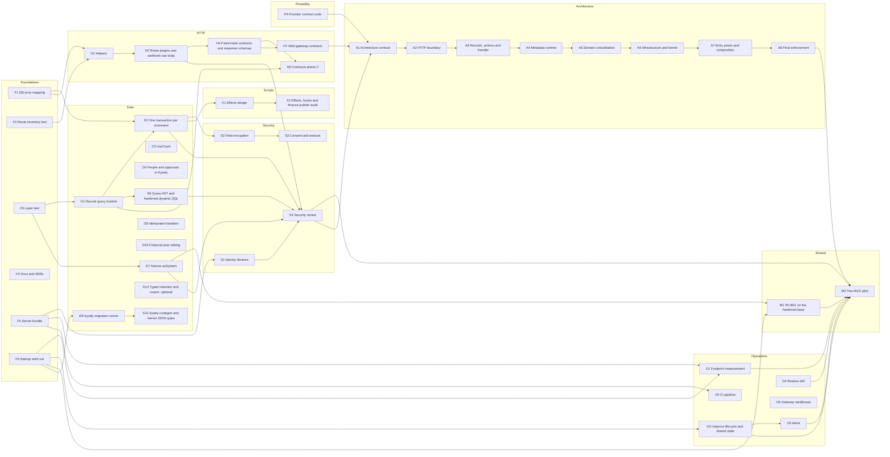

# Backend enhancement plan — NGO Management Platform

Status: in progress, updated 2026-10-26. This is the single backend plan; the earlier action plan was folded in and removed. Source: the solution-architect review of `ngo-platform/` against `.cursor/docs/product-briefs/ngo-management-platform.md`, and the follow-up questions answered the same day. On 2026-10-25 five pairs of blocks that had not started were merged (section 3), and agent briefs with exit tests were added (section 12). Track A, added on 2026-10-26, completes the five-layer architecture after the earlier behaviour-changing blocks landed.

This plan keeps the current architecture: a modular monolith on plain Fastify, a definition interpreter, PostgreSQL with row-level security, Kysely for fixed tables, a transactional outbox, and money rules enforced in the database. It hardens that architecture, and it lists the work needed before a single-NGO pilot and before a shared multi-NGO installation.

## 1. Questions and answers

### 1.1 What is the current design pattern?

A modular monolith with a metadata-driven runtime. Record types, workflows, posting rules and receipt rules are definitions that generic engines execute. A small fixed core owns the ledger, receipts, money accounts, payments and identity. Services are plain classes wired by hand in `platform.ts`. Side effects leave through a transactional outbox. Every tenant transaction switches to the runtime role and sets the tenant before any statement runs. Ledger balance, closed periods, and receipt immutability are checked in code and again by database triggers.

The pattern fits the brief. The weak points are structural:

- A record save opens several short transactions before the write transaction.
- Database rule violations reach the user as HTTP 500.
- Folder boundaries already leak, for example `domain/payments` imports `engines/records`.
- `RecordService` is about 1,560 lines.
- The script runtime has one hook, before-save, out of the ten the brief asks for.
- Process start does migrations and work across every organisation.

### 1.2 Is the stack suitable? Plain Fastify or NestJS with the Fastify adapter?

Keep plain Fastify. NestJS on Fastify keeps the same HTTP engine and adds a dependency-injection container, decorator metadata, RxJS, and controller, guard, pipe and interceptor layers. All of that costs startup time and memory, and the budget is a 384 MB instance that scales to zero. The current composition root and Fastify's in-process request injection already give good test seams. For record saves, the database and domain work will outweigh framework overhead, so the speed gap is probably small but unmeasured.

Revisit NestJS only if a like-for-like production-build spike meets all of: under 250 MB resident with two script runs, under 4 s from zero to first response, under 500 ms p95 save latency, full test parity, and a named maintainability gain that pays for migrating 100+ routes.

### 1.3 Is this an enterprise-grade solution?

Not yet. The architecture can get there; production readiness is unproven. Maturity is an advanced beta, ready for a controlled pilot only after the correctness, security and operations gates in section 6. Shared multi-NGO production is a no-go today. These are the gaps:

- The checks in a save run outside the write transaction.
- Database rule errors return 500.
- The shared installation has no lifecycle or operator controls.
- No measured memory, cold-start or latency figures exist for the target environment.
- Sensitive fields are masked but not encrypted.
- There is no backup-restore drill, no alerting, and no graceful shutdown.
- `/health` returns `ok` without checking anything.
- Payment gateways are tested only against fake clients.

### 1.4 No ORM and raw SQL: is this how a SaaS platform should be built?

Not as a general template, but it is the right choice for this product. Kysely, which is a typed query builder rather than an ORM, covers the fixed tables, and only 32 hand-written query calls remain across 11 files, guarded by a ratchet test. A full ORM would add little here. The core features are database behaviour, not object mapping:

- the role and tenant set per transaction
- row-level security
- deferred accounting triggers
- JSON records whose fields are defined at runtime
- expression indexes created at runtime
- `SKIP LOCKED` job claims and advisory locks
- record, ledger, receipt, audit and outbox writes committed together

The rule going forward is to build what differentiates the product and use libraries for generic security and infrastructure. That means:

- **Keep custom:** tenant boundaries, financial invariants, metadata query semantics, atomic domain transactions.
- **Use maintained libraries:** JWT and OIDC verification, TOTP, SQL clause validation, migration bookkeeping.
- **Use managed services:** only when their operational guarantees are worth more than cost, portability and scale to zero.

### 1.5 Are we using the full potential of Kysely? Should we reduce low-level code?

Kysely is used well for fixed tables. Running it inside the transaction that `withTenant()` opens is deliberate, and it rules out Kysely-managed transactions, savepoints, streaming and affected-row counts. Getting all of Kysely is not the goal; a small, reviewed raw-SQL boundary is. The gains available now:

- Convert the people and approvals queries to typed common table expressions. This removes 8 of the 32 raw calls.
- Wrap the dynamic record functions `app_record_ids`, `app_record_count` and `app_record_agg` in one typed module.
- Return `rowCount` from the database port so Kysely's affected-row results work.
- Type stable kernel JSON such as job state and outbox envelopes.

Keep these as SQL: row-level-security policies, triggers, database functions, migrations, managed-index DDL, and the JSON field expressions behind dynamic record queries. A switch to Kysely's native PostgreSQL dialect is deferred until streaming or savepoints are actually needed.

### 1.6 Should we add a thin wrapper over Fastify?

Yes, but use Fastify plugins and a few small helpers, not a custom framework. Split `server.ts` into route plugins by capability, with one public scope and one authenticated scope. The authenticated scope resolves the request context once in a hook. Add three helpers alongside the existing `sendOnce()`: authentication, `requirePermission()`, and error mapping.

Keep Fastify's request, reply, hooks, cookies, raw webhook bodies, streams and static hosting visible. Do not build a router facade, use decorators, or put all route settings into one configuration object. Plugins only organise route registration, so per-request cost should not change materially; measure to confirm.

Before splitting, the route-guard test has to inspect the routes Fastify actually registered, not search the text of `server.ts`.

### 1.7 Should we add request and response models?

Yes, for fixed JSON routes, as TypeScript interfaces paired with JSON Schemas. Ajv's `JSONSchemaType<T>` checks that each schema matches its interface, and both come from dependencies already installed. Today's route generics are checked at compile time only, so nothing validates a request body at runtime.

- **Start with:** authentication, API keys, roles, members, settings, approvals and money routes, plus the shared error shape.
- **Wrap dynamic payloads:** give records, actions, definitions and bulk operations fixed outer envelopes, such as `{ data, expectedVersion }`. The published definitions still validate what is inside.
- **Leave unmodelled:** streams, files, gzip exports, OIDC redirects and raw webhooks.
- **Response schemas:** use them only for security-sensitive views, such as an API-key token that may appear only when the key is created. A closed response schema silently drops fields, so never apply one to configured record data.
- **Avoid:** class-based DTOs.
- **Known drift:** `ActionResult.open` is a string in code and an object in the generated OpenAPI document.

### 1.8 Can a customer use MySQL instead of PostgreSQL?

Yes, later, as a second implementation of the same persistence contract. PostgreSQL stays the reference database. Swapping the connection string is not enough: tenant isolation, JSON record queries, job claiming, and the ledger and receipt triggers are PostgreSQL behaviour today. Application code will call ports such as `RecordStore` and `LedgerStore`. `infrastructure/postgres` and `infrastructure/mysql` each implement those ports, with their own migrations and triggers. MySQL is for a single NGO with its own database until a shared-mode design passes the same tenancy tests. Section 11 has the ports, the rules, and blocks P1–P7. MySQL itself waits for a customer who needs it.

## 2. Decisions

| Decision | Status |
| --- | --- |
| Plain Fastify; record it as an ADR and drop NestJS from the docs | Adopted |
| No full ORM; Kysely for fixed tables; SQL for PostgreSQL-specific behaviour | Adopted |
| One transaction per command, with the save split into stages | Adopted |
| Scripts return proposed effects; the host checks and applies them in the same transaction | Adopted |
| Fastify route plugins plus small helpers | Adopted |
| Schema-backed interfaces for fixed routes; envelopes around dynamic payloads | Adopted |
| Maintained libraries for JWT, OIDC and TOTP; membership and roles stay local | Adopted |
| NestJS migration | Rejected unless the spike in section 1.2 passes |
| Class DTOs, custom router facade, route decorators | Rejected |
| Patch the save in place (map database errors only, keep the separate transactions) | Rejected: pool pressure and stale-read checks remain. F1 still ships first as the quick fix |
| Separate read and write models (CQRS) or event sourcing | Rejected: more memory and complexity than the free tier allows, and the brief does not need it |
| Scripts in a separate process or isolated V8 | Rejected: does not fit 384 MB, and `isolated-vm` needs a native build on App Engine |
| Script host callbacks (async QuickJS) | Rejected; revisit if script authors must branch on data they look up themselves |
| Native Kysely PostgreSQL dialect | Deferred until streaming or savepoints are needed |
| Managed queue instead of the Postgres outbox | Deferred until independent worker scaling is needed |
| `kysely-codegen` generates the database types, replacing the in-repo generator. `kysely-typegen` is the fallback if generation must stay inside code; `kanel-kysely` (PostgreSQL only), `prisma-kysely` (needs a Prisma schema) and `kysely-schema-generator` (MySQL only) do not fit | Adopted; block D11 |
| PostgreSQL is the reference database. MySQL is a second implementation of the same persistence ports, not a connection-string swap. Shared MySQL needs one database per NGO | Adopted. Build the ports with P2–P4. Build the MySQL driver (P5) only when a customer needs it |

## 3. Building blocks

Effort is in working days (d) or weeks (w) for one developer working with AI assistance. "Depends on" lists blocks that must be finished first.

**Merged blocks (2026-10-25).** Five pairs of blocks that had not started were merged, because they change the same files or one is a small follow-on of the other. The absorbed IDs stay in the tables, marked "Merged into", so older references still resolve. Section 12 has one agent brief per block that has not started.

| Kept block | Absorbs | Why |
| --- | --- | --- |
| D11 | D5 | D5 is only column overrides in the `kysely-codegen` config that D11 creates |
| D6 | P3 | D6 already builds clauses "from a structured representation"; that representation is P3's query AST. Building it once avoids rewriting the dynamic SQL twice |
| H2 | H3 | Moving the raw body into the webhook plugin is part of creating that plugin |
| H4 | H5 | Request and response schemas share one `http/contracts/` module and one OpenAPI change |
| X2 | X3 | Both are build work on the script publish and run path after the X1 design |
| O2 | O7 | Both decide how an instance behaves when several start, run and stop: readiness, shutdown, caches, rate limits, cron |

D9 and D11 were not merged, but both change migration tooling and the test-database setup. Run D9 first and start D11 from the tip after D9 merges.

### Track F — Foundations

| ID | Block | Effort | Depends on | Done when |
| --- | --- | --- | --- | --- |
| F1 | Map Postgres `23505` (unique) and `P0001` (money and receipt triggers) to `rule_violation` or `validation_failed` | 0.5 d | — | A duplicate PAN and a post into a closed period return 422; logs record the database code, not an unhandled error |
| F2 | Route-guard test inspects the registered Fastify routes and keeps an exact public-route allowlist. Check that the two-step begin and confirm routes are protected | 1 d | — | Adding an unlisted route without sign-in fails the test; the test no longer reads `server.ts` text |
| F3 | Layer-dependency test; fix the three current leaks (`domain/payments` → `engines/records`, `identity/profile-service` → `engines/records`, `metadata/cross-refs` → `engines/automation` and `engines/notify`); `RecordService` receives `LedgerService` and `ReceiptService` from `platform.ts` instead of constructing its own defaults | 1–2 d | — | A new cross-layer import fails the test; payment confirmation moves the record through an outbox event; `RecordService` has no default engine instances |
| F4 | Bring `ngo-management-platform.md` in line with the code: Fastify not NestJS (section 10 and the component diagram), Kysely not Prisma (section 7.1), scrypt not bcrypt (section 5.1), the hooks that exist, and ADR-01's lint-rule claim replaced by the F3 test; add ADRs for plain Fastify and for no ORM | 1 d | — | The doc names no framework, library or hook the code does not use |
| F5 | Production server bundle and start script (esbuild as a dev dependency); stop running production through `tsx` | 1 d | — | `npm run build:server` produces one bundle that starts and passes a smoke test |
| F6 | Move migrations, platform re-sync, `profiles.ensureAll()` and shipped-module publishing out of process start into a deploy step or job | 1–2 d | — | Process start does not walk every organisation; a second instance does not republish definitions |

### Track D — Data correctness and persistence

| ID | Block | Effort | Depends on | Done when |
| --- | --- | --- | --- | --- |
| D1 | Extract the record query subsystem from `RecordService`; one typed module wraps `app_record_ids`, `app_record_count` and `app_record_agg` | 2–3 d | F3 | `record-service.ts` builds no list SQL; query and plan tests pass unchanged |
| D2 | One transaction per create, update and transition; the save becomes stages (authorize, merge, conditions, signatures, copy-from, calculate, script, validate, unique, rules, write, posting and receipt effects, audit and outbox) | 4–6 d | D1, F1 | A save checks out one pool connection; two concurrent saves of one unique value end with one rejected with 422; record, core-rule and donation tests pass |
| D3 | The database port returns `rowCount` with rows, so Kysely's affected-row results work | 1 d | — | `numUpdatedRows` is correct in a test; existing `returning` clauses still work |
| D4 | Convert the people (5) and approvals (3) raw queries to Kysely with typed common table expressions | 2 d | — | Raw-SQL baseline drops from 32 to 24 or fewer; plan-parity tests pass |
| D5 | Merged into D11 | — | — | — |
| D6 | Harden the owner-privileged dynamic record SQL. Clauses are built from the validated record-query AST in section 11.4, compiled by one PostgreSQL compiler (absorbs P3); strict validation in the database function; narrowed grants; hostile-input tests | 4–7 d | D1 | Hostile clause tests are rejected; only the runtime role can call the functions; current query and plan tests pass through the AST; `record-service.ts` and the query module build no SQL text from user input |
| D7 | Replace general `asSystem()` access with named capabilities (provisioning, outbox claim, job claim, identity lookup, retention) | 3–4 d | F3 | No service outside the kernel opens owner transactions directly; a test enforces this |
| D8 | Outbox and job delivery contract: each handler is idempotent; a failure of one handler does not re-run handlers that already succeeded for that event | 2–3 d | — | Replay tests show no duplicate emails, webhooks or transitions |
| D9 | Migration runner on Kysely's own pieces. Replace the custom dialect, driver and adapter in `src/kernel/migrate.ts` (and `FILE_LOCK`) with Kysely's standard PostgreSQL dialect on one connection, and call `migrator.migrateUp()` once per pending file with transactions on. Each file and its `kysely_migration` row then commit together, under Kysely's lock, one file at a time, so test workers still do not block each other. `SqlFileMigrationProvider` stays, because Kysely has no `.sql` file loader. Confirm two things first: a parameterless `sql.raw(file)` still runs a multi-statement file through Kysely's driver, and Kysely's PostgreSQL migration lock is transaction-scoped. Add the crash-recovery test | 1–2 d | F6 | The custom dialect, driver, adapter and `FILE_LOCK` are gone; a failure inside a file leaves neither its schema change nor its history row; a restart after a simulated crash leaves schema and history consistent; the migration and type-generation tests pass |
| D10 | Financial-year start month as a per-organisation setting (fixed at April in `fiscalYearKey` and `fiscalYearBounds` today) | 1 d | — | Two organisations close different years; receipt and ledger periods follow the setting |
| D11 | Replace `scripts/gen-db-types.mjs`, its declarations `scripts/gen-db-types.d.mts`, and `scripts/db-type-overrides.json` with `kysely-codegen`, the generator Kysely's documentation lists first and the only one with a CLI for both PostgreSQL and MySQL. Steps: add it as a development dependency; add a config file (PostgreSQL dialect, `numeric` read as a string, output `src/kernel/db-types.ts`, column overrides); `npm run db:types` runs the F6 migrate command on a dedicated schema of the test database, then `kysely-codegen`; the stale check uses its `--verify` flag (confirm it exists in the installed version first); `src/kernel/jobs.ts` switches from `Json` to the generated JSON type if the name differs; `test/kysely.test.ts` drops the tests of the old script and keeps the tests of what node-postgres returns at runtime. Absorbs D5: column overrides type stable kernel JSON (job state, outbox event envelopes) | 2–3 d | F6, D9 | The three custom files are deleted; `npm run db:types` regenerates the file; a migration merged without regenerating fails the suite; `tsc` and the runtime-shape tests pass; `numeric` and `int8` columns still read as `string`; job and outbox code compiles without casts on the overridden JSON columns |
| D12 | Optional. Typed table names in `src/kernel/retention.ts` and `src/kernel/tenant-export.ts`: the table lists become `keyof DB`, so a misspelled or dropped table fails to compile; the batched deletes and paged reads use Kysely builders, with `ctid` kept as a small `sql` fragment. The snapshot isolation statement in tenant export becomes an option on `withTenant()` (for example `{ isolation: 'repeatable read', readOnly: true }`), because Kysely sets isolation only on transactions it opens itself | 1 d | — | Raw-SQL baseline drops by up to 3; a table removed by a migration breaks the build in these two files; retention and export tests pass unchanged |

### Track H — HTTP layer

| ID | Block | Effort | Depends on | Done when |
| --- | --- | --- | --- | --- |
| H1 | HTTP helpers: authentication hook, `requirePermission()`, error-mapping module; `sendOnce()` stays as is | 1 d | F1, F2 | Routes no longer call `context(req)` by hand; error tests pass unchanged |
| H2 | Split `server.ts` into Fastify plugins (auth, records, builder, administration, payments and webhooks, files and imports, internal and static) under public and authenticated scopes. Absorbs H3: the raw request body is kept only in the webhook plugin; other routes use Fastify's standard JSON parser | 3.5–5 d | H1 | `server.ts` only creates the app and registers plugins; route inventory, headers, cookies, CORS, rate-limit, idempotency, stream and webhook tests pass; signature tests pass on exact bytes; other routes no longer keep raw text |
| H3 | Merged into H2 | — | — | — |
| H4 | Fixed-route contracts. Request interfaces plus JSON Schemas for authentication, API keys, roles, members, settings, approvals and money; shared error schema; malformed shape returns 400, business rejection stays 422. Absorbs H5: response schemas for security-sensitive views, and the `ActionResult.open` drift in the OpenAPI document is fixed | 4–7 d | H2 | Missing, mistyped and unknown fields return the agreed 400; valid but rejected input still returns 422 with field issues; an API-key token appears only in the create response; no connector secret or refresh token appears in any response; the OpenAPI document and the code agree on `ActionResult.open` |
| H5 | Merged into H4 | — | — | — |
| H6 | Request contracts, phase 2: fixed envelopes for record save, transition, query and aggregate, bulk operations, and definition drafts | 2–3 d | H4, D1 | Envelope errors return 400; a newly published record field is accepted without a restart |
| H7 | The web app's HTTP gateway imports the shared fixed contracts | 2 d | H4 | Gateway fixtures type-check against the contracts; no `get<T>()` cast left on contracted routes |

### Track S — Security and privacy

| ID | Block | Effort | Depends on | Done when |
| --- | --- | --- | --- | --- |
| S1 | Replace the hand-written JWT, OIDC key verification and TOTP code with maintained libraries; membership, roles and sessions stay local | 3–5 d | F5 | Identity and OIDC tests pass; the footprint change is measured in O1 |
| S2 | Application-level encryption of sensitive field values with a versioned key, as a stage of the save pipeline | 5–8 d | D2 | Sensitive values are ciphertext in the database; reads, exports and masking behave as before; a key-rotation test passes |
| S3 | Consent records, erasure by pseudonymisation, and retention rules for financial records; retention period confirmed with counsel | 1–2 w | S2 | An erasure request pseudonymises personal fields and keeps amounts, dates and receipt numbers |
| S4 | Independent security and tenant-isolation review across records, files, jobs, scripts, configuration, exports, identity and money | 1 w, external | D2, D6, D7, H2, S1 | Findings fixed or accepted by an owner in writing |

### Track X — Override scripts

| ID | Block | Effort | Depends on | Done when |
| --- | --- | --- | --- | --- |
| X1 | Design scripts that return effects: declared inputs, effect types (`ledger.propose`, `records.create`, `notify`, `connector.call`), validation and test-run preview | 1 w | D2 | Design reviewed; effect schema published with the other definition schemas |
| X2 | Build the effects and the next hooks: validate, after-save, workflow guard, custom button. Absorbs X3: publishing a finance script writes an audit event and notifies the treasurer, as the brief requires | 2 w | X1 | A script proposes a journal line and a notification, applied in the save transaction; an unbalanced proposal is rejected; a test run shows effects without writing; publishing a finance script produces an audit event and a treasurer notification |
| X3 | Merged into X2 | — | — | — |

### Track O — Operations and performance

| ID | Block | Effort | Depends on | Done when |
| --- | --- | --- | --- | --- |
| O1 | Measure memory, cold start and p95 save latency of the bundled build against hosted PostgreSQL, with the database awake and paused | 1–2 d | F5, F6 | Figures recorded against section 12 of the architecture doc (under 250 MB, under 4 s, under 500 ms) |
| O2 | Instance lifecycle and shared state. Readiness check that tests the database; graceful shutdown on `SIGTERM` that drains requests, the outbox run and the pool. Absorbs O7: a role or membership change reaches every instance (for example through a counter checked like `config_version`), not only the local 30-second actor cache; rate limits either move to PostgreSQL or are documented as per instance; the cron interval per installation mode is set and documented | 3 d | F6 | Readiness fails with the database down; shutdown completes without dropped requests in a test; with two instances, a removed role is refused on both within the agreed time; the documented maximum delay for notifications and automations matches the cron setting |
| O3 | Alerts on permanently failed outbox events and jobs, error rate and memory; one dashboard | 2 d | O2 | A forced failure raises an alert |
| O4 | Backup and restore drill on the hosted database; agreed recovery point and recovery time | 2 d | — | A restore into a fresh database passes the smoke tests within the agreed time |
| O5 | CI pipeline: type-check, tests, architecture tests, bundle budget, dependency audit | 2 d | F5 | Every change runs the pipeline; a failing check blocks merge |
| O6 | Verify Razorpay and Cashfree against their sandboxes | 2–3 d | — | Order, signed webhook and duplicate delivery work against each sandbox |
| O7 | Merged into O2 | — | — | — |

### Track M — Shared installation

The product design for this track is `.cursor/docs/plans/ngo-release-2-build-blocks.md`. R2-B01 is the organisation lifecycle (provision, activate, suspend, reactivate) through an operator command, with no operator web console. R2-B02 is configuration export and import. This plan only records what that release must use from the hardening work.

| ID | Block | Effort | Depends on | Done when |
| --- | --- | --- | --- | --- |
| M1 | R2-B01 uses the hardened base: provisioning runs as a deploy command, not inside process start (F6), and operator actions use the named owner capabilities (D7). The lifecycle itself stays specified in R2-B01 | — | F6, D7 | R2-B01's checkpoints O1–O11 pass, and no lifecycle step runs during process start |
| M2 | Usage metering and an operator web console stay out of Release 2, which rejected a public operator console. Revisit after the shared pilot | — | M3 | A written decision on metering and a console, after M3 |
| M3 | Shared pilot with two NGOs | 1 month | R2-B01, S4, O1, O2, O3, O4 | No cross-organisation access in the automated suite or the pilot; budgets met |

### Track A — Five-layer architecture completion

Track A is a behaviour-preserving structural programme. It is the explicit exception to the earlier rule that folders move only when another block changes behaviour: those blocks are now merged, but their transitional folders and broad dependency allowances remain. Each block starts from the merged tip after its predecessor, keeps the suite green, and removes its own temporary architecture exceptions.

| ID | Block | Effort | Depends on | Done when |
| --- | --- | --- | --- | --- |
| A1 | Architecture contract and exact transitional baseline | 1–2 d | H7, P4, S4 | The test parses imports with the TypeScript compiler API, distinguishes type-only port imports, rejects new violations, and every existing exception names an owner and removal block |
| A2 | HTTP to application boundary | 3–5 d | A1 | No file under `src/http/` imports `Platform`, runtime, domain or concrete infrastructure; each plugin receives a small application-facing dependency bundle |
| A3 | Records, actions and transfer ownership | 5–8 d | A2 | Record runtime code is under `runtime/records`, multi-capability actions/import/export are application use cases, transport implementations are infrastructure, and the affected `engines/` folders are gone |
| A4 | Definitions, workflows, automation, expressions and scripts | 5–8 d | A3 | `metadata/`, `expressions/`, `scripts/`, builder, approvals and automation are in their final runtime/application locations with no sibling-runtime service calls |
| A5 | Domain consolidation | 4–7 d | A4 | Identity, accounts, ledger, receipts, payments, organisations, privacy and permissions are in `domain/`; domain imports only domain code and domain-owned ports |
| A6 | Infrastructure consolidation and kernel dissolution | 5–8 d | A5 | PostgreSQL, jobs, outbox, files, notification, connectors, transfer, audit, crypto, sequences and observability implementations are in `infrastructure/`; `kernel/` is deleted |
| A7 | Entry points and composition | 2–3 d | A6 | `platform.ts` is the only composition root; process entry points are thin; `deployment.ts` is renamed to `prepare-deployment.ts` while `dist/deploy.js` and npm command behaviour stay unchanged |
| A8 | Final enforcement and documentation | 1–2 d | A7 | Legacy top-level folders and the layer allowlist are empty, architecture tests enforce the final rules, focused suites pass, and the full integration-branch regression passes |

## 4. Dependencies



D3, D4, D8, D10, F4, O4 and O6 have no dependencies and can be scheduled whenever there is capacity. D12 also has none and is optional: it is not in any wave or release gate.

## 5. Delivery waves

Blocks in one wave can run in parallel. A wave starts when the blocks it depends on are done, not when the whole previous wave is.

**Branches.** All enhancement work happens on the integration branch `backend_enhancement`, created from `master` at `f53a684`.

- Each block gets its own branch and worktree, created from the current tip of `backend_enhancement`, never from `master`.
- A finished block merges back into `backend_enhancement` only, after its "done when" check, `npx tsc --noEmit`, the architecture tests, its newly added tests, and a minimal regression set (the existing test files that directly cover the code it changed) pass. A block does not run the full suite.
- The full regression suite runs only when a person asks for it, on `backend_enhancement`, through `ngo-worktrees/run-suite.ps1`. The 2026-10-26 round (D2 slice 2, H2 slice 2, D7 rest, D6, D11, H4, O3) runs without it.
- At most six blocks run at the same time, each in its own worktree.
- A block that depends on another starts after that block has merged, from the updated tip.
- `backend_enhancement` merges into `master` once, when the enhancement is complete. Until then nothing from this plan merges into `master`.
- Nothing is pushed to a remote.

| Wave | Blocks | Outcome |
| --- | --- | --- |
| 1 | F1, F2, F3, F4, F5, F6, D3, D10, O4, O6 | Correct error codes, guard rails in tests, accurate docs, a real production build, fast startup |
| 2 | D1, D4, D7, D8, D9, D11 (after D9), H1, O1, O2, O5 | Record queries isolated, fewer raw queries, standard migration runner and type generator with typed kernel JSON, measured footprint, CI in place, instance lifecycle and multi-instance state handled |
| 3 | D2, D6, H2, S1 | One transaction per command, query AST and hardened dynamic SQL, modular HTTP layer with the raw body confined to webhooks, standard identity libraries |
| 4 | H4, X1, S2, O3 | Validated fixed routes and secret-free responses, encrypted sensitive fields, alerting, scripts design |
| 5 | H6, H7, X2, S3, M1 | Full contracts, script effects and hooks with finance publish audit, privacy workflows, R2-B01 on the hardened base |
| 6 | S4 | External review and accepted/fixed findings |
| 7 | A1–A8, sequential | Exact architecture guardrails, final five-layer ownership, no legacy folders or exceptions |
| 8 | M3 | Shared pilot on the final hardened architecture |

### 5.1 Block status

Updated whenever a block changes state. "Merged" means merged into `backend_enhancement`; the commit is the merge commit there.

| Block | Status | Branch or commit | Notes |
| --- | --- | --- | --- |
| F1 | Merged | `f5b496d` | Unique and trigger database errors return 422 |
| F2 | Merged | `6b9a576` | Route guard reads registered routes; exact public list |
| F3 | Merged | `51781fa` | Layer test and allowlist; payments confirmation in `application/` |
| F4 | Merged | `a3a7144` | Architecture doc matches the code; ADR-11 plain Fastify, ADR-12 no ORM |
| F5 | Merged | `8ca083e` | esbuild 0.28.2 pinned; `build:server` makes `dist/server.js`, `npm start` runs it with plain `node`; smoke test |
| F6 | Merged | `1548cd8` | `npm run deploy:prepare` migrates and publishes; process start only checks migrations and the platform package, and exits if not prepared; `main.ts` moved to `src/main.ts` |
| D1 | Merged | `9a71a32` | Record list, count and aggregate SQL in `src/runtime/records/query.ts`, with typed wrappers for the record functions. Related tests 171/171 |
| D2 | Merged | `57ab16b`, `e820570` | Create, update, transition, approval requests and the import check each open one transaction with every check inside; one pool checkout per save (two when a before-save script fails, for the log after rollback); concurrent unique saves give one 201 and one 422. Slice 2 merged (`e820570`): 13 stage files under `src/runtime/records/save/`; `record-service.ts` 1,436 → 753 lines; tests unchanged |
| D3 | Merged | `efc5fed` | Affected-row counts reach Kysely |
| D4 | Merged | `d43793e` | People and approvals queries use Kysely; with D1, the raw-SQL baseline is now 17 calls across 7 files; 10 plan-parity cases |
| D5 | Merged into D11 | — | |
| D6 | Merged | `0fd77b6` | Includes P3. Validated AST (`src/runtime/records/query-ast.ts`) compiled by one PostgreSQL compiler (`pg-query-compiler.ts`); migration 016 limits the three record functions to the compiler's grammar, ends their search path with `pg_temp`, and lets only `app_runtime` execute them; hostile-input tests. The compiler and migration 016 must change together |
| D7 | Merged | `642f9fb`, `662029f` | Named capabilities in `src/kernel/capabilities.ts`, including `AccountStore`, `SignInStore`, `SessionStore`, `MemberDirectory` and `ProfileRecords` for identity; no service outside the kernel opens owner transactions; the allowlist is empty and `test/owner-capabilities.test.ts` enforces it |
| D8 | Merged | `a1a703b` | Migration 014 records finished handlers per outbox event; every handler safe to replay; jobs notify on finish once. Related tests 128/128 |
| D9 | Merged | `9fc5b4a` | Kysely's `PostgresDialect`, one `migrateUp()` per file: each file and its history row commit together; failing-file, crash-recovery and lock tests. Kysely's lock is session-level on a fixed key, safe with one call per file; the test helper now uses the same key. A small `Kysely` subclass limits the migrator's table check to the named schema, used only when the database names one (test worlds, type generation; without it test-world creation took about twice as long). The production deploy step uses Kysely's own check unchanged (`9e8e492`) |
| D10 | Merged; web build verified 2026-10-26 after the web packages were restored | `7545382` | Start month per organisation, fixed once a year is opened or a receipt issued; business document added. Web build could not run: Angular packages are missing from `web/node_modules` |
| D11 | Merged | `84aa091` | Includes D5. `kysely-codegen` 0.20.0 replaces the three custom files; `npm run db:types` generates from a throwaway schema; `-- --verify` is the stale check; `.gitattributes` keeps `db-types.ts` LF; job and outbox JSON typed (`src/kernel/db-json.ts`). Installed in the shared `node_modules`; `--verify` passes on the merged branch |
| D12 | Done | `3ec7362` | Retention and tenant export are typed Kysely queries (raw SQL 3 → 0). `withTenant()` and `asSystem()` take `{ isolation, readOnly }`; export stays on `asSystem()` as a repeatable-read, read-only snapshot. Moving export to `withTenant()` would change behaviour; not done |
| H1 | Merged | `779480b` | Signed-in scope resolves the context once (`contextOf(req)`); error mapping in `src/http/errors.ts`; builder draft route checks sign-in first. Related tests 220/220 |
| H2 | Merged | `b351d02` | Slice 1 (`f1d12e8`): routes in nine plugins under `src/http/plugins/`; `server.ts` 1,064 → 164 lines; route list identical. Slice 2, from H3: only the payment webhook keeps the raw body; signature test on exact bytes |
| H4 | Merged | `c307b72` | Includes H5. Contracts in `src/http/contracts/` for authentication, API keys, roles, members, settings, approvals and money: a malformed body gets 400 `bad_request` with issues, a refused valid body keeps 422. API-key token only in the create response; no connector secret or refresh token in any response; `ActionResult.open` is a string in code and OpenAPI. Four tests now expect 400 for malformed input |
| H6 | Done | `371526b` | Fixed envelopes for record create/update/transition/action, query, aggregate, bulk, definition draft, extension patch and rollback; record contents still checked by published definitions (new fields work without restart). Malformed envelopes return 400; four tests moved from 422 to 400. Ajv `allowUnionTypes` clears the warnings |
| H7 | Merged | merge after `af49fc6`, plus the organisation import fix | `src/http/contracts/types.ts` (type exports only) re-exported by `web/src/app/core/contracts.ts`; gateways call `contracted<Routes>(http)` route tables; 24 generic casts removed and 8 request bodies now typed; web architecture test allows server HTTP imports only through `core/contracts.ts`, type-only. Routes without a server contract (`/api/me`, runtime, pins, jobs, audit, shares, imports, profiles) keep local types. Web build passes; 577 web and guard tests. Approved 2026-10-26; web packages restored with `npm --prefix web ci` (lockfile unchanged; npm audit reports 2 moderate and 5 high in existing web dependencies) |
| M1 web screens | Merged | merge after `8df995a` | O1 OneNGO mark with the NGO's name and logo, `<screen> \| OneNGO` titles; O11 `/o/<code>/sign-in` (remembered organisation, "Use another organisation", neutral not-found, invitation and reset return there); settings for legal name, contact, address, time zone, registrations, logo and the setup checklist, with server issues on their fields; O10 receipt print view shows the saved issuer. Web build passes; 97 web and guard tests. Open wording: invitation subject without "on OneNGO", authenticator label `NGO Platform:<email>` |
| S1 | Merged | merge after `4dfe5bb` | `jose` signs and verifies access tokens (HS256, byte-identical to the old signer) and verifies OIDC ID tokens with a one-hour JWKS cache through the injectable fetch; `otplib` makes and checks two-step codes (SHA-1, 6 digits, 30 s, ±1 period). Legacy-token, RFC 6238 and enrolled-secret tests. Footprint (`measure:bundle`, local, medians): RSS idle 110.7 → 113.1 MB, peak 146.7 → 149.9 MB, first signed-in response 2450 → 2412 ms, `dist/server.js` 853,674 → 851,965 bytes; both libraries load from `node_modules`. | Approved 2026-10-26: `jose` ^6.2.13 and `otplib` ^13.5.0, added in `d151189` (npm audit's two moderate findings, `fast-uri` and `nodemailer`, predate it) |
| S2 | Done | `214d976` | Sensitive values stored as AES-256-GCM ciphertext under `ENCRYPTION_KEY` plus `ENCRYPTION_KEY_PREVIOUS`; unique sensitive fields (donor PAN) checked by a keyed hash (migration 019). Open: no command or route yet runs `Platform.reencryptSensitiveFields()` (needed once after deploy); two-step and connector secrets still use only `ENCRYPTION_KEY`; tenant export carries ciphertext; key source per environment is a person's decision |
| S3 | Merged, awaiting counsel and product-owner approval | `f66349e` | Migration 020 (`consent_event`, `erasure_request`, append-only); `/api/privacy/consents` and `/api/privacy/erasures` with `privacy:*` permissions; erasure pseudonymises the subject's personal fields and copies in linked records, keeps amounts, dates, numbers, receipts and journals. Known residue: donor name in posted journal memos, provider payment payloads. Retention default 8 years (`FINANCIAL_RETENTION_YEARS`) pending counsel; financial rows never deleted. No web screens yet |
| Ops follow-ups | Merged | `6074438` | `npm run fields:reencrypt` (deploy step `--reencrypt-sensitive-fields`) rewrites stored secrets under the current key and queues the field jobs; never at normal start. Two-step, connector, gateway, SMTP and sign-in secrets decrypt with `ENCRYPTION_KEY_PREVIOUS` too. `src/kernel/database-support.ts` refuses non-PostgreSQL URLs, MySQL, PostgreSQL before 15 and unknown `INSTALLATION_MODE` (`one-ngo` default, or `shared`) in `main.ts` and `deploy.ts`. To confirm: the name `one-ngo` |
| S4 fixes | In progress (6 parallel blocks) | `block/S4-money` (S4-1, S4-16), `block/S4-scripts` (S4-2, S4-8), `block/S4-auth` (S4-3, S4-6, S4-11, S4-13), `block/S4-authz` (S4-7, S4-10, S4-12), `block/S4-http` (S4-4, S4-5, S4-17), `block/S4-infra` (S4-9, S4-14, S4-15) | Decided 2026-10-26: fix all 17. Migration numbers reserved: 023 money, 024 auth, 025 authz, 026-027 infra, 028 http, 029 scripts |
| S4 | Review done; findings open | report `docs/reports/s4-review-2026-10-26.md` and probes `test/security/` merged | 17 findings: 2 High, 5 Medium, 6 Low, 4 Informational, none Critical. Pilot blockers: S4-1 (payment request lets the caller choose amount and paid step; ₹1 marks a ₹1,00,000 donation paid), S4-2 (scripts run on the main thread; one organisation stalls all), S4-3 (a session alone can switch off two-step). Others: S4-4 rate-limit client address behind App Engine, S4-5 open redirect after Google sign-in, S4-6 access tokens live 15 min after sign-out, S4-7 privilege escalation via people and API-key managers, S4-8 Try it reads balances without script-admin, S4-9 erasure leaves data in side tables, S4-10 member lookup leaks a name, S4-11 two-step code reuse, S4-12 jobs keep creator rights after suspension, S4-13 cross-organisation lockout, S4-14 to S4-17 informational. 11 probes are `it.fails` until fixed. S4 is done when each is fixed or accepted in writing. Earlier note: Decided 2026-10-26: reviewed by an isolated AI agent with no builder context instead of an outside human reviewer; report-only, no fixes. Output `docs/reports/s4-review-2026-10-26.md`; findings become blocks `S4-<n>`, each fixed or accepted in writing by an owner. Residual risk: the reviewer comes from the same tool family that built the code, so this does not replace a human penetration test before wider rollout |
| X1 | Done, approved 2026-10-26 (decisions in design section 19, `8df995a`) | `c792ed4` | `ngo-script-effects-design.md` (now section 6.6 of `architecture/ngo-platform-architecture.md`), `schemas/scriptEffects.schema.json`, pure validator (11 tests). Scripts run unchanged. Eight open questions in design section 18; X2 starts after review |
| X2 | Merged | merge after `b0950bf` | Includes X3. Scripts propose `ledger.propose`, `records.create`, `records.update`, `notify` and `connector.call`, held and applied in the save transaction; any refusal rolls back the save. Hooks: before save, validate, after save, workflow guard, custom button (`script` action step). Section 19 built: `runAs` and `balances` need `config:script:admin` to publish; named recipients in organisation settings; finance publish and rollback write `script.published.finance` and notify the `admin` role; `ctx.propose.*` helpers. Migration 021. One journal per record per script version (existing unique index). Open: Try it does not check open financial years or enabled connectors; no web editors for script effects or named recipients. 342 tests on the merged tip |
| O1 | Merged, local only; hosted run deferred to DevOps (`docs/operations/devops-handover.md` section 4) | `d0adff4` | `npm run measure:bundle`. Local, shared machine, 5 runs: peak memory 144 MB (budget 250), save p95 18 ms create / 38 ms pay (budget 500), start to first signed-in response 4.7 s median, range 3.0–9.9 s (budget 4 s, missed). A person still runs it against hosted PostgreSQL, awake and paused |
| O5 | Merged; pipeline setup deferred to DevOps (`docs/operations/devops-handover.md` section 1) | `ba5d7c8` | `npm run ci`, `npm run ci:audit`, `azure-pipelines.yml`. A person must create the pipeline in Azure DevOps, give it credentials for the company npm registry (`artifacts-west.pwc.com`), and add a build-validation branch policy on `backend_enhancement` and `master` |
| O2 | Merged | `8181883` | `GET /ready` checks the database; graceful shutdown drains requests, the outbox run and the pool; migration 015 `access_version` makes role and membership changes reach every instance within 5 s; general rate limits stay per instance (documented); cron 60 min one-NGO, 5 min shared (doc section 4.5). Includes O7 |
| O3 | Merged; applying deferred to DevOps (`docs/operations/devops-handover.md` section 2) | `908544a` | Fixed `alert` names in the logs: `outbox.failed_permanently`, `job.failed`, `http.unhandled_error` (ERROR), `memory.high` (WARNING, `MEMORY_ALERT_MB` default 300). Log metrics, alert policies and a dashboard in `docs/operations/monitoring/`; a person applies them with gcloud (README there, architecture doc section 4.6) |
| O4 | Deferred to DevOps | — | Backup and restore drill; `docs/operations/devops-handover.md` section 3 |
| O6 | Deferred to DevOps | — | Gateway sandboxes; `docs/operations/devops-handover.md` section 5. Unblocked: the gateway-credentials routes landed with the ops gaps (`92cf8f6`) |
| M1 | Server side done | `a2f4fef`; full regression at `3497493`: 123 files, 1,430 tests (one stale table count fixed) | R2-B01 checkpoints O2-O11 (server): migrations 017-018, resumable `npm run organisation:onboard` operator command (never at start-up), organisation and setup routes, suspend/reactivate/close, receipt issuer snapshot. Web left: shell branding, `/o/<code>/sign-in`, settings screens and receipt print view. Closing has no retention check yet |
| M3 | Not started | — | Needs M1, S4 and O4, and the hosted O1 run |
| P1 | Done | `737c312` | ADR-13 and architecture section 4.7: PostgreSQL 15+ everywhere; MySQL one-NGO only after P5; shared MySQL unsupported until six criteria pass. The start-up check that refuses unsupported databases is deferred to a code change (nothing reads `INSTALLATION_MODE` yet) |
| P2 | Merged | foundation `8421d5f`; finance and identity `96f381c`; engines `5c6e2e8`; records `a68387e`; final `4dfe5bb` | Includes P3 (the D6 compiler is now `src/infrastructure/postgres/query-compiler/record-query.ts` behind `RecordQueries`). Opaque `Tx` and `TransactionManager` (`src/kernel/ports/transaction.ts`); stores in `src/infrastructure/postgres/stores/` behind ports beside the core code (records: `RecordStore`, `RecordQueries`, `PersonDirectory`, `ShareStore`; finance: `LedgerStore`, `ReceiptStore`, `MoneyAccountStore`, `PaymentStore`, `IssuerSource`; identity, organisation, admin, engines and `DefinitionStore`). `test/persistence-architecture.test.ts`: no core file imports Kysely or the SQL executor, and the allowlist is empty. Only composition roots import `src/infrastructure/`. Built as four parallel slices; raw-SQL total unchanged (13) |
| P4 | Merged | merge after `5429fdb`; fix in migration 022 | `src/infrastructure/contract-tests/` (`defineProviderContract`, PostgreSQL fixture, README coverage table), `npm run test:contract`, part of the normal run: 72 tests over every section 11.3 port and the 11.5 invariants, including database-enforced tenancy and bypass writes. `DatabaseCapabilities` and the PostgreSQL profile added (not yet read at start-up). Found that the database accepted new balanced lines on a posted journal entry; fixed by migration 022. Before a second provider: promote `JobStore`, `OutboxStore` (claim and settle), `IndexManager`, `MigrationRunner` and `TenantStore` from kernel functions to ports |
| P5–P7 | Not started | — | Wait for a customer. P3 is merged into D6 |
| A1 | Done (server, `one-ngo`) | `8b6b7bf` | Exact architecture contract: `test/layer-architecture.test.ts` reads imports with the TypeScript compiler API, tells type-only port imports from value imports, rejects new violations; the baseline started at 220 edges, each with an owner and removal block |
| A2 | Merged | `526be08` | HTTP receives typed application bundles (`HttpDeps`) instead of `Platform` |
| A3 | Merged | `7ec0508` | Records runtime, sharing and transfer use cases; connectors, files and notifications split from infrastructure. The last 6 connector edges went in A7: `application/connectors/ports/connector-runtime.ts` holds type-only ports for HTTP, the secret box, the outbox and the delivery policy, injected from composition |
| A4 | Merged | `9775c75` | Definitions, workflows and automation own their contracts; `BuilderSupport` takes services, not `Platform` |
| A5 | Merged | `450e18b` | Domain imports only domain code and domain-owned ports |
| A6 | Merged | `32d8852` | Infrastructure no longer imports core values; package-ownership rules. Left: 7 documented Kysely exceptions in `test/package-allowlist.json` (audit, idempotency, rate limit, jobs, outbox, sequences, contract fixture) |
| A7 | Done (server), branch `block/A7-composition` | see branch | `platform.ts` calls one private wiring function per capability in `src/composition/` (infrastructure, definitions, records, messaging, identity, payments, jobs, files, operations, administration, handlers, scheduler, http, organisations, deployment, entry); only `platform.ts` and the four entry points may import composition, and composition may import every layer. Entry points parse inputs and call composition or `platform.ts`; organisation command orchestration moved to `application/organisations/organisation-command.ts`. `asTx`, `transactions` and `joinTx` live once, in `domain/ports/transaction.ts`; `Actor`, `TenantContext` and `systemActor` live once, in `domain/ports/tenant-context.ts` (runtime copies re-export; infrastructure keeps only `SYSTEM_ACTOR_PREFIX`, covered by `test/infrastructure-parity.test.ts`). The audit trail stays module-level in the domain and is bound by composition; `test/composition.test.ts` asserts every entry point reaches the binding. The message catalogue is now `locale/` (a copy of the web catalogue). `deployment.ts` is `prepare-deployment.ts`; esbuild still emits `dist/deploy.js` |
| A8 | Done for the server | see branch | `test/layer-allowlist.json` is empty (0 edges) and the layer test asserts it; the layer test also fixes the root of `src/` to the four entry points and `platform.ts`. Full regression not run on this branch |
| G | Done (server, `one-ngo`), branch `block/G-guardrails` | see branch | Guardrails first, behaviour unchanged (tests, test helpers, scripts and docs only). New conformance rules, now with no violations and no pending list (the pending-violation mechanism was removed once empty): runtime and application sibling rules, no domain/runtime re-exports in application files http sees, no executable values in `/ports/` files, allowlist expiry read from this section, `src/domain/ports/` no longer exempt from the persistence test, composition is wiring only. Rules and decisions: section 4.4 of `docs/architecture/ngo-platform-architecture.md` |
| H | Merged | `6cba842` (branch commit `bbc89f7`) | HTTP to application use cases; no domain or runtime values or re-exports in `src/http/` (payment confirmation through `application/payments`, `http/contracts/privacy.ts`, `main.ts` passes `platform.http`). Records, actions, definitions, sign-in, privacy and payment confirmation are use cases; `application/shared/http-api.ts` declares its own error type and helpers with no re-exports; OpenAPI and record-query parsing moved to `application/`. Left for later: the admin, session, files, organisation and internal bundles still use `Pick<Service,...>`. Evidence: tsc, `build:server`, 33 focused files (493 tests) |
| R | Merged | branch commit `43147e7` | Done: approval service, automation engine and run-action depend on `ApprovalRecords`, `ActionRecords` and `AutomationRecords` ports and on `DefinitionReader`; record service receives scripts through the `RecordScripts` contract (`ScriptFailure` now in `domain/script-failure.ts`, effect types in `runtime/scripts/types.ts`); shared settings keys, `normalisePhone` and `cleanFileName` live in `application/shared/` so administration, connector and import services no longer value-import sibling services. Runtime and application sibling decoupling (approval service, automation engine, run-action, record service and script sandbox, administration, connector and import services) |
| D | Merged | branch commit `9820f69` | Done: SQL executor types now in `infrastructure/postgres/database.ts`, `transactions` and `asTx` in `infrastructure/postgres/tx.ts`, `joinTx` in `domain/transaction-scope.ts`; port constants moved to their owners; password breach and common-password list behind domain-owned ports with an infrastructure adapter; API-key and role policy in `domain/identity`. Not done (documented): transaction opening stays inside `PaymentService` and `MoneyAccountService` (about 20 calls around gateway calls; moving them would change transaction counts); session-expiry and consent/erasure policy stay in application because they need the runtime `FieldDef` type. Domain purity: SQL executor types out of `domain/ports/`, transactions (`asTx`, `joinTx`) out of domain, constants out of port files, password-policy ports; domain keeps rules and application opens transactions; session, role, API-key and consent policy into domain |
| I | Merged | branch commit `d6e8feb` | Done: infrastructure throws a plain `InfrastructureError` that `src/composition/infrastructure-errors.ts` maps to `PlatformError` at each port (the `Symbol.hasInstance` brand is gone); `ownerCapabilities(db)` composes 12 narrow stores under `infrastructure/postgres/stores/owner/`; one Logger port and one tenant-context in `domain/ports`, shims deleted; parity tests for the fiscal-year SQL and the approval `likePattern`. Left: two catalog queries (`pg_trgm`, invalid indexes) remain in `tenant-directory.ts` (raw-SQL baseline). Infrastructure ownership: tenant-directory split, one Logger port, no tenant-context re-export shims, `InfrastructureError` brand |
| C | Merged | `fb55cb5` (branch commit `20453b8`) | Done: `httpDeps` and `organisationOperations` take explicit wiring groups, not `Platform`; `core as Platform` and the later mutation are gone; `Platform` no longer has `transactions`, `audit`, `builderStore`, `organisationName`, `sandbox`, `exports`, `idempotency` or `access`; its scheduler methods come from `Scheduler`; `builderSupport(modulesDir?)` for tests; tenant export audit, publish follow-up and outbox notifications are application use cases (`TenantExportUseCase`, `AfterPublish`, `OutboxNotifications`); `PlatformOptions` use core port types; `SchemaRegistry`, `ScriptEffectsValidator`, `ScriptSandbox` and `BuilderSupport` take their schema and modules folders from `PATHS`; server-bundle test saves a scripted record under `dist/server.js`. Composition: wiring takes explicit dependencies, not `Platform`; `PlatformOptions` use core port types; `tenantExport.audit` becomes an application use case; `modulesDir` and `schemaDir` come from `PATHS` |
| F | Done (server, `one-ngo`) | `7d082b9` plus the docs commit | Repo independence and documentation. Clean `npm ci` (`@ngo/one-ngo`, own lockfile, no junction); all 17 S4 findings ported; `tsc --noEmit`, `build:server` and `db:types --verify` pass; full suite on 2 workers: 86 files, 1075 tests, 0 failures, 8.6 min. External identifiers kept on purpose: export tag `ngo-platform-export/1`, the two `User-Agent` strings, the monitoring label. |
| Test timeout fix | Merged | `ad3a05a` | Test database connections get 20 seconds |
| Test speed fix | Merged | `a2233a1` | `synchronous_commit` off on test databases; at most 6 Vitest workers |
| Full regression | Passed | `5429fdb` | 2026-10-26 15:30: 129 files, 1,502 tests (232 s); type-check clean. The first run failed 2 builder tests (29 missing English labels from X2 and S3 and the action `script` step displacing a table column), fixed in the same commit. Covers every merged block, web included. Previous run `3497493`, 2026-10-26 11:27: 123 files, 1,430 tests (255 s, 6 workers); type-check clean. One stale table count in `test/kysely.test.ts` (48 → 54 after M1) was fixed and that file rerun. Covers every merged block. Earlier runs: `868607a` (116 files, 1,300 tests), `9fc5b4a` (112 files, 1,202 tests) |
| Ops gaps | Done | `92cf8f6` | GET `/internal/tick` (App Engine cron header only, no HEAD); `PUT /api/admin/payment-gateways/{razorpay,cashfree}` and `GET /api/admin/payment-gateways` (no secrets returned); `.npmrc` plus `npmAuthenticate@0` in CI. DevOps still creates the npm service connection, the `npmRegistryConnection` variable, `app.yaml` and `cron.yaml` |
| Web packages | Restored 2026-10-26 | — | `npm --prefix web ci` from the company registry. Earlier note: `web/node_modules` is empty; an offline restore lacks some packages (e.g. `zod`); needs one online `npm --prefix web ci` from the company registry. Web build and web tests cannot run until then |

## 6. Release gates

**Gate 1 — single-NGO pilot.** F1–F6, D2, D8, D9, H2, S1, O1, O2, O4, O5 and O6 are done. S4 has covered at least tenancy, identity and money. Budgets in section 12 of the architecture doc are met on the target environment.

**Gate 2 — shared multi-NGO production.** Gate 1, plus D6, D7, S2, S3, S4 in full, O3, the multi-instance part of O2 (formerly O7), R2-B01 (M1), A8, and a successful M3 pilot. An operator web console is not part of this gate.

Product scope that is not part of this plan (statutory books, reports, offline capture, volunteers, compliance calendar) has its own exit criteria in section 14 of the architecture doc and must also pass before the brief's parity goal is met.

## 7. Verification

Every block keeps the current suite green (about 1,114 tests on local PostgreSQL) and the architecture tests (`kysely-architecture`, `web-architecture`, the raw-SQL ratchet). New tests added by this plan:

- duplicate unique value and closed-period post return 422 (F1)
- registered-route inventory with a public allowlist (F2)
- layer dependencies (F3)
- one pool connection per save and concurrent unique saves (D2)
- hostile dynamic-clause input (D6)
- no owner transactions outside the kernel (D7)
- outbox and job replay without duplicate effects (D8)
- each migration file commits with its history row, and crash recovery (D9)
- 400 versus 422 contract behaviour and secret-free responses (H4)
- script effects applied in the transaction and an unbalanced proposal rejected (X2)
- readiness, graceful shutdown, and a role change seen by two instances (O2)

Section 12 lists the exact test files and commands each block must pass.

## 8. Escalation

```
ESCALATION REQUIRED — [SEVERITY: Medium]
Reason: Database-enforced rule violations (unique PAN, closed period, receipt immutability) return HTTP 500, and the pre-write checks of a save run in separate transactions from the write.
Mitigation: Ship F1 in wave 1. Finish D2 before the next parity module that uses unique fields or cross-record checks.
Evidence: record-service.ts prepare() opens its own withTenant calls (profile check, person fields, each unique field, each signature, each copy-from); server.ts maps PlatformError only; nothing in src handles 23505 or P0001.
Follow-up: Tech lead and product owner decide whether D2 blocks the next module.
```

## 9. Not in this plan

- Replacing the monolith, adopting NestJS or an ORM, or splitting into separate packages. The repository stays one package; section 10 only moves folders inside `src/`.
- Statutory books, depreciation, reports, documents, offline capture, public giving pages, and the new first-delivery modules. These follow the phases in the architecture doc.
- Data migration from the current system.
- Release 2 product scope. Organisation onboarding, lifecycle, organisation-specific sign-in, receipt issuer snapshots and configuration packages are specified in `.cursor/docs/plans/ngo-release-2-build-blocks.md` (R2-B01, R2-B02). The Bulk Share panel, the Builder role preview, the business documents and the two open product questions in that document's "Carried over from Release 1" section stay there too. Track M only says which hardening blocks that release depends on.
- A standalone rename of every file. Track A moves files in coherent ownership slices, not one global mechanical rename. A7 includes the narrow `deployment.ts` → `prepare-deployment.ts` rename because it clarifies the boundary between the executable command and the reusable deployment operation.

## 10. Backend folder structure

Five layers, one package. This is a Clean/Hexagonal architecture for a modular monolith, not a mandate to create an interface for every class. `engines/`, `kernel/`, `metadata/`, top-level `identity/`, `expressions/` and `scripts/` go away. A use case in `application/` is the only place that calls more than one capability. `web/`, `migrations/`, `schemas/`, `modules/`, `platform/` and `test/` stay where they are.

The root files are thin process adapters or composition. They may parse process arguments and environment, call a composed application operation, log the result and set an exit code. They do not contain business rules or construct concrete adapters outside `platform.ts`.

```text
src/
  main.ts                         # serving-process entry point
  deploy.ts                       # deploy command entry point; output remains dist/deploy.js
  prepare-deployment.ts           # reusable deploy operation: migrations, packages, profiles, modules
  organisation.ts                 # thin operator-command entry point
  platform.ts                     # composition root: calls the wiring in composition/ in dependency order
  composition/                    # one private wiring function per capability; may import every layer;
                                  # only platform.ts and the entry points import it

  http/                           # adapters. No business rules.
    server.ts                     # creates Fastify and registers plugins
    context.ts                    # token or API key to TenantContext
    errors.ts                     # PlatformError and database error mapping
    idempotent.ts
    openapi.ts
    contracts/                    # request and response interfaces plus JSON Schemas
      auth.ts
      money.ts
      records.ts
      errors.ts
    plugins/                      # one Fastify plugin per area
      auth.ts
      records.ts
      builder.ts
      admin.ts
      payments.ts
      files.ts
      internal.ts

  application/                    # use cases. The only layer that orchestrates.
    records/
      create-record.ts
      update-record.ts
      transition-record.ts
      query-records.ts
      import-records.ts
    payments/
      confirm-payment.ts          # payments domain + record transition + outbox
    definitions/
      publish-definition.ts
    identity/
      sign-in.ts
    organisations/
      onboarding-service.ts
      lifecycle-service.ts
      organisation-command.ts
    privacy/
      record-consent.ts
      erase-person.ts
    actions/
      run-action.ts
      print-receipt.ts

  runtime/                        # the metadata interpreter. Generic, no NGO-specific rules.
    records/                      # from engines/records
      query.ts                    # D1
      save/                       # D2, one file per stage
      record-service.ts
      validator.ts
      visibility.ts
      shares.ts
      bulk.ts
      person-fields.ts
      rich-text.ts                # from domain/rich-text.ts
    definitions/                  # from metadata/: store, schemas, indexes, catalogue
    workflows/                    # from engines/approvals
    automation/                   # from engines/automation
    expressions/                  # from expressions/
    scripts/                      # from scripts/

  domain/                         # protected rules. Configuration cannot redefine these.
    ledger/
    receipts/
    accounts/                     # from domain/money-accounts.ts
    payments/                     # intents, providers port, webhook verification
    identity/                     # sessions, passwords, roles, API keys
    organisations/                # organisation identity and lifecycle invariants
    privacy/                      # consent and erasure policy
    permissions.ts                # from kernel/permissions.ts

  infrastructure/                 # adapters behind core-owned ports.
    postgres/                     # from kernel: db.ts, pg-database.ts, kysely.ts, migrate.ts, db-types.ts
    jobs/                         # from kernel/jobs.ts
    outbox/                       # from kernel/outbox-dispatcher.ts
    files/                        # from engines/files
    notify/                       # from engines/notify
    connectors/                   # from engines/connectors
    transfer/                     # import and export, from engines/imports
    audit.ts
    crypto.ts
    sequences.ts
    observability/                # logger, alerts and archive adapters
```

### 10.1 Runtime call flow and source dependencies

The runtime call flow moves from an adapter to policy and then through a port:

```text
http → application → runtime / domain → capability-owned port → infrastructure adapter
```

Source dependencies do **not** point from domain to infrastructure. Core policy owns the contracts it needs; infrastructure imports those contracts to implement them. `platform.ts` constructs the graph:

```text
http ───────────────→ application
                          ├────────→ runtime ───────→ domain
                          └────────────────────────→ domain

infrastructure ── type-only implementation dependency ──→ core-owned ports
platform.ts ─────────────────────────────────────────────→ every layer
```

| Source | May import | May not import |
| --- | --- | --- |
| root entry points | `platform.ts` and their inbound adapter/operation | Concrete stores, Kysely, business services, another command's internals |
| `http` | `application` public APIs, `http/contracts`, HTTP-local helpers | `platform.ts`, `runtime`, `domain`, concrete `infrastructure` |
| `application` | Public runtime/domain APIs and application-owned or lower-layer ports | Fastify, concrete infrastructure, another use case's internal module |
| `runtime` | `domain`, runtime-owned ports, pure shared contracts | `http`, `application`, concrete infrastructure, a sibling runtime capability's service |
| `domain` | Domain-local modules and domain-owned ports | `http`, `application`, `runtime`, concrete infrastructure |
| `infrastructure` | Port contracts and types owned by the capability it implements; infrastructure-local modules and approved driver libraries | HTTP plugins, application use cases, runtime/domain concrete services |
| `platform.ts` | Every layer for construction only | Request handling or business decisions |

An infrastructure import of a core port must be type-only. Port files contain contracts, not executable business logic, injection tokens or constants. Move executable values to the owning domain/runtime module.

### 10.2 Ports and composition

- A port exists only at a side-effect boundary, provider boundary, persistence boundary or deliberate test seam.
- The capability that needs the operation owns the port. Examples: `PaymentProvider` beside payments, `RecordStore` beside the record runtime, `PrivacyStore` beside the privacy use case.
- Concrete PostgreSQL, HTTP-provider, file, SMTP and queue implementations live under `infrastructure/`.
- Do not add an interface for every service. Pure in-process collaboration uses concrete classes and exported types.
- `platform.ts` is the sole composition root. It may delegate to private, capability-specific factory functions, but those functions remain part of composition and are not imported by HTTP, application, runtime or domain code.
- HTTP plugins receive small application-facing dependency bundles. They never receive `Platform`.

A confirmed payment preserves the transactional-outbox behaviour: the HTTP plugin calls the payment application use case; the payment domain validates and records confirmation; infrastructure persists the outbox event; an application handler coordinates the configured record transition. The payments domain never imports the record runtime.

### 10.3 Legacy-to-final ownership

| Current location | Final owner |
| --- | --- |
| `engines/records` | Generic behaviour in `runtime/records`; commands and cross-capability work in `application/records`; stores in `infrastructure/postgres` |
| `engines/actions` | `application/actions`; capability-specific rules remain in domain/runtime |
| `engines/approvals` | Workflow interpretation in `runtime/workflows`; approval commands in application |
| `engines/automation` | `runtime/automation`; external delivery behind infrastructure ports |
| `engines/builder` | Definition inspection in `runtime/definitions`; publish/rollback use cases in `application/definitions` |
| `engines/imports` | Import/export use cases in application; CSV/file transfer in `infrastructure/transfer` |
| `engines/files` | File use cases through a core-owned `FileStore`; implementations in `infrastructure/files` |
| `engines/notify` | Notification port owned by its caller; SMTP and delivery in `infrastructure/notify` |
| `engines/connectors` | Connector use cases in application/runtime; network implementations in `infrastructure/connectors` |
| `engines/admin` | Split across organisation/identity application and domain modules; stores in infrastructure |
| `metadata` | `runtime/definitions` |
| `expressions` | `runtime/expressions` |
| `scripts` | `runtime/scripts` |
| top-level `identity` | Rules in `domain/identity`; sign-in orchestration in `application/identity`; stores in infrastructure |
| `domain/money-accounts*` | `domain/accounts` |
| `domain/field-pattern.ts` | `runtime/definitions/field-pattern.ts` |
| `domain/rich-text.ts` | `runtime/records/rich-text.ts` |

`kernel/` is dissolved by ownership, not copied wholesale:

| Kernel responsibility | Final owner |
| --- | --- |
| database, Kysely, generated database types and migrations | `infrastructure/postgres` |
| jobs and outbox dispatcher | `infrastructure/jobs` and `infrastructure/outbox` |
| cryptography and secret rotation | `infrastructure/crypto` |
| audit writer and archive | `infrastructure/audit` |
| logging and alerts | `infrastructure/observability` behind a core-owned logging port |
| sequences | `infrastructure/sequences` behind domain-owned sequence ports |
| permissions | `domain/permissions.ts` |
| database errors and readiness | `infrastructure/postgres` |
| rate limiting and idempotency stores | Infrastructure implementations behind application/HTTP-facing ports |
| retention and tenant export | Application orchestration plus PostgreSQL adapters |
| owner capabilities and transaction contracts | Narrow ports beside the capability; implementations under infrastructure |
| list, formatting and settings helpers | The runtime/domain capability that owns their meaning; no new `shared` catch-all |

### 10.4 Enforcement and completion

The architecture test must use the TypeScript compiler API, not a regular expression, and inspect imports, exports and dynamic imports in `.ts`, `.mts` and `.cts` files. It distinguishes type-only port implementation imports from runtime dependencies, checks package restrictions (`fastify` only in HTTP, Kysely/`pg` only in PostgreSQL infrastructure), and checks second-level capability boundaries inside application and runtime.

During A1–A7, every temporary violation is an exact `from → to` edge with a reason, owner and removal block. Broad aliases such as “all engines are runtime” are forbidden. A block removes its exceptions before merge. A8 requires an empty layer allowlist and no legacy top-level folders.

A7 renames `deployment.ts` to `prepare-deployment.ts` together with root-boundary cleanup. `deploy.ts` remains the executable command. The esbuild alias still emits `dist/deploy.js`; `deploy:prepare`, `deploy:prepare:dev`, `fields:reencrypt` and their development variants retain their names and behaviour. The rename updates imports, architecture documentation and deployment/migration tests in the same block.

Track A is behaviour-preserving. It does not change routes, request or response bodies, permissions, validation messages, database schemas, migration history, transaction counts, outbox event names, replay semantics, tenancy, public commands or file formats. If a move exposes a required behaviour change, stop and create a separate reviewed block.

## 11. Database portability

### 11.1 Decision

PostgreSQL remains the reference and default database. The product is **provider-portable**, not SQL-portable: application and runtime code state what persistence operation they need, and an infrastructure provider implements that operation for PostgreSQL or MySQL. No application, runtime, domain, HTTP or module definition code imports Kysely, uses PostgreSQL SQL, or refers to a database table.

Do not claim that a MySQL driver alone delivers compatibility. The current system is PostgreSQL-first:

- Tenant transactions set `LOCAL ROLE app_runtime` and `app.tenant_id`; PostgreSQL row-level security is the second line of tenant isolation.
- The generic record store uses `jsonb`, PostgreSQL functions, dynamic JSON expressions, and PostgreSQL-managed expression indexes.
- Jobs and outbox claims use `FOR UPDATE SKIP LOCKED`; migrations use an advisory lock; time calculations and catalog checks use PostgreSQL functions.
- Financial correctness is repeated in PostgreSQL triggers and constraints.

MySQL has no PostgreSQL-equivalent row-level security. Therefore MySQL is permitted only for a **single-NGO installation with one database per NGO** until a shared-mode strategy has independently passed the tenancy and financial contract tests. A shared MySQL installation must use one database/schema per NGO, or an equally strong database-enforced isolation mechanism. Application-level `tenant_id` filtering alone is not an acceptable substitute for the brief's rule that one NGO's data is never visible to another.

### 11.2 Target shape

```text
http → application → runtime / domain → persistence ports ← infrastructure/postgres
                                                         ← infrastructure/mysql
```

The interfaces (ports) belong in the core, beside the use case or engine that needs them. The database implementations belong in `infrastructure/`. Kysely is an implementation detail of each provider, not a type imported by application code.

```text
src/
  application/
  runtime/
    records/
      ports/
        record-store.ts
        record-query.ts
        record-indexes.ts
    definitions/
      ports/
        definition-store.ts
  domain/
    ledger/
      ports/
        ledger-store.ts
    receipts/
      ports/
        receipt-store.ts
  kernel/
    ports/
      transaction-manager.ts
      job-store.ts
      outbox-store.ts
      tenant-store.ts
      migration-runner.ts

  infrastructure/
    postgres/
      transaction-manager.ts
      stores/
      migrations/
      query-compiler/
      invariant-triggers/
    mysql/
      transaction-manager.ts
      stores/
      migrations/
      query-compiler/
      invariant-triggers/
    contract-tests/
```

The existing `Database`, `SqlExecutor`, `typed(tx)` and PostgreSQL Kysely dialect move behind the PostgreSQL implementation. They must not become a generic `query(sql)` port, because that only moves PostgreSQL coupling to every caller.

### 11.3 Ports and provider capabilities

Keep ports business-oriented and small:

| Port | Required operations |
| --- | --- |
| `TransactionManager` | tenant-scoped transaction, system transaction, rollback, isolation level |
| `RecordStore` | get, save with expected version, link, soft delete |
| `RecordQuery` | run a validated record-query AST, count, aggregate |
| `DefinitionStore` | read published snapshot, draft, publish, version, patch |
| `LedgerStore` / `ReceiptStore` | protected write operations and read models |
| `OutboxStore` / `JobStore` | append, claim lease, complete, fail, retry |
| `IndexManager` | create, remove and inspect a managed configured-field index |
| `MigrationRunner` | apply provider migration and record the same logical migration id |

Each driver publishes a capability profile at startup:

```ts
interface DatabaseCapabilities {
  provider: 'postgres' | 'mysql';
  tenantIsolation: 'rls' | 'database-per-tenant';
  jsonRecordQueries: 'native' | 'limited';
  concurrentIndexBuild: boolean;
  skipLocked: boolean;
  deferrableFinancialConstraints: boolean;
}
```

Product configuration and deployment reject a provider that cannot meet the selected installation mode. A capability profile is not a silent fallback: a MySQL driver may use a different query compiler and index strategy, but it may not quietly weaken tenancy, receipt or ledger rules.

### 11.4 Data and query model

The definition format and record-query request are the portable contract. Replace SQL fragments assembled in `RecordService` with a validated query AST:

```ts
type RecordPredicate =
  | { kind: 'equals'; field: string; value: string | number | boolean }
  | { kind: 'range'; field: string; from?: string | number; to?: string | number }
  | { kind: 'contains'; field: string; text: string }
  | { kind: 'statusIn'; values: string[] };
```

The PostgreSQL compiler turns it into the current JSONB expressions and managed partial/expression indexes. The MySQL compiler turns it into `JSON_EXTRACT`/generated-column indexes or rejects a definition the provider cannot index safely. User values remain bound parameters in both drivers.

Use a portable logical representation for money, IDs, dates and JSON:

- money: decimal strings at the boundary and database `DECIMAL`, never floating point
- IDs: UUID strings generated by the application, or a documented provider mapping
- timestamps: UTC instants
- configured data: JSON document, validated by definitions
- fixed engine JSON: typed, stable JSON contracts

Do not promise byte-for-byte identical SQL plans or text-search ranking. Define portable behaviour and document provider-specific performance characteristics.

### 11.5 Invariants and migrations

Every provider has two equal layers of protection:

1. Application/domain validation through the same use case and ports.
2. Provider-native constraints, triggers and transactions that reject unbalanced journals, closed-period writes, receipt reuse, illegal void changes and stale writes.

Migrations are provider-specific implementations of the same logical migration identifier:

```text
database-contract/
  001-core.ts                  # tables, rules and observable outcomes
infrastructure/
  postgres/migrations/001-core.sql
  mysql/migrations/001-core.sql
```

The contract tests run against every supported provider. A provider migration cannot be marked released until it passes ledger, receipt, tenancy, record, outbox and migration-recovery tests. Do not translate PostgreSQL SQL automatically to MySQL.

### 11.6 Building blocks

| ID | Block | Effort | Depends on | Done when |
| --- | --- | --- | --- | --- |
| P1 | Write a provider-compatibility decision: PostgreSQL shared mode; MySQL single-NGO mode only; acceptance criteria for future shared MySQL | 1 d | — | Deployment documentation rejects unsupported combinations |
| P2 | Define persistence ports and move Kysely/SQL types behind `infrastructure/postgres` | 1–2 w | D1, D2, D7 | Application, runtime and domain compile without importing Kysely or SQL executor types |
| P3 | Merged into D6. P2 moves the D6 compiler behind the `RecordQuery` port | — | — | — |
| P4 | Create a provider-neutral database contract suite: tenancy, ledger, receipts, optimistic writes, jobs, outbox, migrations and indexes | 1 w | P2 | PostgreSQL passes the suite; every new provider must run it |
| P5 | Build MySQL migration and store implementations for one-NGO installations | 3–5 w | P1, P2, D6, P4 | MySQL passes the same core contract suite, including financial and migration-recovery cases |
| P6 | MySQL performance, backup/restore and operational qualification | 1–2 w | P5, O1, O4 | Published MySQL provider limits, footprint and recovery results |
| P7 | Shared MySQL design spike: database-per-NGO provisioning, operations cost, export and automated cross-tenant tests | 2–3 w | P5, M1 | A human architecture review approves it or MySQL remains single-NGO only |

P1 can start in wave 1. P2 follows D2 rather than delaying correctness work; the query AST it needs is already built by D6. P5 is a separate product investment; do not start it until a customer requirement and support budget exist.

## 12. Agent briefs

One brief per block that has not started. A block already in progress (F6, D1, D4, D8, H1) keeps the brief it was started with. Give the agent the block's row in section 3 or 11.6, this section's shared rules, and its brief. Nothing else should be needed.

### 12.1 Shared rules for every block

**Start.**

1. Confirm every block in "Depends on" shows Merged in section 5.1. If one does not, stop and report.
2. Create the branch `block/<ID>-<short-name>` and the worktree `ngo-worktrees/<ID>` from the current tip of `backend_enhancement`.
3. Set section 5.1 to "In progress" with the branch name, and commit that change on `backend_enhancement`.
4. Read the files the brief names before editing. Note how many tests currently pass in those test files, so later failures can be compared against that count.

**While working.**

- Change only what the brief and the block row describe. Do not rename or move files the block does not already change (section 10).
- Keep the import direction of section 10. Add a layer-test allowlist entry only for a folder that has not moved yet, never for a new import.
- Do not raise the raw-SQL ratchet baseline. A block may only lower it.
- Do not install a package the brief does not name. If one is needed, stop and ask.
- Do not call the public internet, use MCP tools, or push to a remote.
- If the block changes business behaviour (rules, fields, validation, permissions, flows), update the business document under `docs/business/` as the workspace rule requires.

**Stop and ask a person when:**

- a test outside the block's area fails, and the failure is not explained by the block's change;
- the "done when" check would need a scope change, a new dependency, or a change to a decision in section 2;
- a database migration would rewrite or drop existing tenant data;
- the brief names a human gate.

**Exit criteria (every block).** All of these must pass in the block's worktree:

```powershell
npx tsc --noEmit
npx vitest run test/layer-architecture.test.ts test/kysely-architecture.test.ts test/web-architecture.test.ts test/route-guard.test.ts
npx vitest run <the block's test files listed in its brief>
```

Then:

1. Check every clause of the block's "done when" and record the evidence (test name or command output) in the merge commit message.
2. Commit on the block branch. Merge into `backend_enhancement` with `--no-ff` and the message `Merge block <ID>: <summary>`.
3. Set section 5.1 to Merged with the merge commit, and add a one-line note.
4. Do not run the full suite. It runs on `backend_enhancement` through `ngo-worktrees/run-suite.ps1` after each round of merges.

A test file named in a brief as "new" does not exist yet; the block creates it. A test named as "existing" must pass unchanged unless the brief says what changes in it.

### 12.2 Track D

**D2 — One transaction per command.**
- *Goal:* create, update and transition each run in one `withTenant()` transaction and one pool connection, as ordered stages.
- *Read:* `src/engines/records/record-service.ts` (`prepare()` and the save path), the D1 query module, `src/kernel/db.ts`, `src/kernel/db-errors.ts`, `src/domain/ledger.ts`, `src/domain/receipts.ts`.
- *Do:* create `src/runtime/records/save/` with one file per stage, in the order of the D2 row. Each stage receives the open transaction and a save context, and returns or throws. Delete the separate `withTenant()` calls inside `prepare()`. Unique checks run inside the write transaction, and a lost race reaches the user through the F1 mapping as 422. `RecordService` keeps its public methods and calls the pipeline.
- *Do not:* change the order in which stages run, or change any validation message. Do not add script effects (that is X2).
- *Exit tests:* new `test/save-transaction.test.ts` (one pool checkout per save, counted through a pool spy; two concurrent saves of one unique value end with exactly one 422). Existing: `save-pipeline`, `core-rules`, `donations`, `donations-module`, `record-actions`, `db-errors`, `tenancy`, `money-payments`, `merge`, `sharing`.

**D6 — Query AST and hardened dynamic record SQL (absorbs P3).**
- *Goal:* user-controlled filters never become SQL text. One validated AST, one PostgreSQL compiler, a locked-down database function.
- *Read:* the D1 query module, the migrations that define `app_record_ids`, `app_record_count`, `app_record_agg`, section 11.4.
- *Do:* define the `RecordPredicate` AST from section 11.4, extended to every filter, sort and aggregate the query module supports today. Validate the AST against the published definition (the field exists, the operator fits the type, values are bound). Compile it to the current JSON expressions. In a new migration, make the database functions reject clauses outside the compiled grammar, and revoke execute from every role except the runtime role.
- *Do not:* change query results or the managed-index strategy. Do not add a MySQL compiler.
- *Exit tests:* new `test/dynamic-sql-hostile.test.ts` (injection strings in field names, values, sort keys and aggregate names are rejected or bound; a non-runtime role cannot call the functions). Existing: `kysely-plans`, `query-aggregates`, `list-view`, `indexes`, `approvals-query`, `bulk`, `tenancy`.

**D7 — Named owner capabilities instead of `asSystem()`.**
- *Goal:* only the kernel opens owner transactions, through named capabilities.
- *Start after:* D8 has merged (both rework jobs and outbox).
- *Read:* every `asSystem(` call. Today there are calls in identity, people, profile, payments, automation, connectors, files, definitions, the index manager, and kernel jobs, outbox, retention, tenants, export, rate-limit and idempotency.
- *Do:* add `src/kernel/capabilities.ts` with provisioning, outbox claim, job claim, identity lookup, retention, and any other narrow capability the calls need. Each capability exposes only the operations its callers use. Wire them in `platform.ts`, and replace every `asSystem()` call outside the kernel.
- *Exit tests:* new `test/owner-capabilities.test.ts` (scans `src/` and fails on `asSystem(` outside `src/kernel/`). Existing: `identity`, `auth-flows`, `jobs`, `tenancy`, `people-admin`, `money-payments`, `connectors`, `files`, `indexes`, `hardening`.
- *Stop and ask if:* a caller needs general owner access that no narrow capability can express.

**D9 — Migration runner on Kysely's own pieces.**
- *Read:* `src/kernel/migrate.ts`, `test/migrate.test.ts`, `test/migration-007.test.ts`, the F6 deploy command.
- *Do first:* prove both assumptions in the D9 row with a throwaway test: a multi-statement file runs through `sql.raw`, and Kysely's PostgreSQL migration lock is transaction-scoped. If either is false, stop and report.
- *Do:* the steps in the D9 row.
- *Exit tests:* existing `migrate`, `migration-007`, `kysely`, plus new cases in `migrate.test.ts`: a failure inside a file leaves no schema change and no history row; a simulated crash followed by a restart leaves schema and history consistent; two parallel migrators on separate test databases do not block each other.

**D11 — `kysely-codegen` and typed kernel JSON (absorbs D5).**
- *Start after:* D9 has merged.
- *Human gate:* approval to install `kysely-codegen` as a development dependency from the company registry.
- *Do:* the steps in the D11 row. Then add column overrides for job state and outbox envelopes, and remove the casts on those columns in `src/kernel/jobs.ts` and `src/kernel/outbox-dispatcher.ts`. Point the `db:types` script in `package.json` at the new command.
- *Exit tests:* existing `kysely` (the runtime-shape tests stay; the old-script tests are removed), `jobs`, `migrate`, plus a stale-types check that fails when a migration is added without regenerating. Also run `npm run db:types`; it must leave `src/kernel/db-types.ts` unchanged on a clean tree.

**D12 — Typed retention and export tables (optional).**
- *Read:* `src/kernel/retention.ts`, `src/kernel/tenant-export.ts`, `withTenant()` in `src/kernel/db.ts`.
- *Do:* the steps in the D12 row, including the `{ isolation, readOnly }` option on `withTenant()`.
- *Exit tests:* existing `import-export`, `hardening`, `tenancy`, `kysely-architecture` (the ratchet baseline is lowered by the number of calls removed).

### 12.3 Track H

**H2 — Route plugins and webhook raw body (absorbs H3).**
- *Read:* `src/http/server.ts`, the H1 helpers, `test/route-guard.test.ts`, `test/http.test.ts`.
- *Do:* create `src/http/plugins/` with the seven plugins named in the H2 row. Use one public scope and one authenticated scope, where the authenticated scope resolves the context in the H1 hook. Move routes without changing paths, methods, status codes or headers. Register the raw-body content parser only inside the webhook plugin.
- *Do not:* change route behaviour, add request schemas (that is H4), or add a router facade or decorators.
- *Exit tests:* existing `route-guard` (the registered route inventory must be identical before and after; record the before list first), `http`, `hardening`, `auth-flows`, `app-api`, `api-keys`, `money-payments`, `files`, `import-export`, `connectors`, `server-bundle`. Add a case to `money-payments`: a webhook signed over the exact raw bytes verifies, and a non-webhook JSON route no longer exposes raw text on the request.

**H4 — Fixed-route contracts and response schemas (absorbs H5).**
- *Read:* the plugins created in H2, `src/http/openapi.ts`, `src/http/errors.ts`.
- *Do:* create `src/http/contracts/` with interfaces and schemas typed by `JSONSchemaType<T>` for the route groups in the H4 row, plus `errors.ts` for the shared error shape. Malformed shape returns 400 with the agreed error body; business rejection stays 422. Add response schemas only for the API-key create response and any view that holds a connector secret or refresh token. Fix `ActionResult.open` so the code and the OpenAPI document agree.
- *Do not:* put a response schema on configured record data. Do not use class DTOs.
- *Exit tests:* new `test/http-contracts.test.ts` (for each contracted route, a missing, a mistyped and an unknown field each return 400, and one valid-but-rejected case returns 422 with field issues) and new `test/response-secrets.test.ts` (an API-key token appears only in the create response; no response body contains a connector secret or refresh token). Existing: `http`, `api-keys`, `roles-api`, `people-admin`, `admin-screens`, `money-payments`, `auth-flows`, `identity`.

**H6 — Request contracts phase 2: envelopes for dynamic payloads.**
- *Do:* fixed outer envelopes (for example `{ data, expectedVersion }`) for record save, transition, query and aggregate, bulk operations and definition drafts. The published definitions still validate the contents.
- *Exit tests:* add envelope cases to `http-contracts.test.ts`: a bad envelope returns 400, and a field published after start-up is accepted without a restart. Existing: `app-api`, `record-actions`, `bulk`, `query-aggregates`, `definition-model`, `builder-support`.

**H7 — Web gateway uses the shared contracts.**
- *Human gate:* blocked until `web/node_modules` is restored (section 5.1, Web packages).
- *Do:* the web HTTP gateway imports the fixed contracts from H4. Remove every `get<T>()` cast on a contracted route.
- *Exit tests:* `npm run web:build`, the web unit tests for the gateway, existing `web-architecture` and `web-build`.

### 12.4 Track S

**S1 — Identity libraries.**
- *Human gate:* a person names and approves the JWT, OIDC and TOTP libraries and their versions before the agent starts.
- *Read:* `src/identity/identity-service.ts`, `src/identity/oidc.ts`, `src/identity/pin-service.ts`, `src/kernel/crypto.ts`.
- *Do:* replace token signing and verification, OIDC key fetching and verification, and TOTP with the approved libraries. Membership, roles, sessions and password hashing stay local. Existing tokens and enrolled TOTP secrets must keep working.
- *Exit tests:* existing `identity`, `auth-flows`, `password-policy`, `pins`, `api-keys`, `crypto`, `server-bundle`. Run `npm run measure:footprint` before and after, and record both figures in the merge commit for O1.

**S2 — Field encryption.**
- *Human gate:* a person decides where the key comes from in each environment.
- *Do:* add an encrypt stage to the D2 save pipeline for fields marked sensitive, and a decrypt step on read, export and masking. Store a key version with each ciphertext. Add a re-encrypt job for key rotation.
- *Exit tests:* new `test/field-encryption.test.ts` (a sensitive value is ciphertext in the table; reads, exports and masking match today's results; rotation re-encrypts and old versions still decrypt). Existing: `field-types`, `import-export`, `save-pipeline`, `people-profiles`, `crypto`.

**S3 — Consent, erasure and retention.**
- *Human gate:* counsel confirms the financial retention period, and the product owner approves the erasure rules.
- *Do:* consent records, an erasure command that pseudonymises personal fields and keeps amounts, dates and receipt numbers, and retention rules wired into `src/kernel/retention.ts`. Update the business document.
- *Exit tests:* new `test/erasure.test.ts` (after erasure, personal fields are pseudonymised and the ledger and receipts still balance and verify). Existing: `hardening`, `donations`, `core-rules`, `import-export`.

**S4 — Security review.**
- *Human gate:* done by an external reviewer, not an agent. An agent may prepare the review pack: the route inventory, the owner-capability list from D7, the hostile-input tests from D6, and the tenancy tests. An agent may also fix findings as separate blocks named `S4-<n>`, each following these shared rules.

### 12.5 Track X

**X1 — Script effects design.**
- *Output:* a design document in `docs/architecture/` and an effect schema published with the other definition schemas.
- *Human gate:* the tech lead reviews the design before X2 starts.
- *Exit tests:* existing `definition-kinds`, `definition-model` and `metadata` pass with the new schema loaded.

**X2 — Effects, hooks and finance publish audit (absorbs X3).**
- *Read:* `src/scripts/sandbox.ts`, the D2 save stages, the X1 design.
- *Do:* the sandbox returns effects and does not call the host. The host validates each effect and applies it in the save transaction. Add the validate, after-save, workflow-guard and custom-button hooks. A test run returns effects without writing. Publishing a finance script writes an audit event and queues a treasurer notification through the outbox.
- *Exit tests:* new `test/script-effects.test.ts` (a journal-line and notification proposal is applied in the save transaction; an unbalanced proposal is rejected and nothing is written; a test run writes nothing; a finance-script publish produces both the audit row and the outbox event). Existing: `sandbox`, `save-pipeline`, `workflow-automation`, `record-actions`, `core-rules`.

### 12.6 Track O

**O1 — Footprint measurement.**
- *Human gate:* needs the hosted PostgreSQL and the target instance size. A person supplies the connection details.
- *Do:* run `npm run build:server` and `npm run measure:footprint` against the hosted database, once with the database awake and once paused. Record memory, cold start and p95 save latency in section 13 of `architecture/ngo-platform-architecture.md`.
- *Exit:* figures recorded against the budget (under 250 MB, under 4 s, under 500 ms). A missed budget is reported, not fixed in this block.

**O2 — Instance lifecycle and shared state (absorbs O7).**
- *Read:* `src/http/main.ts`, `src/http/server.ts` (`/health`), `src/kernel/outbox-dispatcher.ts`, `src/kernel/rate-limit.ts`, `src/http/context.ts` (actor cache), `src/metadata/cron.ts`.
- *Do:* a readiness route that queries the database; a `SIGTERM` handler that stops accepting requests, waits for in-flight requests and the current outbox run, then closes the pool. Add an access-version counter that is bumped on role and membership changes and checked like `config_version`, so cached actors are refreshed on every instance. Decide whether rate limits move to PostgreSQL or stay per instance, and document the choice. Set and document the cron interval for each installation mode.
- *Exit tests:* new `test/lifecycle.test.ts` (readiness fails with the database stopped; shutdown during an in-flight request completes it without an error; two app instances on one database refuse a removed role within the agreed time). Existing: `http`, `hardening`, `jobs`, `roles-api`, `fine-permissions`, `server-bundle`.

**O3 — Alerts and dashboard.**
- *Human gate:* a person chooses the alert channel and creates the hosted alert policies.
- *Do:* structured log events or metrics for permanently failed outbox events and jobs, the error rate and memory. Write the alert and dashboard definitions as files in `deploy/` or `docs/operations/`.
- *Exit tests:* a test that forces a permanently failed job and asserts the alert event is emitted. Existing: `jobs`.

**O4 and O6** stay blocked and are done by a person (section 5.1).

### 12.7 Track M and Track P

**M1 — R2-B01 on the hardened base.** The work is specified in R2-B01. An agent adds the checks that matter here: provisioning runs only from the deploy command, and lifecycle code uses only D7 capabilities. *Exit tests:* R2-B01 checkpoints O1–O11, `owner-capabilities`, `tenancy`.

**M2 and M3** are decisions and a pilot run by people.

**P1 — Provider decision record.** The agent writes an ADR in `docs/architecture/` and adds a start-up check that refuses an unsupported provider and installation-mode combination. *Exit tests:* a unit test of that start-up check.

**P2 — Persistence ports.** The agent follows section 11.2 and 11.3 and moves the D6 compiler behind `RecordQuery`. *Exit tests:* a new layer-test rule that fails on a `kysely` or SQL-executor import outside `src/infrastructure/` and `src/kernel/`; the full record, ledger, receipt and tenancy test files listed under D2.

**P4 — Provider contract suite.** The agent creates `src/infrastructure/contract-tests/` and runs it against PostgreSQL. *Exit tests:* the suite passes on PostgreSQL and covers every port in section 11.3.

**P5, P6 and P7** wait for a customer and a support budget (section 11.6). Each needs its own brief when it is scheduled.

### 12.8 Track A

All Track A blocks are behaviour-preserving. Before moving a file, record its current public exports, direct importers, owning capability, target layer and focused tests in the block commit. Use `git mv` where practical so history remains reviewable. Do not combine an S4 security fix, route change, schema migration, validation-message change or API redesign with a Track A block. If one is necessary, stop and create a separate reviewed block.

**A1 — Architecture contract and exact transitional baseline.**
- *Read:* section 10, `test/layer-architecture.test.ts`, `test/layer-allowlist.json`, `test/persistence-architecture.test.ts`, `test/kysely-architecture.test.ts`, `test/web-architecture.test.ts`, `tsconfig.json`, and every top-level entry under `src/`.
- *Do:* replace regex import scanning with the installed TypeScript compiler API. Resolve relative imports, re-exports and string-literal dynamic imports for `.ts`, `.mts` and `.cts`. Classify both architectural layer and second-level capability. Record every current violation as an exact edge containing `from`, `to`, `reason`, `owner`, and `removeAfterBlock`; sort it deterministically.
- *Do:* add rules for package ownership: `fastify` only in `http`, Kysely and `pg` only in `infrastructure/postgres` after A6, and QuickJS only in `runtime/scripts`. Permit infrastructure to import capability-owned port contracts only through type-only imports. Reject executable values from port modules.
- *Do:* add positive and negative fixtures for HTTP → Platform, application → sibling use-case internals, runtime → sibling runtime service, domain → infrastructure, infrastructure → concrete core service, forbidden package imports and valid infrastructure → port type imports.
- *Do not:* move production files or loosen an existing persistence/security test. The exact baseline may acknowledge current debt but cannot permit a folder wholesale.
- *Exit tests:* `npx tsc --noEmit`; `npx vitest run test/layer-architecture.test.ts test/persistence-architecture.test.ts test/kysely-architecture.test.ts test/web-architecture.test.ts`. Adding any new unlisted edge must fail.

**A2 — HTTP to application boundary.**
- *Read:* every file under `src/http/`, the `Platform` interface and all routes that invoke more than one platform member.
- *Do:* define one small public application API per route area. Plugins receive those APIs and HTTP-local dependencies, not `Platform`. Move route-level orchestration such as record-plus-receipt, role-change-plus-member-read, organisation-plus-provider lookup, readiness/tick and error enrichment into named application use cases.
- *Do:* keep authentication context extraction, schema validation, status codes, headers, cookies, streams, raw webhook bytes and error-to-response mapping in HTTP. Keep all existing route paths and the exact public-route inventory.
- *Do:* route manual and webhook payment confirmation through the payment application API while preserving the outbox event and idempotent transition handler.
- *Do not:* introduce one global `Application`/service-locator object, a router facade, decorators, class DTOs or pass-through interfaces per method.
- *Exit tests:* no `src/http/**` import resolves to `platform.ts`, runtime, domain or concrete infrastructure. Run `route-guard`, `http`, `hardening`, `auth-flows`, `app-api`, `api-keys`, `roles-api`, `people-admin`, `money-payments`, `files`, `import-export`, `connectors`, `lifecycle`, `server-bundle`, and the architecture tests.

**A3 — Records, actions and transfer ownership.**
- *Read:* `engines/records`, `engines/actions`, `engines/imports`, `engines/files`, `runtime/records`, record/application contracts and their ports.
- *Do:* move generic record query/save/validation/visibility/share/bulk/person/rich-text behaviour to `runtime/records`. Move create, update, transition, query, import/export, action execution and receipt-print coordination that calls several capabilities into named application use cases. Keep CSV parsing, file transport and storage adapters under `infrastructure/transfer` and `infrastructure/files`.
- *Do:* keep record persistence ports beside the record runtime and application-specific import/privacy ports beside their use cases. PostgreSQL implementations remain under infrastructure.
- *Do not:* alter stage order, transaction count, validation text, configured record payloads, optimistic concurrency, idempotency, posting/receipt effects or export format.
- *Exit tests:* the affected `engines/records`, `engines/actions` and `engines/imports` folders are deleted and their A1 exceptions removed. Run `save-transaction`, `save-pipeline`, `app-api`, `record-actions`, `query-aggregates`, `list-view`, `bulk`, `sharing`, `files`, `import-export`, `core-rules`, `donations`, `money-payments`, `tenancy`, and architecture tests.

**A4 — Definitions, workflows, automation, expressions and scripts.**
- *Read:* `metadata`, `engines/builder`, `engines/approvals`, `engines/automation`, `expressions`, `scripts`, `runtime/records/save/script*` and definition-related application code.
- *Do:* move definition storage contracts, schema/catalogue interpretation, indexes, field patterns and usage analysis into `runtime/definitions`. Move workflow interpretation to `runtime/workflows`, automation evaluation to `runtime/automation`, expression evaluation to `runtime/expressions`, and sandbox/effect interpretation to `runtime/scripts`.
- *Do:* move publish, rollback, approval decisions, automation commands and any operation coordinating sibling runtime capabilities into application use cases. Sibling runtime folders communicate only through pure contracts or an application orchestrator, never by importing another sibling's service.
- *Do:* move `domain/field-pattern.ts` to runtime definitions. Keep finance script publication audit/outbox semantics and sandbox isolation unchanged.
- *Do not:* change definition JSON schemas, hook order, expression semantics, script effects, workflow outcomes, notification contents or index strategy.
- *Exit tests:* `metadata`, top-level `expressions`, top-level `scripts`, builder, approvals and automation legacy folders are gone and their exceptions removed. Run `metadata`, `definition-kinds`, `definition-model`, `builder-support`, `approvals-query`, `workflow-automation`, `sandbox`, `script-effects`, `indexes`, `record-actions`, and architecture tests.

**A5 — Domain consolidation.**
- *Read:* top-level `identity`, `domain/ledger.ts`, `domain/receipts.ts`, `domain/money-accounts*`, `domain/payments`, organisation/privacy rules and `kernel/permissions.ts`.
- *Do:* put protected rules under `domain/identity`, `domain/ledger`, `domain/receipts`, `domain/accounts`, `domain/payments`, `domain/organisations`, `domain/privacy` and `domain/permissions.ts`. Move sign-in, onboarding, lifecycle and erasure coordination to application. Keep persistence/provider/sequence ports beside the domain capability that needs them.
- *Do:* split mixed files before moving them: policy remains domain; transaction orchestration belongs to application/runtime; concrete cryptography, database and provider calls belong to infrastructure.
- *Do not:* change password compatibility, token/session behaviour, role semantics, payment states, ledger balance rules, receipt numbering, fiscal-year rules, consent/erasure policy or permission names.
- *Exit tests:* top-level `identity/` and old `domain/money-accounts*` paths are gone; domain has no imports from HTTP, application, runtime or concrete infrastructure. Run `identity`, `auth-flows`, `password-policy`, `pins`, `api-keys`, `roles-api`, `fine-permissions`, `people-admin`, `money-payments`, `core-rules`, `donations`, `receipts`, `privacy`, `erasure`, organisation lifecycle tests, and architecture tests.

**A6 — Infrastructure consolidation and kernel dissolution.**
- *Read:* every `kernel/` file; `engines/files`, `engines/notify`, `engines/connectors`; all PostgreSQL adapters; provider contract tests; package imports of Kysely, `pg`, nodemailer and Node I/O/crypto modules.
- *Do:* move database, generated types, migration and transaction implementations to `infrastructure/postgres`; jobs to `infrastructure/jobs`; outbox to `infrastructure/outbox`; concrete file stores to `infrastructure/files`; SMTP/delivery to `infrastructure/notify`; connector HTTP implementations to `infrastructure/connectors`; transfer adapters to `infrastructure/transfer`; audit/archives, crypto/secret rotation, sequences and observability to their infrastructure owners.
- *Do:* split retention, tenant export, rate limiting, readiness, idempotency and owner capabilities into core-owned ports/application operations plus infrastructure implementations. Move permissions to domain and settings/formatting helpers to the capability that owns their meaning. Do not create `common`, `shared`, `utils` or a renamed kernel catch-all.
- *Do:* update database type-generation output and stale-file checks to the final PostgreSQL path without changing generated types. Update provider contract imports and README coverage.
- *Do not:* change migration contents/history, SQL, connection roles, RLS, pool sizes, lock behaviour, job/outbox envelopes, replay rules, encryption formats, secret compatibility, alert names or retention/export results.
- *Exit tests:* `kernel/`, remaining infrastructure-bound `engines/` folders and all Kysely/`pg` imports outside PostgreSQL infrastructure are gone. Run `test:contract`, `kysely`, `migrate`, `migration-007`, `jobs`, `workflow-automation`, `files`, `connectors`, `import-export`, `crypto`, `hardening`, `tenancy`, owner-capability tests and all architecture tests. `npm run db:types` leaves the generated file unchanged.

**A7 — Entry points and composition.**
- *Read:* `main.ts`, `deploy.ts`, `prepare-deployment.ts`, `organisation.ts`, `organisation-command.ts` (now `application/organisations/organisation-command.ts`), `platform.ts`, package scripts and esbuild entry aliases.
- *Do:* make `platform.ts` the sole module that imports concrete adapters and the services they satisfy. It may delegate to private capability wiring functions. Entry points parse process inputs and invoke composed operations only. Move organisation command orchestration under `application/organisations`.
- *Do:* rename `deployment.ts` to `prepare-deployment.ts`. Keep `deploy.ts` as the command entry point and keep the esbuild alias `deploy=...` so output remains `dist/deploy.js`. Preserve all current npm command names, arguments, environment variables, exit codes and logging fields.
- *Do:* keep normal process start read-only apart from serving; deployment remains idempotent; organisation lifecycle never runs during normal start.
- *Do not:* hide composition in HTTP plugins or create a second service locator/composition root.
- *Exit tests:* a new entry-point architecture case proves only `platform.ts` imports both concrete adapters and core services. Run `build:server`, `server-bundle`, `migrate`, `metadata`, `tenancy`, lifecycle/organisation command tests, deployment idempotency tests and architecture tests. Run each deploy/organisation development command with invalid arguments and confirm its existing refusal and exit code.

**A8 — Final enforcement and documentation.**
- *Do:* remove all temporary layer exceptions and legacy-folder aliases. Require the allowed `src/` roots and entry points explicitly. Verify documentation, package scripts, generated paths, imports and diagrams against the final tree.
- *Do:* run `npx tsc --noEmit`, all architecture tests, every focused suite named in A1–A7, then `npm run ci` and the full integration-branch regression through `ngo-worktrees/run-suite.ps1`. Record counts, duration and commit in section 5.1.
- *Do:* update `ngo-backend-building-blocks.md`, ADR-01 and any architecture/operations document that names a moved path. Update business documents only if review finds an accidental business-behaviour change; otherwise do not add a business revision for structural moves.
- *Done when:* no top-level `engines`, `kernel`, `metadata`, `identity`, `expressions` or `scripts` folder exists; the layer allowlist is empty; route inventory, contracts, migrations, generated types and externally visible behaviour match the pre-A1 baseline; all tests pass.
