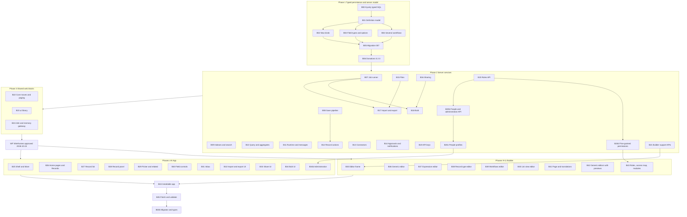

# Release 1 — building blocks and implementation prompts (in order)

This splits the release (`ngo-app-ui-implementation.md`, 13 phases) into 46 building blocks, in build order, plus four added on 2026-10-24 for people, profiles, administration and access: B20b (People and administration API), B20c (People profiles and the `person` field type), B20d (Fine-grained permissions) and B34b (Administration in the app), and B00b added on 2026-10-25, 51 in all. The Builder keeps only definitions; people, role assignment and operational settings are in Administration. Release 1 introduces Kysely for fixed engine tables in B00. B00b hands migration execution to Kysely's migrator. Fixed-table types stay on `npm run db:types`. The migration files and dynamic record SQL remain parameterised SQL. Each block has:
- its dependencies;
- what it delivers;
- the release checkpoints that prove it is done;
- a **ready-to-paste prompt** for an implementation agent.

Planning change 2026-10-25: B00 was added to Phase 1 after the 2026-10-24 validation report. That report remains historical evidence for the implementation before Kysely; B45 must be rerun after B00 and the resulting fixed-table conversions are complete. B00b, the same day, replaces the hand-rolled migrator that B00 left in place. Type generation stays on the repo generator. B00–B45 and B00b are done.

Run the blocks top to bottom. Blocks in the same group with no dependency on each other can run in parallel (marked ∥).

- Release checks: `.cursor/skills/validating-ngo-release/` (checkpoint IDs such as S8, W12).
- Design: `.cursor/docs/design/ngo-app-ui-design.md`.
- Wireframes: `.cursor/docs/design/wireframes/ngo-app-navigation-flows.html`, `.cursor/docs/design/wireframes/ngo-builder-screens.html`.

## Order at a glance



## Common rules (every prompt applies these)

These rules are included by reference in every prompt below ("Apply the common rules").

1. **Where and how:**
   - Work in `ngo-platform/` (Node 22, Fastify, Kysely plus parameterised SQL, PGlite and PostgreSQL; Angular 21 zoneless web app in `web/`).
   - Read the architecture sections named in the prompt before coding; the design wins over the architecture, and the architecture wins over these prompts.
2. **Workspace rules:**
   - No remote assets or runtime calls to the public internet (system fonts, local icon font, no CDNs, no map tiles).
   - No MCP tools.
   - No `git push`.
   - Commit locally with explicit paths only (never `git add -A`).
   - Queue any file deletion and ask for approval before deleting.
   - Never start, stop or re-seed the user's running dev server without asking.
3. **Code:**
   - Match the surrounding code style and comment density.
   - Comments only for constraints the code cannot show.
   - After B00, use Kysely for fixed-table application queries. Keep migration files, tenant preamble, dynamic record list/count/aggregate SQL, database-function calls, managed-index DDL, and journal and receipt triggers as parameterised SQL. After B00b, Kysely's migrator runs those migration files. `npm run db:types` still writes the fixed-table types.
   - `core/**` stays framework-free; Material only under `web/src/app/ui/`; `/api/` only in `core/**/http-*.ts`; only stores call the router; the server is authoritative for every rule.
4. **Tests:**
   - New behaviour gets tests at the level named in the prompt.
   - Never weaken an existing test, budget or check to pass.
5. **Done means:**
   - `npx tsc --noEmit` and `npx vitest run` pass (and `npm --prefix web run build` when web code changed);
   - the release checks for the listed checkpoints pass: `node .cursor/skills/validating-ngo-release/scripts/check-release.mjs --root ngo-platform --phases <phase>` (run from the workspace root);
   - the manual checkpoints are described in the summary for the user to confirm.
6. **Finish:** a short summary with what changed, the test count, the checkpoint results, deletions waiting for approval, and the commit hash.

---

## Phase 1 — Typed persistence and server model

### B00 Kysely typed-SQL foundation

- **Status:** done 2026-10-25 on branch `kysely` (steps P0, K0–K7 of `ngo-kysely-migration-plan.md`, §9 there). PGlite was removed, and the tests run on local PostgreSQL: a `<name>_test` database derived from `DATABASE_URL`, with a schema per test world. That replaces the "PGlite and, when `TEST_DATABASE_URL` is set, PostgreSQL" wording below. K1–K5 are evidenced by `test/kysely.test.ts`, `test/kysely-architecture.test.ts`, `test/kysely-plans.test.ts`, `test/indexes.test.ts` and the full suite: 1,114 tests, none skipped. Raw SQL is down from 372 calls to 32 in 11 allow-listed files. B45 was rerun; see `.cursor/docs/reports/release-validation-2026-10-25.md`.
- **Depends on:** none.
- **Delivers:** compile-time column checks for the fixed engine tables already present at the Release 1 baseline, on top of the existing `Database` port. Every later migration regenerates the checked-in types, and later blocks use this path for new fixed-table application queries.
- **Checkpoints:** K1–K5 below.

#### Checkpoints

- **K1 One transaction path:** Kysely executes through the existing `SqlExecutor` inside `withTenant()` and `asSystem()`. It does not create a second pool or bypass `TENANT_PREAMBLE`.
- **K2 Generated fixed-table types:** Database types cover every fixed table present when B00 runs, are checked in, and have a repeatable generation command. Every later migration regenerates them. A stale type file fails a documented verification check.
- **K3 Existing fixed queries typed:** Existing fixed-table selects, inserts, updates and deletes use Kysely area by area without changing behaviour, transaction boundaries, locking or audit semantics. Later blocks use Kysely for new fixed-table queries.
- **K4 Exact SQL preserved:** Migrations, tenant preamble, dynamic record list/count/aggregate SQL, database-function calls, managed-index DDL, and journal and receipt triggers remain parameterised SQL. Existing record-filter and search query plans are unchanged.
- **K5 Compatibility and isolation:** Typecheck and the existing suite pass on PGlite and, when `TEST_DATABASE_URL` is set, PostgreSQL. A Kysely tenant transaction cannot read or write another tenant.

#### Integration boundaries

Build Kysely on the existing `Database` port in `src/kernel/db.ts`:

- `withTenant()` and `asSystem()` remain the only supported ways to open a transaction;
- construct a transaction-scoped Kysely executor over the `SqlExecutor` that is already inside that transaction;
- tenant-scoped Kysely calls run only after `TENANT_PREAMBLE` has set the runtime role and tenant id;
- PostgreSQL and PGlite use the same application path;
- do not open another connection pool;
- do not use Kysely's migrator (B00b lifts this for running the existing SQL files);
- do not add Prisma, TypeORM or another ORM.

Generate and check in types for every fixed table declared by the migrations present when B00 runs, including `record` and `record_link` for their actual fixed columns, with dynamic record data represented as JSON. The migration SQL remains the schema source of truth. B05 and every later block that adds or changes a fixed table must regenerate and commit the types in the same change.

Leave these paths as parameterised SQL:

- `TENANT_PREAMBLE`;
- migration files;
- record list, count and aggregate clause construction;
- `buildQuery` and `metadata/index-expressions.ts`;
- calls to `app_record_ids`, `app_record_count` and `app_record_agg`;
- managed-index DDL;
- journal and receipt triggers;
- any query whose dynamic structure cannot be represented without weakening its existing safety or query plan.

Move fixed-table queries one bounded area at a time. Run the relevant tests after each area. Do not combine this block with schema redesign, naming changes, query optimisation or business behaviour changes.

#### Tests

Add tests for:

- tenant and system transactions through Kysely on PGlite;
- tenant row-level security preventing cross-tenant reads and writes;
- transaction rollback and locking behaviour staying unchanged;
- generated types matching the migration baseline;
- generation-check failure when a known fixed column is changed without regeneration;
- JSON columns and nullable columns preserving their runtime shapes;
- existing identity, definitions, ledger, receipts, workflow and automation behaviour;
- PostgreSQL compatibility when `TEST_DATABASE_URL` is configured;
- unchanged record filter and search plans.

#### Ready-to-paste implementation prompt

```text
Implement block B00 of NGO Platform release 1. Apply the common rules in
.cursor/docs/plans/ngo-release-1-build-blocks.md.

Read the Persistence row in section 10 of
ngo-platform/docs/architecture/ngo-management-platform.md and inspect
src/kernel/db.ts, both database adapters, every migration present at this point,
and representative fixed-table and dynamic-record queries before coding.

Build Kysely on the existing Database port. withTenant() and asSystem() remain
the only transaction entry points. Kysely must use the SqlExecutor already
inside that transaction after TENANT_PREAMBLE; do not open a second pool.

Generate and check in types for every fixed table in the current migration
baseline. Move existing fixed-table application queries to Kysely one bounded
area at a time with no behaviour change. Keep migrations, TENANT_PREAMBLE,
dynamic record list/count/aggregate SQL, database-function calls, managed-index
DDL, and journal and receipt triggers as parameterised SQL. Do not use Kysely's
migrator or add another ORM.

Add a repeatable generation and stale-type verification command. Every later
migration in Release 1 must regenerate and commit the fixed-table types.

Done: K1–K5 are evidenced; typecheck and the full existing suite pass on PGlite
and, when TEST_DATABASE_URL is configured, PostgreSQL; record filter and search
plans are unchanged. Commit "Typed SQL foundation with Kysely".
```

B00b, at the bottom of this file, supersedes the migrator and type-generator sentences in the prompt above. The transaction path and the parameterised-SQL boundaries still stand.

### B01 Definition model foundation

- **Status:** done.
- **Depends on:** B00 (finishes the uncommitted partial work in `src/metadata/*`, `schemas/*`, `src/engines/records/record-service.ts`).
- **Delivers:** the `recordGroup` kind, field `copyFrom`, list view `related` sections and `compactColumns`, with cross-reference checks.
- **Checkpoints:** S1 (recordGroup part), S4, S5.

```text
Implement block B01 of NGO Platform release 1. Apply the common rules in .cursor/docs/plans/ngo-release-1-build-blocks.md.

Read Architecture §2.1, §2.2 and §2.4 in .cursor/docs/architecture/ngo-app-ui-implementation.md. Some of this is already partly coded and uncommitted in ngo-platform (recordGroup kind, copyFrom types, schemas, cross-refs, copyFromReferences in record-service.ts): review it, keep what is right, finish the rest.

Build:
- recordGroup kind: types, schemas/recordGroup.schema.json, cross-refs (record types must be published), install order last.
- FieldDef.copyFrom { reference, field } with the cross-ref checks in §2.1 (reference field, published referenceType, source exists, compatible type, not calculated).
- ListViewDef detail sections as a union: field sections or related { recordType, field, total? } with checks; compactColumns with the same checks as columns (max 6).
- Server copy-from-reference step in RecordService.prepare exactly as §2.2 (after visibleWhen, before calculate; only when the reference changes; permission and type checks).
- Runtime definitions: recordGroups resolved per person (§2.4: order, readable types only, first group wins, "Other").

Tests (test/*.test.ts): copyFrom on create, change, unchanged keeps old values, no read permission, wrong type, deleted record; recordGroup resolution; schema and cross-ref errors for each new rule.
Done: checkpoints S4 and S5 by review; tests pass. Commit "Definition model: record groups, copy from reference, related sections, compact columns".
```

### B02 New definition kinds: translation, action, page

- **Status:** done.
- **Depends on:** B01.
- **Delivers:** types, schemas, cross-references and install order for `translation`, `action` and `page`.
- **Checkpoints:** S1, S2.

```text
Implement block B02 of NGO Platform release 1. Apply the common rules in .cursor/docs/plans/ngo-release-1-build-blocks.md.

Read Architecture §2.11 (translation), §2.12 (action) and §2.13 (page).

Build:
- Add 'translation', 'action', 'page' to DEFINITION_KINDS with TypeScript types exactly as in those sections (ActionDef with placement including 'bulk' from §2.20, ActionStep union, PageDef and Widget union, ViewRef).
- schemas/translation|action|page.schema.json with descriptions on every property (they drive the generic editor later) and annotations x-expression, x-ref, x-group, x-order where the architecture implies them.
- Cross-refs: translation entries warn when the path no longer exists; action recordType, steps (templates, connectors, steps exist), expressions; page widgets (record types, list views, fields summable or groupable, roles).
- Install order: translation, action, page after listView and recordGroup.

Tests: schema validation and cross-ref errors per kind; a module containing each kind loads.
Done: checkpoints S1, S2 pass. Commit "Definition kinds: translation, action, page".
```

### B03 Field types and options ∥ B04

- **Status:** done.
- **Depends on:** B01.
- **Delivers:**
  - field options `unique`, `pattern`, `rollup` and the type `multiChoice`;
  - the types `file`, `location`, `signature` and `richText`;
  - record type `visibility`.

  This covers model, schema, validator and cross-references only; behaviour comes in B08.
- **Checkpoints:** S3, S6b, S29.

```text
Implement block B03 of NGO Platform release 1. Apply the common rules in .cursor/docs/plans/ngo-release-1-build-blocks.md.

Read Architecture §2.15, §2.18 (file field shape), §2.19 (visibility), §2.21.

Build (model only; save-time behaviour is block B08):
- FieldType adds multiChoice, file, location, signature, richText. FieldDef adds unique, pattern, patternMessage, rollup { recordType, reference, measure, field?, where? }, multiple, accept, maxSizeMb.
- RecordTypeDef adds visibility: 'organisation' | 'restricted' (default organisation).
- recordType.schema.json for all of the above with descriptions.
- record-validator.ts value schemas per new type (location bounds and 6 decimals; signature shape; multiChoice array of choice values; file id or array; richText string max 50,000).
- Cross-refs: unique only on text/email/phone/number; pattern length ≤ 200 and safety check (reject nested quantifiers); rollup target type and reference exist and the reference points back; file options valid.

Tests: validator per type; cross-ref errors; existing tests still pass.
Done: checkpoints S3, S6b, S29 pass. Commit "Field types and options: unique, pattern, rollups, multi-choice, file, location, signature, rich text, visibility".
```

### B04 Several workflows per record type ∥ B03

- **Status:** done.
- **Depends on:** B01.
- **Delivers:** the model for primary and parallel workflows, and `workflow` references on chips, rules and triggers.
- **Checkpoints:** S31 (model part).

```text
Implement block B04 of NGO Platform release 1. Apply the common rules in .cursor/docs/plans/ngo-release-1-build-blocks.md.

Read Architecture §2.22.

Build (model and checks; engine behaviour is block B08):
- WorkflowDef gains role ('primary' | 'parallel'), appliesWhen, startsWhen. Definition store allows several workflows per record type; workflowFor() returns the primary for compatibility; add workflowsFor(recordType).
- Chips gain workflowState { workflow, in }; posting and receipt rules gain workflow; automation statusChanged trigger gains workflow; RecordQuery gains states { [workflow]: string[] }.
- Cross-refs: at most one primary without appliesWhen; several primaries each need appliesWhen; parallel needs no appliesWhen; step keys unique across all workflows of a record type; every workflow reference resolves.
- Schemas for all new properties.

Tests: cross-ref cases; the Donations module still loads and behaves unchanged.
Done: checkpoint S31 (types part) passes. Commit "Several workflows per record type: model and checks".
```

### B05 Migration 007

- **Status:** done.
- **Depends on:** B02, B03, B04.
- **Delivers:** every table and column the release needs.
- **Checkpoints:** S6, S31 (migration part).

```text
Implement block B05 of NGO Platform release 1. Apply the common rules in .cursor/docs/plans/ngo-release-1-build-blocks.md.

Read Architecture §2.7, §2.10, §2.11, §2.13, §2.14, §2.16–§2.20, §2.22 for the tables and columns.

Build migrations/007_ui.sql (row-level security like the existing tables, app_runtime grants):
- record.search_text text + pg_trgm trigram index (guard if pg_trgm is unavailable: create the column, skip the index, log at start-up); record.workflow_key text; record.workflow_state jsonb not null default '{}'.
- managed_index; role.customised; member.locale, tenant.default_locale; member_pin; connector, connector_delivery; job, job_item; api_key; import (and import column mapping storage); file_object; record_share.
- Indexes needed by these tables themselves (not managed field indexes).
- Regenerate and commit the B00 Kysely fixed-table types after the migration; use them for application queries against the new tables.

Tests: migration runs on PGlite and on TEST_DATABASE_URL when set; RLS blocks cross-tenant reads on every new table.
Done: checkpoint S6 and the migration part of S31 pass. Commit "Migration 007 for release 1".
```

### B06 Donations module 0.2.0

- **Status:** done.
- **Depends on:** B05.
- **Delivers:**
  - the Donor record type, the donors list view and the Fundraising group;
  - the donation changes;
  - three actions: Send reminder, Pay now, Print receipt;
  - rollups, unique PAN, the PAN pattern;
  - roles.
- **Checkpoints:** S7.

```text
Implement block B06 of NGO Platform release 1. Apply the common rules in .cursor/docs/plans/ngo-release-1-build-blocks.md.

Read Architecture §2.9, §2.12 (the three actions), §2.15 (Donor rollups, unique, pattern).

Build in modules/donations:
- donor.recordType.json (name, email, phone, PAN sensitive + unique, address, city, notes; totalGiven and donationCount rollups over donation.donor where status is paid), donors.listView.json (with the related Donations section and total), fundraising.recordGroup.json.
- donation.recordType.json: donor reference; donor fields with copyFrom and editableWhen "isEmpty(record.donor)"; PAN pattern.
- donations.listView.json changes from §2.9 (layout table, compactColumns, donor preset, create and edit fields).
- send-reminder, pay-now, print-receipt *.action.json.
- module.json 0.2.0 with roles (Finance record:donor:*, action permissions; Viewer read).

Tests: install 0.2.0 fresh; upgrade from 0.1.0 keeps existing donations and organisation patches; actions and rollups validate.
Done: checkpoint S7 passes. Commit "Donations module 0.2.0: donors, actions, rollups".
```

---

## Phase 2 — Server services

### B07 Job runner

- **Status:** done.
- **Depends on:** B05.
- **Delivers:** the shared runner for background jobs, its routes, and the notification when a job finishes.
- **Checkpoints:** S23.

```text
Implement block B07 of NGO Platform release 1. Apply the common rules in .cursor/docs/plans/ngo-release-1-build-blocks.md.

Read Architecture §2.16.

Build src/kernel/jobs.ts: job registry by kind, claim with SKIP LOCKED on the outbox dispatcher's tick, batches of 100 rows per transaction within a time budget, resume after restart, cancel, progress, job_item results, one import or bulk job per organisation at a time, in-app notification to the creator when finished. Routes GET /api/jobs/:id, GET /api/jobs/:id/items?status=failed, POST /api/jobs/:id/cancel (creator or admin:jobs).

Tests: a fake job kind runs in batches, resumes after an interrupted tick, cancels, respects the per-organisation limit, notifies.
Done: checkpoint S23 passes. Commit "Background job runner".
```

### B08 Save pipeline

- **Status:** done.
- **Depends on:** B03, B04, B05.
- **Delivers:**
  - unique, pattern, rollups, rich-text sanitising, signature and location rules;
  - the search text;
  - workflow selection and parallel starts, and steps across workflows;
  - visibility checks on single-record operations.
- **Checkpoints:** S8, S17, S18, S30 (server part), S32.

```text
Implement block B08 of NGO Platform release 1. Apply the common rules in .cursor/docs/plans/ngo-release-1-build-blocks.md.

Read Architecture §2.2, §2.15, §2.19 (engine checks), §2.21, §2.22.

Build in src/engines/records and src/domain:
- unique (friendly message, blanks allowed), pattern with patternMessage and a time limit, rollups maintained in the same transaction on child create/update/delete/re-point with a rollup.rebuild job on publish.
- domain/rich-text.ts allow-list sanitiser (exact list in §2.21), plain text for search; signature: file must exist and be a PNG ≤ 200 kB, signedAt/signedBy set by the server, clear-only afterwards; location bounds.
- search_text filled on every save (searchable values + number, lower-cased); search.rebuild job when searchable fields change.
- Workflows: choose the primary by appliesWhen at create (fixed after), start parallel workflows on startsWhen, run steps across workflows by step key, expressions states.<key> and workflow.
- Restricted visibility checks for get, update, step and (later) action and files: creator, shares, read:all, approvers.
- permissions-policy header geolocation=(self).

Tests: each rule; the rich-text attack corpus (script, on* attributes, javascript: links, style, img, iframe); Donations module unchanged behaviour.
Done: checkpoints S8, S17, S18, S30 (server and policy), S32 pass. Commit "Save pipeline: field options, rich text, signatures, workflows, visibility".
```

### B09 Managed indexes and search ∥ B10–B14

- **Status:** done.
- **Depends on:** B07, B08.
- **Delivers:** the index manager and trigram search.
- **Checkpoints:** S9, S10.

```text
Implement block B09 of NGO Platform release 1. Apply the common rules in .cursor/docs/plans/ngo-release-1-build-blocks.md.

Read Architecture §2.10.

Build src/metadata/index-manager.ts: compute needed indexes after recordType or listView publish (references, unique fields, filtered and sorted fields, location lat/lng, parallel workflow state used by chips/filters/sorts); index key includes type key, field and cast; create concurrently in index.build jobs under the owning role; cap 25 per record type with a Builder warning; drop indexes unused for 30 days; managed_index bookkeeping. Query search uses search_text ilike with the trigram index, falling back when pg_trgm is missing.

Tests: indexes created, shared across organisations with the same key and cast, not shared across different casts, capped, dropped; explain plans use them for filter, sort and search.
Done: checkpoints S9, S10 pass. Commit "Managed indexes and trigram search".
```

### B10 Query, aggregates and visibility SQL ∥

- **Status:** done.
- **Depends on:** B08.
- **Delivers:**
  - query `sum`, the `near` filter, distance sort and `states` filters;
  - one SQL helper for visibility;
  - the aggregate endpoint.
- **Checkpoints:** S11, S27 (SQL part).

```text
Implement block B10 of NGO Platform release 1. Apply the common rules in .cursor/docs/plans/ngo-release-1-build-blocks.md.

Read Architecture §2.3, §2.13 (aggregate), §2.19, §2.21 (near, distance), §2.22 (states).

Build: one visibility SQL helper used by query, aggregate, export and related sections; query adds sum, near and distance sort, states filters, reference filters; POST /api/records/:type/aggregate (count/sum, groupBy field or period day/week/month/financialYear) with permission and readable-field checks and a 5-minute cache per request shape.

Tests: sums over filtered sets; near and distance; states; restricted visibility in query and aggregate; financial-year buckets.
Done: checkpoint S11 passes. Commit "Query sums, location, workflow states, aggregates, visibility helper".
```

### B11 Runtime definitions and messages ∥

- **Status:** done.
- **Depends on:** B02, B04.
- **Delivers:** runtime `recordGroups`, `workflowSets` and pages; translated labels; the messages endpoint; the person's language.
- **Checkpoints:** S15.

```text
Implement block B11 of NGO Platform release 1. Apply the common rules in .cursor/docs/plans/ngo-release-1-build-blocks.md.

Read Architecture §2.4, §2.11, §2.13, §2.22 (runtime parts).

Build: GET /api/runtime/definitions?locale= returns translated labels, recordGroups, workflows (primary) plus workflowSets, pages visible to the person, actions per record type; GET /api/runtime/messages?locale= merges the shipped catalogue (web/src/locale/*.json read at start-up) with organisation translation overrides; member.locale read and PUT /api/me/locale; notifications and templates rendered in the recipient's language with English fallback.

Tests: translation resolution and fallback, overrides, recipient language, page audience filtering.
Done: checkpoint S15 passes. Commit "Runtime definitions: translations, pages, workflow sets".
```

### B12 Record actions and print view

- **Status:** done.
- **Depends on:** B08, B11.
- **Delivers:** the action runner, its step types, the print view, and action permissions.
- **Checkpoints:** S14.

```text
Implement block B12 of NGO Platform release 1. Apply the common rules in .cursor/docs/plans/ngo-release-1-build-blocks.md.

Read Architecture §2.12.

Build: POST /api/records/:type/:id/actions/:key — permission, when, form validation against the action's fields, steps in one transaction (setFields, transition, createRecord, notify, webhook, createPayment, openReceipt), notifications and webhooks via the outbox, response { record, message, open? }. Print view data route for /print/receipt/:id. action:<key> permissions in the catalogue.

Tests: each step type; permission and when; webhook failure does not roll back; print data access rules.
Done: checkpoint S14 passes. Commit "Record actions and receipt print view".
```

### B13 Connectors ∥

- **Status:** done.
- **Depends on:** B05.
- **Delivers:** SMS, WhatsApp and webhook connectors, delivery logs, and notification channels.
- **Checkpoints:** S16.

```text
Implement block B13 of NGO Platform release 1. Apply the common rules in .cursor/docs/plans/ngo-release-1-build-blocks.md.

Read Architecture §2.14.

Build: connector settings encrypted like the email connector; kinds sms (generic HTTP template), whatsapp (Business Cloud API), webhook (URL + HMAC secret); channels sms and whatsapp in notifications with phone recipients; webhook automation step; signed payloads x-ngo-signature; outbox retries with backoff; delivery log; routes GET/PUT /api/admin/connectors/:key, POST .../test, GET .../deliveries (admin:connectors). No call unless configured and enabled.

Tests: recorded fake HTTP client only (no real network): signing, retries, disabled connectors never call, secrets never returned.
Done: checkpoint S16 passes. Commit "Connectors: SMS, WhatsApp, webhooks".
```

### B14 Approvals and notifications ∥

- **Status:** done.
- **Depends on:** B04, B10.
- **Delivers:** the approvals query (who may approve worked out in SQL) and count; notifications read-all and paging.
- **Checkpoints:** S12, S13.

```text
Implement block B14 of NGO Platform release 1. Apply the common rules in .cursor/docs/plans/ngo-release-1-build-blocks.md.

Read Architecture §2.5, §2.6.

Build: POST /api/approvals/query returning exactly the ApprovalRow fields (record title from titleField, from/to status labels across several workflows), eligible (type, step) pairs computed once and filtered in SQL, search, filters type/step/requestedBy, sort, paging; GET /api/approvals/count; decide keeps its own check; POST /api/notifications/read-all; paging on GET /api/notifications.

Tests: eligibility in SQL matches decide on the same data; own and decided requests excluded; paging and sorting; count.
Done: checkpoints S12, S13 pass. Commit "Approvals query and count; notifications read-all".
```

### B15 Files

- **Status:** done.
- **Depends on:** B07, B08.
- **Delivers:** the `FileStore` (Cloud Storage and local), upload and download, quota, and clean-up.
- **Checkpoints:** S26.

```text
Implement block B15 of NGO Platform release 1. Apply the common rules in .cursor/docs/plans/ngo-release-1-build-blocks.md.

Read Architecture §2.18.

Build: FileStore port with a local-disk adapter and a Google Cloud Storage adapter (deployment settings; tests use local); POST /api/files streamed upload with size and quota checks and content-based type allow-list; GET /api/files/:id served same-origin with content-disposition and nosniff, access through the linked record (visibility and sensitive rules); link files on save; files.cleanup job for unlinked uploads after 24 hours; storage usage per organisation.

Tests: limits, disguised file types refused, quota, access via record, sensitive hiding, cleanup.
Done: checkpoint S26 passes. Commit "File attachments and storage".
```

### B16 Sharing

- **Status:** done.
- **Depends on:** B10.
- **Delivers:** the share routes, and restricted visibility in every read path.
- **Checkpoints:** S27.

```text
Implement block B16 of NGO Platform release 1. Apply the common rules in .cursor/docs/plans/ngo-release-1-build-blocks.md.

Read Architecture §2.19.

Build: GET/POST/DELETE /api/records/:type/:id/shares (record:<type>:share or creator), expiry, notification to the person shared with; ensure the visibility helper covers query, aggregate, export, related, and the engine covers get, update, step, action, files; "Shared with me" chip support in runtime list views for restricted types; permission catalogue adds read:all and share.

Tests: one test that runs every read path for a restricted type with creator, share by person, share by role, expired share, read:all and approver.
Done: checkpoint S27 passes. Commit "Record sharing and restricted visibility".
```

### B17 Import and export

- **Status:** done.
- **Depends on:** B07, B10, B15.
- **Delivers:** upload, column matching, checking, running and failed rows for imports; CSV export.
- **Checkpoints:** S25.

```text
Implement block B17 of NGO Platform release 1. Apply the common rules in .cursor/docs/plans/ngo-release-1-build-blocks.md.

Read Architecture §2.17 (import and export parts).

Build: POST /api/records/:type/imports (multipart ≤ 10 MB, ≤ 20,000 rows), PUT /api/imports/:id/mapping (auto-match by label/key; reference matching by number, title or unique field; choices by label or value; dd/mm/yyyy and ISO dates; update-by-unique), POST .../check (prepare without saving, counts and first 200 problems), POST .../run (import job, quiet mode with its permission, rollups and search rebuilt once), GET .../failed.csv; GET /api/records/:type/export.csv with the list query, masking, and a job above 50,000 rows.

Tests: mapping cases, check without side effects, update-by-unique, quiet mode permission, failed CSV, export masking and the job path.
Done: checkpoint S25 passes. Commit "CSV import and export".
```

### B18 Bulk operations

- **Status:** done.
- **Depends on:** B07, B12, B16.
- **Delivers:** bulk edit, step, action, share and export over selected ids or a query.
- **Checkpoints:** S28.

```text
Implement block B18 of NGO Platform release 1. Apply the common rules in .cursor/docs/plans/ngo-release-1-build-blocks.md.

Read Architecture §2.20.

Build: POST /api/records/:type/bulk with ids or query (cap 5,000), operations edit, step, action (placement bulk), share, export, optional input; ≤ 50 run inline with per-record results, more as a bulk job; every record through the normal pipeline and approvals; record:<type>:bulk plus per-record permission.

Tests: mixed permissions, approvals create one request per record, job path and progress, failures reported.
Done: checkpoint S28 passes. Commit "Bulk operations".
```

### B19 API keys, idempotency, OpenAPI ∥

- **Status:** done.
- **Depends on:** B05.
- **Delivers:** API keys, idempotency keys, and a generated OpenAPI document.
- **Checkpoints:** S24.

```text
Implement block B19 of NGO Platform release 1. Apply the common rules in .cursor/docs/plans/ngo-release-1-build-blocks.md.

Read Architecture §2.17 (API keys part).

Build: api_key with hashed secret, role, last used, revoke; Authorization: ApiKey <id>.<secret> resolves an actor api:<name> with the role's permissions and its own rate limit; GET/POST/DELETE /api/admin/api-keys (secret shown once, admin:api-keys); Idempotency-Key for create, update and step (24 hours); GET /api/openapi.json generated per organisation from published record types, workflows and actions.

Tests: key auth, revoke, rate limit, audit actor, idempotent replays, OpenAPI matches the Donations module.
Done: checkpoint S24 passes. Commit "API keys, idempotency, OpenAPI".
```

### B20 Roles API ∥

- **Status:** done.
- **Depends on:** B05.
- **Delivers:** the roles and members routes, the permission catalogue, and the `customised` flag.
- **Checkpoints:** S19.

```text
Implement block B20 of NGO Platform release 1. Apply the common rules in .cursor/docs/plans/ngo-release-1-build-blocks.md.

Read Architecture §2.7 and §5.

Build: GET/POST /api/admin/roles, GET/PUT/DELETE /api/admin/roles/:key (no delete with members), GET /api/admin/permission-catalogue generated from definitions (read, create, update, sensitive, read:all, share, import, export, bulk, transition:<step>, action:<key>, money, setup), GET /api/admin/members and PUT /api/admin/members/:userId/roles; role.customised set on edit and respected by module re-sync; admin:roles.

Tests: catalogue for the Donations module; customised roles survive re-sync; delete blocked.
Done: checkpoint S19 passes. Commit "Roles and access API".
```

### B20b People and administration API ∥

- **Status:** done.
- **Depends on:** B20, B07 (jobs list). Added 2026-10-24 for user management and the Administration area (app Journeys 21 and 23); can run any time after B20.
- **Delivers:** adding, inviting, suspending and reactivating people over HTTP, a members list with status and two-step state, a read-only directory for `people:read`, role membership routes, one permission rule for changing a person's roles, and the audit log, organisation settings and everyone's-jobs routes for Administration.
- **Checkpoints:** S19b.

```text
Implement block B20b of NGO Platform release 1. Apply the common rules in .cursor/docs/plans/ngo-release-1-build-blocks.md.

Read Architecture §2.7 and §5; Design §8b (Administration); app Journeys 21 and 23 in .cursor/docs/design/wireframes/ngo-app-navigation-flows.html.

Build on the existing IdentityService (addMember, inviteMember, suspendMember; members:manage) and RolesService (members, setMemberRoles; admin:roles):
- GET /api/admin/members gains status (active | invited — added but never signed in | suspended), two-step state (on, off, required-not-set when one of their roles requires it), joined or invited date; search q (name, email), filters role[] and status[], sort name | joined | status, and paging (limit, offset, total).
- POST /api/admin/members { email, displayName, roles[], invite?: boolean } → 201 { userId } (existing account in another organisation keeps its sign-in; an existing active member → 409 "already a member"; a suspended member → 409 with reactivate hint); invite sends the set-password email.
- POST /api/admin/members/:userId/invite (exists) also serves "Resend invitation" (a new single-use link; the old one stops working).
- POST /api/admin/members/:userId/suspend (signs them out everywhere; never yourself) and POST /api/admin/members/:userId/reactivate.
- PUT /api/admin/members/:userId/roles accepts members:manage or admin:roles (keep the lock-out guard).
- GET /api/people (the directory, people:read): active members only (never invited or suspended), with userId, name, email and roles only — no status, two-step state, invitation or join details; search q, filter role[], sort name, paging. B20c adds the profile fields marked "Shown in the directory".
- New permission people:read, listed as "See people" in the Setup group; not given to every role by default. Donations module 0.2.1 (version bump from 0.2.0, with an upgrade test from 0.2.0): its Viewer and Finance roles gain people:read; customised roles are left alone as usual.
- Role membership (Administration › Roles): GET /api/admin/roles/:key/members, POST /api/admin/roles/:key/members { userIds[] } (active or invited people), DELETE /api/admin/roles/:key/members/:userId; members:manage or admin:roles; the same lock-out guard as PUT /api/admin/members/:userId/roles.
- Administration routes: GET /api/admin/audit (filters person including api:<name>, area, record type, date; paging; admin:audit), GET and PUT /api/admin/settings (name, default language, storage quota, API requests per minute per key; admin:settings; audited), GET /api/admin/jobs (everyone's jobs with progress, filters kind, started by, date; paging; admin:jobs). New permissions admin:audit and admin:settings in the Setup group (names final, decided 2026-10-24).
- Permission catalogue: list members:manage as "Manage people" in the Setup group, admin:roles as "Manage roles". GET /api/me capabilities gain peopleDirectory (people:read), people (members:manage), roles (admin:roles), connectors (admin:connectors), apiKeys (admin:api-keys), jobs (admin:jobs), audit (admin:audit) and settings (admin:settings), so More shows "People · directory" and "Administration" and Administration shows only the allowed areas.
- Audit every change. No delete: people are suspended, so records, approvals and the audit log keep their names.

Tests: add (new account, existing account from another organisation, duplicate, suspended), invite and resend (old link stops working), suspend signs out (refresh tokens revoked) and blocks sign-in, reactivate, list status and two-step state, filters, sort and paging, permissions (members:manage vs admin:roles vs people:read), lock-out guard (person roles and role membership); directory returns active people only and no administrator fields; role membership add and remove; audit filters; settings validation and audit; jobs list permission; module upgrade 0.2.0 → 0.2.1 grants people:read to Viewer and Finance.
Done: tests pass; checkpoint S19b (people and administration routes present) passes. Commit "People and administration API".
```

### B20c People profiles ∥

- **Status:** done.
- **Depends on:** B20b, B03, B08. Added 2026-10-24.
- **Delivers:** one profile per person (record type `person`), the field options `selfEditable` and `directory`, the self-edit rule, `GET/PUT /api/me/profile`, the profile fields in the directory, and the `person` field type end to end.
- **Checkpoints:** S19c.

```text
Implement block B20c of NGO Platform release 1. Apply the common rules in .cursor/docs/plans/ngo-release-1-build-blocks.md.

Read Architecture §2.23, §2.7 and §5; Design §8a (People and profiles); app Journeys 21 and 22; Builder screen 27 (Profile fields).

Build:
- The platform-shipped record type person (not a module, so every organisation has it): fields Kind (choice Staff, Volunteer, Board), Department, Designation, Phone (sensitive, selfEditable, directory), Emergency contact (sensitive, selfEditable), Photo (file, images, selfEditable, directory), Joining date, Employee ID (visibleWhen Kind is Staff); organisations patch it like any shipped definition; it cannot be removed and has no numbering or workflow. A list view for it with a create form (used by "Add a person").
- One profile per member linked by userId (unique managed index); created in the same transaction as POST /api/admin/members from the profile values sent with it; empty profiles created for existing members on upgrade.
- Field options selfEditable and directory (boolean, default false) in types, schema and validator; the cross-reference check rejects them on any record type other than person.
- Self-edit rule in the save pipeline (before field conditions): without members:manage, only your own profile and only selfEditable fields; otherwise 422 naming the field ("Department is set by your administrator."). Profiles of suspended people are read-only.
- Routes: GET and PUT /api/me/profile (own profile, selfEditable flags, PUT accepts only selfEditable fields); GET and PUT /api/admin/members/:userId/profile (members:manage); GET /api/people adds the directory fields, masking sensitive ones without record:person:sensitive and applying visibleWhen; /api/records/person is refused for people without members:manage.
- Field type person (any record type): value is a user id; the validator checks an active member when set or changed; runtime definitions and query results carry { id, name }; GET /api/people?pick=1&q= for the picker (anyone who can edit such a field); query filter in [userId…] with the token me resolved on the server; managed indexes as for references; usable as a filter, column, chip condition and expression value, not in copyFrom; import matches by email; notification recipient { type: 'personField', field }.

Tests: profile created on add and on upgrade; self-edit allowed and refused (other person, non-selfEditable field, suspended); directory fields and masking; options rejected outside person; person field validation (inactive member refused on change, kept when unchanged), filter me, import by email, notification to the person in a field.
Done: tests pass; checkpoint S19c passes. Commit "People profiles and the person field type".
```

### B20d Fine-grained permissions ∥

- **Status:** done.
- **Depends on:** B20, B08, B10, B11, B15. Added 2026-10-24. There is no permission definition kind: permissions stay generated or free-text strings.
- **Delivers:** permissions on record panel sections, fields (`readPermission`, `editPermission`), page widgets and links, enforced on the server and reflected in runtime definitions; the permission suggestions route for the Builder autocomplete; the access map route.
- **Checkpoints:** S19d.

```text
Implement block B20d of NGO Platform release 1. Apply the common rules in .cursor/docs/plans/ngo-release-1-build-blocks.md.

Read Architecture §2.1 (section, field, widget and link permission rows), §2.7 (permission catalogue, suggestions, access map), §2.19 (field and part visibility), §5; Design §8a (Permissions on parts of screens, Access map); Builder screens 18, 24, 25, 26.

Build:
- Types, schemas and cross-refs: list view section permission; field readPermission and editPermission (sensitive: true means readPermission record:<type>:sensitive unless set; the two may not disagree; editPermission not on calculated or rollup fields); page widget and link item permission. Cross-ref warns (never fails) when a permission string is neither generated nor held by any role.
- Enforcement: readPermission masks values in get, query rows, related sections and exports with the same mask as sensitive fields, '***' with no partial characters (decided 2026-10-24), refuses filter, sort, sum and group on that field for that person (403 naming it), leaves out file fields and refuses their downloads, and masks it in templates and notifications for recipients without it; editPermission refuses changes on create, update, step, action, bulk and import (422 naming the field); section, widget and link permissions remove them from runtime definitions, and aggregate requests for hidden widgets are refused.
- Runtime definitions per person omit chips, steps, actions, sections, widgets and links they cannot use, and mark fields masked or readOnly.
- GET /api/admin/permission-catalogue adds a "Used in definitions" group with every other permission string found; GET /api/admin/permission-suggestions?q= (generated plus used strings, each with where used and how many roles hold it; config:read); GET /api/admin/access-map?area=&recordType=&role= (every element, its required permission, whether overridable, roles holding it, warnings; with role, what that role sees; config:read).

Tests: masking in every read path (get, query, related, export, files, aggregate, templates), filter/sort/sum refused, editPermission refused in every write path, section/widget/link removal from runtime definitions, sensitive equivalence, suggestions content, access map warnings and role view.
Done: tests pass; checkpoint S19d passes. Commit "Fine-grained permissions: sections, fields, widgets, links; suggestions and access map".
```

### B21 Builder support APIs

- **Status:** done.
- **Depends on:** B02.
- **Delivers:** check, changes (in plain language), "used by", expression check and try, template preview and test, script and posting-rule try, modules.
- **Checkpoints:** S20.

```text
Implement block B21 of NGO Platform release 1. Apply the common rules in .cursor/docs/plans/ngo-release-1-build-blocks.md.

Read Architecture §2.8.

Build all routes in the §2.8 table: check (errors and warnings with paths), changes against published or module with plain-language lines from metadata/describe.ts and impact warnings, usages (including literal field names in scripts), expressions check and try (server evaluator; real record needs read access), templates preview and test (test goes to the signed-in person through configured email), scripts try (sandbox limits, config:script:publish), posting-rules try (balance), modules list, enable, disable, update review.

Tests: each route, permissions, describe text for each kind.
Done: checkpoint S20 passes. Commit "Builder support APIs".
```

---

## Phase 3 — Shared web blocks

### B22 Core moves, address primitives, paging, row view

- **Status:** done.
- **Depends on:** phase 2.
- **Delivers:**
  - `core/api.ts` and `core/session.ts` move to `services/`;
  - `core/address.ts` and `PagedController<T>`;
  - `RowView` with adapters;
  - the record session gains `pickReference`, related sections and actions.
- **Checkpoints:** A1, A3, W3 (part).

```text
Implement block B22 of NGO Platform release 1. Apply the common rules in .cursor/docs/plans/ngo-release-1-build-blocks.md.

Read Architecture §1 (rules), §3.1, §3.11, and the existing web/src/app/core/records/*.

Build: move core/api.ts and core/session.ts to web/src/app/services/ (update imports); core/address.ts typed parameter codecs (text, list, flag, range, sort, depth) used by records url.ts; core/paging/PagedController<T> generalised from ListController (records keep behaviour; existing tests pass unchanged); core/rows.ts RowView and adapters for records (approvals, builder and admin adapters come with their blocks).

Tests: existing core tests unchanged and passing; new tests for address codecs and PagedController with two page sources.
Done: checkpoints A1, A3 pass; W3 partial. Commit "Core: address primitives, paging, row view; services moved out of core".
```

### B23 ui component library

- **Status:** done.
- **Depends on:** B22.
- **Delivers:**
  - the ported controls move from `records/cards` to `ui/`;
  - new controls: app-bar, nav, autocomplete, editable-table, widget;
  - the look tests move with them.
- **Checkpoints:** A2, A8 (partial until the field controls in B30), W1 (ui part), W2 (partial).

```text
Implement block B23 of NGO Platform release 1. Apply the common rules in .cursor/docs/plans/ngo-release-1-build-blocks.md.

Read Architecture §3.1, §3.2, §3.11; design §1–§3, §5, §6.

Build: move records/cards controls (chip-bar, list-filter-toolbar → list-toolbar, applied-filter-pills → filter-pills, list rows → card-rows, sheets → panel, cf-form and cf-field) into web/src/app/ui/ keeping markup and ported stylesheets byte-identical; table-rows (RowView, sort header, ⋮ menu, inside the panel style); infinite-scroll; ui/viewport.ts (narrow < 760, wide ≥ 1100); new app-bar, nav (bottom bar or rail), autocomplete (sources), editable-table (reorder, row panel), widget (stat, chart as inline SVG, list, links, groups). Update look tests to the new paths.

Tests: look tests (ported CSS unchanged), component logic in core where possible.
Done: checkpoints A2 and A8 (for these controls) pass. Commit "ui component library".
```

### B24 i18n core, locale files, in-memory gateway

- **Status:** done.
- **Depends on:** B22.
- **Delivers:** `core/i18n.ts`, the locale catalogues, the literal-text architecture test, and `core/testing/memory-gateway.ts`.
- **Checkpoints:** A7, W3, W4.

```text
Implement block B24 of NGO Platform release 1. Apply the common rules in .cursor/docs/plans/ngo-release-1-build-blocks.md.

Read Architecture §2.11, §3.13, §3.11 (memory gateway).

Build: core/i18n.ts t(key, params) with plural one/other and Intl number and date formats per locale; web/src/locale/en.json complete for all current screen text and hi, ta, te, bn, mr catalogues (machine-ready keys; mark untranslated entries for review rather than inventing translations); replace literal text in existing components with t(); architecture test that fails on literal English words in templates outside locale/ (small allow-list); core/testing/memory-gateway.ts implementing every gateway port over sample data.

Tests: i18n unit tests; the architecture test; memory gateway drives ListSession and RecordSession tests.
Done: checkpoints A7, W3, W4 pass. Commit "Translations core, locale catalogues, in-memory gateway".
```

### WF Remaining wireframes (approval gate) — done, approved 2026-10-24

- **Depends on:** phase 3.
- **Delivers:** wireframes for every release 1 screen that has none yet, approved by you before the app and Builder phases start.
- **Status:** done. The user approved the wireframes on 2026-10-24, including the later additions (people and profiles, Administration, the access map and field permissions, the breadcrumb). Phases 4–11 may start. The prompt below is kept for history.

```text
Create the remaining wireframes for NGO Platform release 1, in the same style and the same controls as .cursor/docs/design/wireframes/ngo-app-navigation-flows.html and .cursor/docs/design/wireframes/ngo-builder-screens.html (phone and desktop side by side; Builder on desktop). Apply the common rules in .cursor/docs/plans/ngo-release-1-build-blocks.md.

Screens (from Architecture §7 "Wireframes still needed"):
- App: Home with widgets and pins, a page view, language choice in More, record actions in the panel and the row menu, the print view, the import stepper and export, the file field and previews, the share panel, selection and the bulk bar, location/signature/rich-text fields, a record with two workflows.
- Builder: page editor, action editor, translations grid, connectors, API keys, workflows list for a record type.

Add them as new journeys and screens to the existing HTML files (do not remove existing ones), keep panels single column, follow Design §13a. Then stop and ask the user to approve before any of phases 4–11 start.
```

---

## Phases 4–8 — App (∥ with Builder phases 9–11 after WF)

### B25 Shell, navigation, More, language

- **Status:** done.
- **Depends on:** WF, B23, B24, B20c (My profile).
- **Checkpoints:** W5 (part), W6, W14, W22 (My profile), W24, W25, A10; Flow 9.1, Journey 22; the breadcrumb on every journey.

```text
Implement block B25 of NGO Platform release 1. Apply the common rules in .cursor/docs/plans/ngo-release-1-build-blocks.md.

Read Architecture §3.3, §3.8, §3.13, §2.23 (own profile); Design §3, §8a (Profiles, My profile), §8b; wireframes Flow 1.2 and 9.1, Journey 12 (language) and Journey 22 (My profile).

Build: shell/ with app bar and ui/nav (bottom bar below 760px, rail otherwise; Home, Records, Inbox, More), ShellStore (destinations, active, approvals badge from GET /api/approvals/count every 60 s and after decisions), routes /, /records, /inbox, /more, /pages/:key, /print/receipt/:id and the existing redirects; more/ screen (account card that opens My profile — no separate My profile entry, entries from /api/me capabilities — "People · directory" (/people) for people:read and "Administration" (/admin) for any administration permission — two-step, all record types, pages, Builder, language choice saved to the member, About, Sign out); language change without reload; My profile panel (?panel=profile) on ui/panel and cf-form over GET /api/me/profile: selfEditable fields editable, the others read-only with "Set by your administrator", Save sends only changed selfEditable fields to PUT /api/me/profile and shows "Profile saved.". Replace pages/shell.ts (queue the old file for deletion approval).

Breadcrumb (Design §3, Architecture §1 rule 6 and §3.3): core/breadcrumbs.ts (framework-free trail from the route, its address parameters and the runtime definitions, starting at the destination with no leading "Home" (decided 2026-10-24), for every route of the release including Administration and the Builder; back links keep a list's own parameters; labels through t()); ui/breadcrumb (nav landmark "Breadcrumb", links, aria-current on the last item, full trail when wide, first · "…" menu · last when narrow, ellipsis on long last items); the shell renders it under the app bar on every route except sign-in, reset password and /print/receipt/:id; ShellStore exposes crumbs and ScreenMeta gains crumbLabel for the last item.

Tests: ShellStore logic in core (People · directory and Administration entries from capabilities); core/breadcrumbs.test.ts with a case for every route family (lists with and without a group, record, create, each panel mode, Inbox tabs, pages, People, My profile, Language, every Administration area, Builder kinds and selections, kept list parameters, translated labels, none on sign-in and print); My profile form model (editable vs read-only fields); architecture checks, including that no screen imports ui/breadcrumb.
Done: checkpoints W5 (these routes), W6, W14 and the My profile part of W22 by manual check; A4 passes. Commit "Shell, navigation, More, language, My profile".
```

### B26 Home pages, pins, Records

- **Status:** done.
- **Depends on:** B25, B10, B11.
- **Checkpoints:** W7; Flows 1.2, 2.1.

```text
Implement block B26 of NGO Platform release 1. Apply the common rules in .cursor/docs/plans/ngo-release-1-build-blocks.md.

Read Architecture §3.4, §3.12, §2.13; Design §4, §13a.4; wireframes Flow 1.2, 2.1 and the new Home widgets and page view wireframes.

Build: core/pages.ts (page definition + roles + pins → widgets and aggregate requests); home/ screen drawing the home page widgets (or record groups when no page), personal pins first; /pages/:key view; Records screen (search over record types when more than eight, collapsible groups remembered per person, one column on every size, no counts); "Pin to Home" in the list ⋮ (personal, or draft of the home page for config:publish).
Breadcrumb: do not draw one; the shell's trail already covers Home, Records and More › <page>; supply nothing beyond ScreenMeta's title.

Tests: core/pages.ts and groups with the memory gateway.
Done: checkpoint W7 by manual check. Commit "Home pages and widgets, pins, Records screen".
```

### B27 One record list screen

- **Status:** done.
- **Depends on:** B23, B22.
- **Checkpoints:** A6, W8, W15; Flows 2.2–2.8.

```text
Implement block B27 of NGO Platform release 1. Apply the common rules in .cursor/docs/plans/ngo-release-1-build-blocks.md.

Read Architecture §3.5, §4; Design §5; wireframes Flows 2.2–2.8.

Build records/record-list.screen.ts for every size using ui/ controls only: chip-bar, list-toolbar (Cards/Table switch hidden when narrow, Sort menu, Filters with count), filter-pills, card-rows or table-rows on RowView, infinite-scroll, create button, Filters panel; narrow screens always cards; table columns wide vs compactColumns; breadcrumb: no own breadcrumb, the shell derives Records › group › type from the address (check that back links keep the list's parameters). Remove the table view and the record page (records/table/*, records/record.page.ts) — queue the deletions and ask for approval before deleting.

Tests: parity tests (cards and table give the same queries and URLs), address contract tests.
Done: checkpoints A6 (after approval), W8, W15 pass. Commit "One record list screen".
```

### B28 Record panel: modes, actions, workflows, print

- **Status:** done.
- **Depends on:** B27, B12.
- **Checkpoints:** W9, W10, W21; Flows 3.1–4.3.

```text
Implement block B28 of NGO Platform release 1. Apply the common rules in .cursor/docs/plans/ngo-release-1-build-blocks.md.

Read Architecture §3.6, §3.14, §3.22; Design §6, §13a.3, §13a.13; wireframes Flows 3.1–4.3 and the new actions and two-workflow wireframes.

Build records/record-panel.ts on ui/panel (one column; bottom sheet when narrow, centred up to 720px otherwise) with modes view, edit, step, create, action (panel=action:<key>), share later; footer: workflow steps grouped by workflow (primary first), configured actions, Edit; row ⋮ menu with actions where placement includes row; confirmations in the panel; open routes followed; one status line per workflow; print view screen at /print/receipt/:id using the browser print dialog (no breadcrumb there). Breadcrumb: set ScreenMeta crumbLabel to the open record's number and title once loaded; the panel mode item (Edit, step, action, Share) comes from core/breadcrumbs.ts.

Tests: core/records/actions.ts merging steps and actions with when and permission; RecordSession action mode.
Done: checkpoints W9, W10, W21 by manual check. Commit "Record panel: actions, several workflows, print view".
```

### B29 Record picker and related sections

- **Status:** done.
- **Depends on:** B28, B23.
- **Checkpoints:** W11, W12; Flows 5.2–6.2.

```text
Implement block B29 of NGO Platform release 1. Apply the common rules in .cursor/docs/plans/ngo-release-1-build-blocks.md.

Read Architecture §3.6 (picker, related); Design §8; wireframes Flows 5.2–5.3, 6.1–6.2.

Build ui/record-picker on ui/autocomplete (search limit 8, second line, New <type> "<text>" when creatable), with a people source for person fields (Architecture §2.23, §3.23: GET /api/people?pick=1, active members, name with email as the second line, never "New …", shown as the name once chosen, "Assigned to me" filter value me), RecordSession.pickReference with the client copy mirror (core/records/references.ts) locking fields by editableWhen and unlocking on clear; related sections (count, server sum, latest ten, open in own list, New … for this record via presets).

Tests: core references and related loading with the memory gateway; the people source (active only, no "New …").
Done: checkpoints W11, W12 by manual check. Commit "Record picker, person picker and related sections".
```

### B30 Field controls

- **Status:** done.
- **Depends on:** B23, B15.
- **Checkpoints:** W17, W20, A8 (complete).

```text
Implement block B30 of NGO Platform release 1. Apply the common rules in .cursor/docs/plans/ngo-release-1-build-blocks.md.

Read Architecture §3.18, §3.21, §2.15; Design §13a.7, §13a.9, §13a.12; the new field wireframes.

Build ui controls and their cf-field mapping: multiChoice (multiple select, pills), pattern errors, rollup display (read-only), unique errors; ui/file-field (choose, drag and drop, camera capture on phones, progress, previews for images and PDF, download); ui/location-field (use my location with accuracy, typed coordinates, label, Open in maps link only); ui/signature-field (canvas pad with pointer events, clear, typed name, uploads PNG on save, Signed by … on …); ui/rich-text-field (contenteditable toolbar, paste cleaning with core/rich-text.ts sharing the server allow-list). No external libraries, no map tiles.

Tests: core/rich-text.ts against the attack corpus; field model mapping.
Done: checkpoints W17, W20 by manual check; A8 passes with all controls. Commit "Field controls: files, location, signature, rich text, multi-choice".
```

### B31 Inbox

- **Status:** done.
- **Depends on:** B23, B14.
- **Checkpoints:** W13; Flows 7.1–7.6.

```text
Implement block B31 of NGO Platform release 1. Apply the common rules in .cursor/docs/plans/ngo-release-1-build-blocks.md.

Read Architecture §3.7; Design §7; wireframes Flows 7.1–7.6.

Build core/inbox (address contract, ApprovalsSession on PagedController, notifications paging, RowView adapter with exactly the common workflow fields), inbox/ screen (chips Approvals and Notifications, list-toolbar, filter-pills, card-rows on phones and table-rows wider, inline Approve, Reject reason panel, Mark all read, default tab rule). Breadcrumb: none of its own; the shell shows Inbox › Approvals or Notifications from the tab. Replace pages/inbox.page.ts (queue deletion approval).

Tests: inbox address contract, ApprovalsSession with the memory gateway, parity cards vs table.
Done: checkpoint W13 by manual check. Commit "Inbox: approvals and notifications".
```

### B32 Import and export UI

- **Status:** done.
- **Depends on:** B27, B17.
- **Checkpoints:** W16.

```text
Implement block B32 of NGO Platform release 1. Apply the common rules in .cursor/docs/plans/ngo-release-1-build-blocks.md.

Read Architecture §3.17; Design §13a.8; the import and export wireframes.

Build the list ⋮ Import and Export (with permissions); import stepper in the panel (import=new&importStep=n&importId): upload, map columns with EditableTable and suggestions, check results, run with job progress (closable, reopen from the notification), result with failed-rows download; export of the current list or selected rows.

Tests: core import session (steps, address) with the memory gateway.
Done: checkpoint W16 by manual check. Commit "Import and export in the record list".
```

### B33 Share UI ∥ B32

- **Status:** done.
- **Depends on:** B28, B16.
- **Checkpoints:** W18.

```text
Implement block B33 of NGO Platform release 1. Apply the common rules in .cursor/docs/plans/ngo-release-1-build-blocks.md.

Read Architecture §3.19; Design §13a.10; the share panel wireframe.

Build "Share" in the record panel ⋮ (panel=share): existing shares with access and expiry, add person or role via ui/autocomplete with read or edit and optional expiry, remove; automatic "Shared with me" chip for restricted record types.

Tests: core share session with the memory gateway.
Done: checkpoint W18 by manual check. Commit "Record sharing UI".
```

### B34 Selection and bulk UI ∥ B32

- **Status:** done.
- **Depends on:** B27, B18.
- **Checkpoints:** W19.

```text
Implement block B34 of NGO Platform release 1. Apply the common rules in .cursor/docs/plans/ngo-release-1-build-blocks.md.

Read Architecture §3.20; Design §13a.11; the bulk bar wireframe.

Build core/records/selection.ts (selection, allowed operations, results); table checkbox column; cards long-press and Select entry using the ported toolkit selection styles; Select all matching (≤ 5,000); bulk bar (ported look) with steps allowed for every selected record, bulk actions, Edit fields, Share, Export; inputs in the panel; result summary and job progress.

Tests: selection logic with mixed permissions in core.
Done: checkpoint W19 by manual check. Commit "Selection and bulk actions".
```

### B34b Administration: people, roles and operations ∥ B32

- **Status:** done.
- **Depends on:** B27, B28, B20b, B20c, B13, B19, B07, B15 (and B34 for selection on the management variant). Added 2026-10-24; takes over the Builder people screens, and the connectors, API keys and storage screens planned in B42 and B43.
- **Delivers:** the Administration area at `/admin` on every size (People, Roles membership, Connectors, API keys, Background jobs, Audit log, Organisation settings with storage use), and the read-only People directory at `/people`.
- **Checkpoints:** W22, W23; Journeys 21 and 23.

```text
Implement block B34b of NGO Platform release 1. Apply the common rules in .cursor/docs/plans/ngo-release-1-build-blocks.md.

Read Architecture §3.23, §2.7, §2.14, §2.16, §2.17, §2.23, §5; Design §8b (Administration); app Journeys 21 (People directory and Administration) and 23 (operational settings).

Breadcrumb: none of its own; supply ScreenMeta crumbLabel for the open person, role or connector name so the shell shows More › Administration › area › item (and More › People › person for the directory).

Build admin/ (lazy, /admin/**) and core/admin/ on the shared ui/ controls only, every list on RowView (admin/rows.ts) and every address per Architecture §4:
- Administration home: only the areas allowed by /api/me capabilities; a link "What each role allows" to the Builder for config:read.
- Roles (/admin/roles, /admin/roles/:key, ?add): role list with member counts; members with Remove; Add people via ui/autocomplete over active and invited people; lock-out message; link "What this role allows" to /builder/roles/:key.
- Connectors (/admin/connectors, /admin/connectors/:key): list with what uses each, settings with secrets as set or not set, Test, deliveries with filters and Retry now (routes from B13).
- API keys (/admin/api-keys, ?create): list, create with the secret shown once in the panel (never in the address), revoke confirmed in the panel, link to /api/openapi.json (routes from B19).
- Background jobs (/admin/jobs, ?status=&job=): everyone's jobs with progress, failed items with download, Cancel (routes from B07 and B20b).
- Audit log (/admin/audit): read-only with filters (B20b).
- Organisation settings (/admin/settings): name, default language, storage use against the quota and the quota, API requests per minute (B20b, storage use from B15).

Build core/people/ (address contract status, role, q, sort, filter parameters, person, add; PeopleSession on PagedController with two variants chosen by the route; RowView adapter; http gateway) and one people/people.screen.ts component mounted at /people (directory, people:read) and /admin/people (management, members:manage), each with its route guard:
- directory (people:read): GET /api/people; active people, name, email, roles and the directory profile fields; search, Sort, Filters (role and the directory choice fields such as Kind and Department) with pills; cards on phones, table wider; a person opens read-only in ui/panel; no status chips, create button, row ⋮ or selection;
- management (members:manage): GET /api/admin/members; chips Active, Invited, Suspended, All with counts; columns person, roles, kind, two-step, status, joined; row ⋮ (change roles, resend invitation, suspend or reactivate); selection and bulk bar (add or remove a role, resend, suspend); create button opening Add a person (?add: email, name, roles via ui/autocomplete, the person list view's create fields through cf-form, "Send the invitation email now"); person panel (?person=<id>: roles, sign-in and invitation state, the whole profile with Edit profile in the record panel's edit mode, Resend invitation, Suspend with the confirmation in the panel, Reactivate, read-only while suspended, lock-out message on role changes).
Role changes accept members:manage or admin:roles; the server stays authoritative.

Tests: people and admin address contracts; PeopleSession both variants with the memory gateway (directory hides administrator fields and actions; add, resend, suspend, reactivate, roles, lock-out error shown); role membership session; Administration home areas from capabilities; API key secret never written to the address; parity cards vs table.
Done: checkpoints W22 and W23 by manual check. Commit "Administration: people, roles, connectors, API keys, jobs, audit, settings".
```

---

## Phases 9–11 — Builder (∥ with app phases after WF)

### B35 Editor frame, draft session, catalogue

- **Status:** done.
- **Depends on:** WF, B21, B23.
- **Checkpoints:** B1, B7; Builder 1, 17.

```text
Implement block B35 of NGO Platform release 1. Apply the common rules in .cursor/docs/plans/ngo-release-1-build-blocks.md.

Read Architecture §3.9 (frame, BuilderStore), §4 (Builder addresses); Builder screens 1 and 17.

Build core/builder/DraftSession (load published, draft, shipped base, history; autosave 800 ms; check; changes; publish summary; restore; revert to module version) and its http gateway; BuilderStore; editor frame (header, Visual/JSON/Changes/History tabs, footer with Discard, Check, Publish…); catalogue screen on RowView (chips per kind with counts, search, sort, filters, ⋮ row actions, + New with starters); phones show catalogue and read-only summaries. Breadcrumb: the editor frame header shows no separate crumb line; supply ScreenMeta crumbLabel for the definition and the selection (field, step, section, widget) so the shell shows Builder › kind › definition › tab or selection. Replace builder/catalogue.page.ts and editor.page.ts (queue deletion approval).

Tests: DraftSession with the memory gateway.
Done: checkpoints B1, B7 by manual check. Commit "Builder editor frame and catalogue".
```

### B36 Generic schema editor

- **Status:** done.
- **Depends on:** B35, B23 (editable-table, autocomplete).
- **Checkpoints:** B2.

```text
Implement block B36 of NGO Platform release 1. Apply the common rules in .cursor/docs/plans/ngo-release-1-build-blocks.md.

Read Architecture §3.15.

Build builder/editors/generic/: render any kind from its JSON schema (objects → sections, arrays of objects → EditableTable, string arrays → pills, enums → select, booleans → switch, strings and numbers → fields, description → hint) with annotations x-expression, x-ref (Autocomplete over published definitions; x-ref: 'permission' gives ui/permission-field, an Autocomplete over GET /api/admin/permission-suggestions from B20d that still accepts a new free-text permission), x-order, x-group, x-preview; register it as the default editor for every kind. Every permission property in the schemas (chips, steps, actions, sections, fields, widgets, links) carries x-ref: 'permission'. Review and complete descriptions and annotations in every schema under schemas/.

Tests: for every module definition, body → form → body is lossless; every kind's schema renders.
Done: checkpoint B2 passes. Commit "Generic schema-driven Builder editor".
```

### B37 Expression editor ∥ B36

- **Status:** done.
- **Depends on:** B35, B21.
- **Checkpoints:** B3; Builder 4.

```text
Implement block B37 of NGO Platform release 1. Apply the common rules in .cursor/docs/plans/ngo-release-1-build-blocks.md.

Read Architecture §3.9 (expression editor), §2.8 (check and try APIs); Builder screen 4.

Build core/builder/expression-catalogue.ts (fields of the record type, previous values, status, states.<workflow>, person, functions exported by src/expressions), ui/expression-field with suggestions, live check through the API (message and position, "did you mean"), Try it on a real record or sample values; used by every x-expression property.

Tests: catalogue and suggestion logic in core.
Done: checkpoint B3 by manual check. Commit "Expression editor".
```

### B38 Record type editor and field panel

- **Status:** done.
- **Depends on:** B36, B37 (B20c for the profile options and the person field type; B20d for field permissions).
- **Checkpoints:** B4 (part), B9 (fields part), B10; Builder 2, 3, 5, 31.

```text
Implement block B38 of NGO Platform release 1. Apply the common rules in .cursor/docs/plans/ngo-release-1-build-blocks.md.

Read Architecture §3.9 table rows 2, 3, 5, 26, 27; §3.18, §3.19, §3.21 (Builder parts); §2.23; Builder screens 2, 3, 5, 26, 27.

Build builder/editors/record-type/: general (names, title field, numbering with next-number preview, visibility), fields table on EditableTable with rule badges and Used by, field panel sections by type (basics, rules incl. unique and pattern, reference, copy from, conditions, calculated, rollup, file options, location options, signature options, rich-text max length, the person field type on every record type, and "Who can see and change": Sensitive, readPermission and editPermission with ui/permission-field — Builder 26), rules tab; on the person record type only: "Self-editable" and "In directory" badges in the fields table and an "On the profile" section with the switches "Editable by the person themselves" (selfEditable) and "Shown in the directory" (directory), with a warning when a sensitive field is shown in the directory; no numbering, workflow or remove for person; core/builder/ops/record-type.ts pure operations.

Tests: ops unit tests (including setting selfEditable and directory only on person).
Done: checkpoint B4 (record type) by file check and manual check; B10 by manual check. Commit "Record type editor and field panel".
```

### B39 Workflows editor

- **Status:** done.
- **Depends on:** B36, B37.
- **Checkpoints:** B9; Builder 6, 7.

```text
Implement block B39 of NGO Platform release 1. Apply the common rules in .cursor/docs/plans/ngo-release-1-build-blocks.md.

Read Architecture §3.9 rows 6–7, §3.22; Builder screens 6, 7 and the new workflows-list wireframe.

Build builder/editors/workflow/: workflows list per record type (add, primary or parallel, appliesWhen or startsWhen, Applies to summary), per workflow ui/diagram (core/builder/diagram.ts layered layout), states table, steps table and step panel (movement, allowed when, who, approval); core/builder/ops/workflow.ts.

Tests: diagram layout and ops in core.
Done: checkpoint B9 by manual check. Commit "Workflows editor with several workflows".
```

### B40 List view editor with live preview

- **Status:** done.
- **Depends on:** B36, B23.
- **Checkpoints:** B4 (part); Builder 8–10.

```text
Implement block B40 of NGO Platform release 1. Apply the common rules in .cursor/docs/plans/ngo-release-1-build-blocks.md.

Read Architecture §3.9 rows 8–10, §3.16 (index warnings); Builder screens 8, 9, 10.

Build builder/editors/list-view/: chips (incl. workflowState, permission with ui/permission-field), filters, rows, columns and tablet columns, layout and page size, record panel sections (fields or related with total and New … for, and "Shown to people with" permission — Builder 26), create one page or steps (drag fields, warn on missing required), edit; index warnings; ui/live-preview rendering the real card-rows, table-rows and record panel on the draft through the memory gateway (real records when available).

Tests: ops in core; preview applies the draft in memory.
Done: checkpoint B4 (list view) by manual check. Commit "List view editor with live preview".
```

### B41 Page editor and translations grid ∥ B40

- **Status:** done.
- **Depends on:** B36, B26.
- **Checkpoints:** B4 (page, translations).

```text
Implement block B41 of NGO Platform release 1. Apply the common rules in .cursor/docs/plans/ngo-release-1-build-blocks.md.

Read Architecture §3.12, §3.13 (Builder part); the page editor and translations grid wireframes.

Build builder/editors/page/ (widgets on EditableTable with per-widget forms and a live widget preview using ui/widget and the memory gateway; audience; placement; a permission per widget and per link item with ui/permission-field — Builder 26) and builder/translations/ (grid per locale of every translatable path plus ui.* keys, missing-only filter, saves a translation draft).

Tests: translatable path collection in core.
Done: checkpoint B4 (page and translations) by manual check. Commit "Page editor and translations grid".
```

### B42 Generic editors with previews

- **Status:** done.
- **Depends on:** B36, B37.
- **Checkpoints:** B5; Builder 11–16, 21 (action).

```text
Implement block B42 of NGO Platform release 1. Apply the common rules in .cursor/docs/plans/ngo-release-1-build-blocks.md.

Read Architecture §3.15 (generic list), §3.9 rows 11–16; Builder screens 11–16 and 21 (action). Connector settings are not a Builder editor any more: they are in Administration (B34b).

Configure the generic editor (annotations and small preview components only) for record groups (drag order, Other, preview), template (placeholders, preview with a record, Send a test to me), automation (trigger with cron in words via core/builder/cron-text.ts, channels, webhook step), posting rule (lines, balance check) and receipt rule, script (code area, Try it, limits), theme (preview, contrast via core/builder/contrast.ts), action (form fields, steps, permission with ui/permission-field; webhook steps choose a connector from a list).

Tests: cron text and contrast in core; each kind renders.
Done: checkpoint B5 by manual check. Commit "Generic editors with previews".
```

### B43 Roles, access map, modules

- **Status:** done.
- **Depends on:** B35, B36, B20, B20d.
- **Checkpoints:** B6, B11; Builder 18, 19, 24, 25.

```text
Implement block B43 of NGO Platform release 1. Apply the common rules in .cursor/docs/plans/ngo-release-1-build-blocks.md.

Read Architecture §3.9 rows 18–19 and 24–26, §2.7, §2.19 (field and part visibility); Design §8a (Roles, Permissions on parts of screens, Access map); Builder screens 18 (Roles), 19 (Modules), 24 (Access map), 25 (role view).

Build:
- builder/roles/ (definitions only): roles list, name, two-step requirement, permission grid from the permission catalogue with See all, Share, Import, Export, Bulk, "See people" (people:read), per-step and per-action columns, and the "Used in definitions" permission strings; the member count is read-only and links to the app's /admin/roles/<key> (no members tab, no builder/people/); "What can this role see?" opens the role view.
- builder/access/ (Builder 24–25): the access map from GET /api/admin/access-map (areas, record type and role filters, only problems, warnings for permissions no role holds); inline change of overridable permissions (fields, sections, chips, steps, actions, widgets, links) with ui/permission-field, saved as drafts of each owning definition and published together through DraftSession (decided 2026-10-24); the role view with a plain-language summary and ui/live-preview applying the role's permissions to sample records.
- builder/modules/ (turn on or off, review update).
- No Builder screens for connectors or API keys (decided 2026-10-24): the Builder catalogue links "Connectors" and "API keys" to /admin/connectors and /admin/api-keys (built in B34b).

Tests: permission grid mapping in core (including people:read and used strings); access map view model (filters, warnings, role view) with the memory gateway; inline change produces the right draft operations.
Done: checkpoints B6, B11 by manual check. Commit "Roles, access map, modules".
```

---

## Phases 12–13 — Installable app and finish

### B44 Installable app

- **Status:** done.
- **Depends on:** all app and Builder blocks.
- **Checkpoints:** P1, P2, P3, S22.

```text
Implement block B44 of NGO Platform release 1. Apply the common rules in .cursor/docs/plans/ngo-release-1-build-blocks.md.

Read Architecture §3.10; Design §10.

Build: @angular/service-worker with ngsw-config.json (prefetch app shell and local icon font, lazy chunks lazily, no dataGroups so /api is never cached); public/manifest.webmanifest; scripts/make-app-icons.mjs generating 192, 512, maskable 512, apple-touch 180 locally; server no-cache for index.html, ngsw-worker.js, ngsw.json, manifest and long cache for hashed assets; pwa/update-prompt and pwa/offline-banner.

Tests: web-build test asserts manifest, worker, no /api in cached assets, budgets.
Done: checkpoints P1, P2, S22 pass; P3 by manual check. Commit "Installable web app".
```

### B45 Finish and validate the release

- **Status:** done.
- **Depends on:** B44.
- **Checkpoints:** all, including D1–D3 and C1–C4.

```text
Finish NGO Platform release 1. Apply the common rules in .cursor/docs/plans/ngo-release-1-build-blocks.md.

1. Use the validating-ngo-release skill (.cursor/skills/validating-ngo-release/SKILL.md) for the whole release: run the script with --phases all --run, review K1–K5 from B00, then every manual and review checkpoint, then the visual walkthrough at 390, 900 and 1280 px against all wireframes.
2. Fix failures in the implementation (never weaken checks); re-run until every checkpoint passes or has an exception the user agrees to.
3. Update docs: architecture status to implemented with date and test count; implementation-status table in ngo-platform/docs/architecture/ngo-management-platform.md; size report and the validation report in .cursor/docs/reports/.
4. Ask for approval of any queued deletions; commit locally with explicit paths.
Report: result, failures fixed, exceptions, test count, sizes, commit hashes.
```

---

## Remaining

B00–B45 and B00b are done. Type generation still uses the repo generator; the published `kysely-typegen` package is not a generator.

### B00b Kysely migrator and generated types

- **Status:** done 2026-10-25. M1, M2 and M4 are in `src/kernel/migrate.ts`: Kysely `migrateToLatest()` runs each `migrations/*.sql` file in its own transaction, with a per-file advisory lock taken from the application pool. Kysely creates `kysely_migration` itself. Release 1 resets the database, so the previous `schema_migration` history is not copied. M3 stays on `scripts/gen-db-types.mjs` because npm's `kysely-typegen` package is an empty placeholder, not the generator named in the Kysely docs. That script also leaves out `kysely_migration` and `kysely_migration_lock`. Evidence: `test/migrate.test.ts` and `test/kysely.test.ts`. The full suite the same day passed 1,117 of 1,120; the three failures are `npm run db:types` connection timeouts while the suite saturates PostgreSQL, and that file passes when run alone.
- **Depends on:** B00 and B45. Every other release 1 block is already done.
- **Delivers:** `migrateToLatest()` runs the SQL files. `withTenant()`, `asSystem()`, `TENANT_PREAMBLE` and `typed()` stay the application query path. Fixed-table types stay on `npm run db:types`.
- **Checkpoints:** M1–M4 below.

#### Checkpoints

- **M1 Migrator runs the SQL files:** `migrate()` calls Kysely `Migrator.migrateToLatest()` ([Migrations](https://kysely.dev/docs/migrations)). A provider loads each `migrations/*.sql` file as that migration's `up`. There is no `down`, and `db.schema` is not used. Pending files run in filename order. Each file runs in its own transaction, and a failure rolls that file back. Kysely's batch transaction stays off so it does not nest inside the file.
- **M2 Lock and order:** The migrator uses one connection, because `typed()` refuses `beginTransaction`. Each file takes the database-wide advisory lock for that file only. Kysely's own lock table is per schema, and the files also create the `app_runtime` role, `pg_trgm` and grants on `public`, so parallel test schemas must not run those statements together. A lock around the whole batch held a connection per test worker and exhausted PostgreSQL. A new file whose name sorts before the latest applied migration fails startup (`allowUnorderedMigrations` stays off). Kysely records applied filenames in `kysely_migration`. Release 1 resets the database, so names in the previous `schema_migration` table are not copied.
- **M3 Generated types:** blocked. [Generating types](https://kysely.dev/docs/generating-types) names `kysely-typegen`, but the package published under that name has no generator in it. `scripts/gen-db-types.mjs` stays. It still migrates a throwaway schema and writes `src/kernel/db-types.ts` with `numeric` and `bigint` as `string`, `timestamptz` and `date` as `Date`, and defaults as `Generated`. `kysely_migration` and `kysely_migration_lock` are left out of `DB`, as is `schema_migration`. `npm run db:types -- --check` fails while the file is stale.
- **M4 Unchanged boundaries:** `withTenant()`, `asSystem()` and `TENANT_PREAMBLE` still open every application transaction, and `typed(tx)` still runs on that transaction. Dynamic record list, count and aggregate SQL, managed-index DDL, and the journal and receipt triggers stay parameterised SQL. Row-level security, transaction boundaries and the existing query plans stay as they are.

#### Integration boundaries

Keep `migrate(db, migrationsDir)` as the function `createPlatform` calls. Implement it with a short-lived Kysely over one PostgreSQL connection that shares the app database's URL and, in tests, that world's `search_path`. Close that Kysely when the run finishes. Application queries continue to use `typed(tx)` on the `SqlExecutor` inside `withTenant()` or `asSystem()`.

The provider reads the existing `.sql` files. Each `up` runs its file as one simple query on the connection already inside the migrator's transaction. Kysely's prepared statements accept one command, and these files contain many statements, including dollar-quoted function bodies, so the file must not be split on semicolons and must not be rewritten with `db.schema`.

Release 1 resets the database. Do not copy `schema_migration` into `kysely_migration`. Kysely creates its history table and records each file as it runs.

`npm run db:types` stays the command later migrations run. Do not add the npm package `kysely-typegen`; it is not the library the Kysely docs describe. Update the raw-SQL allow-list reason for `src/kernel/migrate.ts` to the migrator driver.

#### Tests

Keep the current type-shape, stale-type, tenant-isolation and query-plan tests, and add:

- a second migrate against the same schema runs nothing further;
- a file whose name sorts before the latest applied migration fails, and applies nothing;
- two schemas migrating at once still succeed, including the `app_runtime` role and `pg_trgm`;
- `db-types.ts` from `npm run db:types` matches the checked-in shapes, and the migrator tables are absent from `DB`;
- `npm run db:types -- --check` fails when a known column is changed without regeneration.

#### Ready-to-paste implementation prompt

```text
Implement block B00b of NGO Platform release 1. Apply the common rules in
.cursor/docs/plans/ngo-release-1-build-blocks.md.

Read B00 and B00b in that file, the Persistence row in section 10 of
ngo-platform/docs/architecture/ngo-management-platform.md, and
https://kysely.dev/docs/migrations and https://kysely.dev/docs/generating-types.
Inspect src/kernel/migrate.ts, src/kernel/kysely.ts, src/kernel/pg-database.ts,
scripts/gen-db-types.mjs and the migrations folder before coding.

Replace the hand-rolled migrator with Kysely Migrator.migrateToLatest() on one
short-lived connection. A provider loads migrations/*.sql as each migration's
up and runs the file as one simple query inside the migrator's transaction.
Do not add down functions, do not rewrite the files with db.schema, and do not
run the migrator through typed(). Hold the database-wide advisory lock for the
whole migrateToLatest(). Keep allowUnorderedMigrations off. Release 1 resets
the database, so do not copy schema_migration into kysely_migration. Kysely
creates that table itself.

Leave scripts/gen-db-types.mjs as the type generator. Do not install the npm
package kysely-typegen. npm run db:types still migrates a throwaway schema
first, then introspects it. The generated db-types.ts must keep numeric and
bigint as string and timestamptz and date as Date, and must omit
kysely_migration and kysely_migration_lock. --check still fails while the file
is stale.

Leave withTenant(), asSystem(), TENANT_PREAMBLE and typed() as they are.
Leave dynamic record SQL, managed-index DDL, and the journal and receipt
triggers as parameterised SQL.

Done: M1, M2 and M4 are evidenced; M3 stays on scripts/gen-db-types.mjs.
Typecheck and the full suite pass on local PostgreSQL; the stale-type check
and the existing query-plan tests pass.
Commit "Kysely migrator for SQL migration files".
```

B00b is done. The prompt above is historical. The implemented lock is one advisory lock per file, checked out from the application pool. A lock around the whole `migrateToLatest()` exhausted PostgreSQL under the test suite. History adoption was removed: release 1 resets the database, and Kysely creates `kysely_migration` itself.
